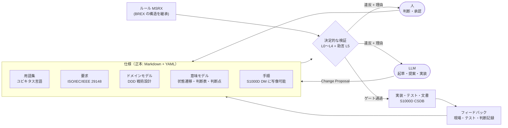

# MutualSpec

> [!NOTE]
> MutualSpec は、Specs of Domain Loops の考え方に基づくフレームワークです。
> ドメインの境界を明示したうえで、仕様・検証・フィードバックをループとして回し、人と LLM が同じ構造と語彙を共有できるようにします。

| 項目 | 内容 |
|---|---|
| プロジェクト名（フレームワーク名） | **MutualSpec** |
| 旧称 | SpecLoop（名前の衝突が多いため 2026-11-19 に改名。[ADR-0015](docs/adr/0015-rename-to-mutualspec.md)） |
| リポジトリ | [shuji-bonji/mutualspec](https://github.com/shuji-bonji/mutualspec)（旧 `shuji-bonji/specloop` から改名。旧 URL は GitHub がリダイレクト） |
| 概念名 | **Specs of Domain Loops** — 境界づけられたコンテキストごとに回る「仕様 → 検証 → フィードバック」のループ（Domain Loop）と、その仕様群 |
| 設計版 | 0.1（設計完結版。実装前のフリーズ候補） |
| 文書の言語 | 日本語（識別子・規格用語は英語） |
| 状態 | Design complete / Implementation not started |

このリポジトリは MutualSpec の**設計パッケージ**です。設計文書、機械可読なスキーマ、既定ルールセット、テンプレート、
1 周分のループを回したサンプルドメイン、そして設計の整合性を確かめる参照チェッカーを含みます。

## 30 秒でわかる MutualSpec



- **境界（Domain）**: 仕様はすべて、どれか 1 つの境界づけられたコンテキストに属します。境界をまたぐ参照はコンテキストマップに宣言した経路（published な用語・インターフェース）に限られます。
- **ループ（Loop）**: Frame → Specify → Validate → Realize → Verify → Learn の 6 フェーズと 5 つのゲート（G0〜G4）。1 周は Git ブランチ 1 本とループ記録 1 つに対応します。
- **仕様（Specs）**: 1 ファイル = 1 Spec Module（S1000D の Data Module に相当）。YAML front matter と型付きの YAML ブロックが規範、Markdown 本文が説明、Mermaid は生成されるビューです。
- **判定はツール、提案は LLM、承認は人**: 適合性の判定は決定的なバリデータだけが行います。LLM は構造化された Change Proposal を出し、人がゲートで承認します。

## ドキュメント

| # | 文書 | 内容 |
|---|---|---|
| 00 | [docs/00-origin.md](docs/00-origin.md) | 元の会話（Grok「DDDについて教えてほしい」）の結論と、この設計への対応表 |
| 01 | [docs/01-vision-and-principles.md](docs/01-vision-and-principles.md) | ビジョン、スコープ、非ゴール、設計原則、MutualSpec と Specs of Domain Loops の位置づけ |
| 02 | [docs/02-glossary.md](docs/02-glossary.md) | MutualSpec 自身のユビキタス言語（用語集） |
| 03 | [docs/03-conceptual-model.md](docs/03-conceptual-model.md) | メタモデル。DDD / S1000D / 29148 の対応づけ、BREX を超える意味モデル層 |
| 04 | [docs/04-spec-format.md](docs/04-spec-format.md) | ファイル・ディレクトリ構造、SMC と要素 ID、ブロック、Mermaid 規約、版管理、トレーサビリティ |
| 05 | [docs/05-the-loop.md](docs/05-the-loop.md) | ループのフェーズ・ゲート・役割分担・成果物、内側ループと外側ループ |
| 06 | [docs/06-rules-and-validation.md](docs/06-rules-and-validation.md) | ルール層 MSRX（BREX アナログ）、検証層 L0〜L5、バリデータの挙動、報告形式 |
| 07 | [docs/07-toolchain-architecture.md](docs/07-toolchain-architecture.md) | ツールチェーン構成、再利用する OSS / 標準と自作部分、CI 連携 |
| 08 | [docs/08-cli.md](docs/08-cli.md) | `mutualspec` CLI のコマンド設計、終了コード、設定 |
| 09 | [docs/09-llm-integration.md](docs/09-llm-integration.md) | Context Pack、出力契約、MCP サーバー、AGENTS.md、LLM の権限境界 |
| 10 | [docs/10-s1000d-profile.md](docs/10-s1000d-profile.md) | S1000D プロファイル（DM への書き出し、BREX 検証、s1000d-stack 連携。s1kd-tools も選べる） |
| 11 | [docs/11-worked-example.md](docs/11-worked-example.md) | サンプルドメイン（小型 UAV 整備）で 1 周回す実例 |
| 12 | [docs/12-roadmap.md](docs/12-roadmap.md) | MVP から 1.0 までのロードマップ |
| 13 | [docs/13-open-questions-and-risks.md](docs/13-open-questions-and-risks.md) | 未決事項、解決済みの問い（Q-08 名前衝突調査と MutualSpec への改名を含む）、リスク、前提として置いた仮定 |
| ADR | [docs/adr/](docs/adr/README.md) | 決定記録（命名、正本形式、ID 体系、ルールモデル、ゲート、MutualSpec への改名、S1000D の検証器など 16 件） |

## リポジトリ構成

```text
mutualspec/                       ← リポジトリ shuji-bonji/mutualspec（設計パッケージ mutualspec-design）
├── README.md                     ← この文書（入口）
├── docs/                         ← 設計文書 00〜13 と ADR
├── schemas/                      ← JSON Schema (draft 2020-12)
│   ├── common.schema.json        ← 共通定義（ID・SMC・適用性・判断点・トレース）
│   ├── module.schema.json        ← Spec Module の front matter
│   ├── mutualspec.config.schema.json ← mutualspec.yaml
│   ├── blocks/*.schema.json      ← 規範ブロック 11 種（charter〜scenarios, rules）
│   ├── graph.schema.json         ← Spec Graph IR
│   ├── loop.schema.json / feedback.schema.json / finding.schema.json
│   └── llm/change-proposal.schema.json ← LLM の出力契約
├── rules/
│   └── SMC-MSPEC-CORE-RULES-022A.md ← 既定ルールセット（default BREX に相当）
├── templates/                    ← Spec Module テンプレート（kind ごと 12 種）
├── examples/uav-maintenance/     ← サンプル: 3 コンテキスト・16 モジュール・ループ 2 周目まで
└── scripts/
    ├── check-design.mjs          ← 設計整合性の参照チェッカー（スキーマ・参照・境界・語彙・意味）
    └── check-mermaid.mjs         ← 全 Mermaid 図の構文検証（mermaid-cli）
```

## 設計の整合性を確かめる

```bash
npm install
npm run check            # スキーマ 19 本でサンプル 16 モジュール・ループ記録・フィードバックを検証
PUPPETEER_EXECUTABLE_PATH=/path/to/chrome npm run check:mermaid   # すべての Mermaid 図の構文検証
```

`scripts/check-design.mjs` は MutualSpec 本体ではなく、**この設計が自己矛盾していないこと**を示すための参照実装です
（コアルールのうち構造・語彙・参照・境界・状態遷移・判断表の主要部分を実装）。本体の設計は [docs/07](docs/07-toolchain-architecture.md) と [docs/08](docs/08-cli.md) にあります。

## 位置づけ（既存の仕様駆動ツールとの関係）

MutualSpec は OpenSpec や GitHub Spec Kit と同じ「仕様駆動開発（SDD）」の系譜にありますが、次の 3 点を中心に据えます。

1. **境界づけられたコンテキストを仕様の一次構造にする**（DDD の戦略設計）。
2. **BREX 型の機械可読ルールで仕様そのものを検証する**（S1000D の考え方）。BREX が扱えない業務の意味（状態遷移・判断表・理由・判断点）は別の層で明示する。
3. **要求品質を ISO/IEC/IEEE 29148 の特性で検査する**。

既存ツールと競合させず、併用もできるよう設計しています（[docs/07](docs/07-toolchain-architecture.md) §7）。

## 商標・規格について

S1000D® は ASD の登録商標です。S1000D の仕様書・スキーマ・デフォルト BREX は再配布が認められていないため、MutualSpec は同梱しません（利用者が s1000d.org から入手）。ISO/IEC/IEEE 29148 の本文も同梱せず、特性名と属性名だけを参照します。
