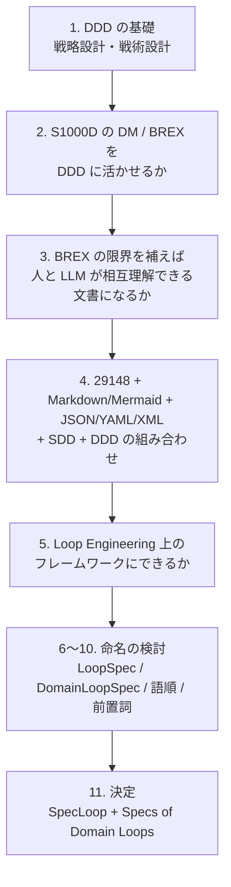

# 00. 出自 — 元の会話とこの設計の対応

元の会話: Grok プロジェクト「SpecLoop」内の会話「DDDについて教えてほしい」（会話 ID `1f562bad-9530-467a-a8cc-661b0782701f`、11 往復）。
この文書は、会話で出た結論・課題を一つずつ取り出し、本設計のどこで確定させたかを示します。会話で「未決」「今後決める必要がある」とされた点は、すべてここで決定（または未決事項として明示）しています。

## 1. 会話の流れ

## 2. 結論・課題 → 設計の対応表

| # | 会話での結論・指摘 | 本設計での扱い | 場所 |
|---|---|---|---|
| 1 | DDD は戦略設計（境界づけられたコンテキスト・ユビキタス言語・コンテキストマップ）と戦術設計（エンティティ・値オブジェクト・集約・ドメインサービス・リポジトリ・ドメインイベント）に分かれる | 戦略設計は `charter` / `context-map` / `glossary`、戦術設計は `model` ブロックとして仕様の一次構造に採用 | [03](03-conceptual-model.md) §2–3 |
| 2 | BREX は「そのコンテキストで許されるモデルの形」を宣言する。DM は集約、BREX はビジネスルール、変換層は腐敗防止層に対応づけられる | Spec Module = DM、SLRX = BREX、SMC = DMC。BREX の objectPath / allowedObjectFlag / objectValue / objectUse をそのまま写した | [03](03-conceptual-model.md) §4, [06](06-rules-and-validation.md) |
| 2 | S1000D のスキーマは巨大。必要なサブセットだけ抽出すべき | SpecLoop の正本は S1000D ではなく独自の小さなメタモデル。S1000D は書き出し先のプロファイル | [ADR-0012](adr/0012-s1000d-as-profile.md) |
| 2 | BREX はプロジェクトごとに異なる | ルールセットは core → organization → project → context の層構造（下位は狭めるだけ） | [06](06-rules-and-validation.md) §3 |
| 3 | BREX は構造ルールであり、業務プロセスの順序・判断ロジック・「なぜ」を持てない。別の明示的なモデルで補う必要がある | **意味モデル層（Domain Semantics Layer）**: 状態遷移・判断表・不変条件・理由（rationale）・判断点（JDG）・適用性 | [03](03-conceptual-model.md) §5, [ADR-0006](adr/0006-domain-semantics-layer.md) |
| 3 | 相互理解の条件: 語彙の一致・ルールの明示・構造の予測可能性・範囲の限定・検証可能性 | 5 条件をそれぞれ glossary / rules・semantics / kind 別テンプレートとスキーマ / charter の inScope・answerableQuestions / 決定的バリデータ に割り当て | [01](01-vision-and-principles.md) §4 |
| 3 | LLM 向けのアクセス層（必要範囲だけ抽出しユビキタス言語の形式で渡す）、出力後の検証必須 | Context Pack と Change Proposal（出力契約）。出力は必ず同じバリデータを通す | [09](09-llm-integration.md) |
| 3 | 相互参照を双方向にする | Spec Graph の双方向エッジとトレース（derivesFrom / satisfiedBy / verifiedBy / implementedBy） | [04](04-spec-format.md) §7 |
| 3 | すべての業務知識を押し込むと肥大化する。範囲を絞る | charter の inScope / outOfScope 必須、暗黙知は判断点として外に出す | [03](03-conceptual-model.md) §5.5 |
| 4 | 29148 = 品質基準、Markdown/Mermaid = 人の表現、JSON/YAML/XML = 機械の構造、SDD = プロセス、DDD = 境界と語彙 | この役割分担をそのまま層構造として採用 | [01](01-vision-and-principles.md) §3 |
| 4–5 | どの形式を「正」とするかを決める必要がある | **1 ファイルに人と機械の正本を同居**（YAML front matter + 型付き YAML ブロック = 規範、Markdown 本文 = 説明、Mermaid = 生成ビュー） | [ADR-0003](adr/0003-single-source-module.md) |
| 5 | ループの終了条件（人が確認するか自動で進むか）を決める必要がある | 機械判定は必要条件、G1（仕様承認）と G4（ループ終了）は人の承認が必須。内側ループは反復上限付き | [05](05-the-loop.md) §4, [ADR-0009](adr/0009-gates-and-human-approval.md) |
| 5 | 暗黙知は別の境界づけられたコンテキストに切り出し、ループの外に置く | 判断点（JDG）として明示し、判断記録をフィードバックとして回収して判断表に昇格させる経路を設計 | [05](05-the-loop.md) §6 |
| 5 | 既存技術の組み合わせで最小限のフレームワークは成立する（29148, S1000D+BREX, Markdown+Mermaid, JSON Schema/YAML/XML Schema, OpenSpec/Spec Kit, DDD, validator, Git, MCP） | ツール表で「再利用」と「自作」を分けた。自作はバリデータのルールエンジン・Spec Graph・Context Pack 生成・CLI に限定 | [07](07-toolchain-architecture.md) |
| 5 | ループの各周回を Git のブランチ・コミット・CI ジョブとして可視化 | 1 ループ = 1 ブランチ + ループ記録 `loops/LP-xxxx/loop.yaml` + PR | [ADR-0010](adr/0010-git-as-loop-ledger.md) |
| 6–11 | 名前: LoopSpec / DomainLoopSpec / SpecLoop、概念名 Domain Loop Specs は前置詞がなく曖昧 → Specs of Domain Loops | プロジェクト名 SpecLoop、概念名 Specs of Domain Loops。冒頭の説明文も会話の案を採用 | [ADR-0001](adr/0001-naming.md) |

## 3. 会話に出てこなかったが、設計完結のために決めたこと

- Spec Module の識別子体系（SMC）と要素 ID 体系 → [04](04-spec-format.md) §3–4, [ADR-0004](adr/0004-smc-and-element-ids.md)
- ルールのパス言語（JSONPath, RFC 9535）と Spec Graph IR → [06](06-rules-and-validation.md), [ADR-0005](adr/0005-slrx-rule-model.md)
- 検証結果の形式（SARIF 2.1.0）→ [ADR-0013](adr/0013-sarif-reporting.md)
- 実装言語（TypeScript / Node.js）→ [ADR-0011](adr/0011-implementation-stack.md)（仮定。見直し可）
- 日本語の禁止語検査における最長一致マスキング（参照チェッカーの実装中に発見）→ [06](06-rules-and-validation.md) §5.2

## 4. 会話で出た語のうち確認が必要なもの

- 会話中の「XML（**XDL** や S1000D）」の XDL が何を指すかは会話からは特定できませんでした。本設計では XML 系の出力先を S1000D プロファイルとして設計し、XDL は未決事項 [Q-01](13-open-questions-and-risks.md) としています。
