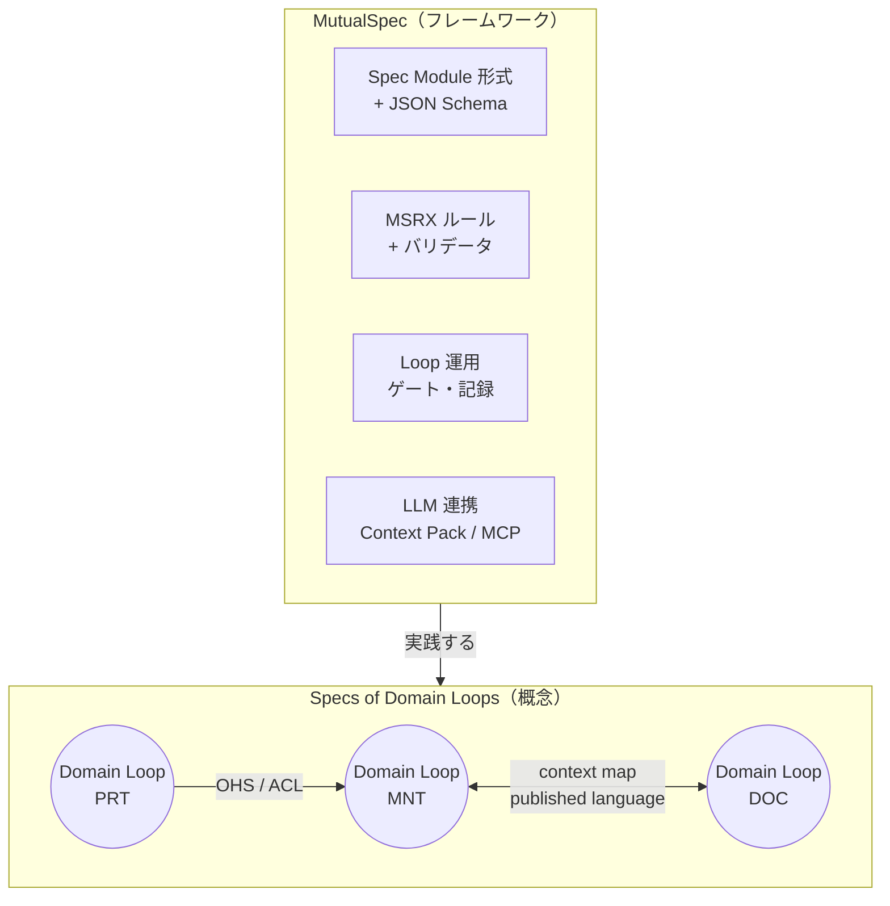

# 01. ビジョン・スコープ・設計原則

## 1. ビジョン

> [!IMPORTANT]
> 人と LLM が、**同じ境界**の中で、**同じ語彙**と**同じルール**を前提に仕様を読み書きし、
> その仕様から実装・文書・検証までを**ループとして**回し続けられる状態をつくる。

業務ルールが複雑で、例外が多く、複数の部署やシステムが関わり、長期に変更が続く領域（典型は整備・保守の技術文書と、それを扱うシステム）では、
仕様・マニュアル・実装の間で「言葉」と「ルール」がずれていきます。LLM が加わると、ずれはさらに速く広がります。LLM は推測で語を補い、構造を無視した自然文で答えることがあるからです。

MutualSpec はこのずれを、次の 3 つを組み合わせて抑えます。

1. **ドメイン（Domain）** — 業務の領域を、DDD の境界づけられたコンテキスト（同じ言葉が同じ意味で通用する範囲）に区切り、ユビキタス言語とともに「この範囲ではこの言葉とルールが有効」と宣言する。
2. **規則（Spec + Rules）** — S1000D の Data Module / BREX の考え方で、仕様の形と語彙を機械可読なルールとして宣言し、ISO/IEC/IEEE 29148 の特性で要求の品質を測る。
3. **循環（Loop）** — 仕様 → 検証 → 実現 → 検証 → 学習を明示的なループとして回し、結果を仕様へ戻す。

### プラットフォームに任せ、資産は Git に残す

エージェントの実行、編成、トレースの画面、そして LLM（手元で動かすものも含む）をどこで動かすかは、Grok Bot、Claude、Azure、AWS などのプラットフォームの役割です。MutualSpec がその実行環境や画面を引き取ることはしません。

プラットフォームが顧客に代わって持たないのは、その顧客の境界と語彙、要求と識別子、判断のルール、ゲートの記録です。これらを Git 上のファイルにしておけば、LLM やサービスを替えても資産として残ります。顧客の仕事に AI を使いながら一人で開発するとき、道具を替えても残るのはこの部分です。

したがって作るのは、中核（[ADR-0017](adr/0017-core-and-plugins.md)）と、実プロジェクトで実際に使うプラグインだけです。実行、画面、モデルの置き場所は、既にあるサービスに乗ります。

## 2. MutualSpec と Specs of Domain Loops

| 名前 | 種類 | 意味 |
|---|---|---|
| **Specs of Domain Loops** | 概念（方法論） | ドメイン（境界づけられたコンテキスト）ごとに回る「仕様・検証・フィードバック」のループ（**Domain Loop**）と、そのループが読み書きする仕様群（**Specs**）。ループはコンテキストマップを通じて互いにつながる。 |
| **MutualSpec** | フレームワーク（成果物） | Specs of Domain Loops を実践するための仕様フォーマット・ルールモデル・ツールチェーン・運用手順の一式。リポジトリ名（`shuji-bonji/mutualspec`）・CLI 名・パッケージ名に使う。旧称は SpecLoop（[ADR-0015](adr/0015-rename-to-mutualspec.md)）。 |

関係は「プロジェクト名が入口、概念名が中身」です（[ADR-0001](adr/0001-naming.md)）。
MutualSpec を使わずに Specs of Domain Loops を実践することも、原理的には可能です（概念はツールに依存しない）。

## 3. 要素ごとの役割分担（会話での整理をそのまま採用）

| 要素 | 役割 | MutualSpec での具体化 |
|---|---|---|
| ISO/IEC/IEEE 29148 | 要求の品質基準 | 要求の属性（ID・理由・優先度・リスク・難易度・検証方法など）と 9 特性に基づく品質ルール（L4） |
| Markdown + Mermaid | 人が読む表現 | Spec Module の本文（説明）と生成ビュー（図） |
| JSON / YAML / XML | 機械が扱う構造 | YAML の規範ブロック、JSON Schema による契約、Spec Graph（JSON）、S1000D XML への書き出し |
| SDD（仕様駆動開発） | 仕様を起点に実装と検証を回す | ループの Realize / Verify フェーズ、トレース、コード注釈 |
| DDD | 境界と語彙の管理 | charter / context-map / glossary / model、境界ルール（L3） |
| S1000D（DM・BREX） | 文書の単位と機械可読ルール | Spec Module（DM 相当）、SMC（DMC 相当）、MSRX（BREX 相当）、S1000D プロファイル |
| Loop Engineering | 仕様・検証・フィードバックの循環を明示的に設計する | 6 フェーズ・5 ゲート・内側／外側ループ・ループ記録 |

「Loop Engineering」は確立した規格名ではないため、MutualSpec では会話での定義（仕様が実装・運用を制約し、結果が仕様に戻り、人と LLM が同じ構造と語彙を共有し、検証が自動で走って逸脱を次のループに戻す）を採用し、[05](05-the-loop.md) で具体化しています。

## 4. 人と LLM の相互理解の 5 条件と、その担い手

会話（第 3 回）で挙げた 5 条件を、MutualSpec の要素に一対一で割り当てます。

| 条件 | 意味 | 担い手 |
|---|---|---|
| 語彙の一致 | 人と LLM が同じ用語を使う | `glossary`（正式表記・コード名・禁止語）、L2 語彙ルール、Context Pack 冒頭の用語表 |
| ルールの明示 | 暗黙の前提を減らす | MSRX ルール（`use` 文が人と LLM の両方に読まれる）、意味モデル層（状態遷移・判断表・理由） |
| 構造の予測可能性 | 次に来る情報の形を推測しやすい | kind ごとに固定されたブロックスキーマとテンプレート、SMC の命名規則 |
| 範囲の限定 | この文書で答えられることを明確にする | `charter` の inScope / outOfScope / answerableQuestions、境界ルール、Change Proposal の `inScope` フラグ |
| 検証可能性 | 生成結果や解釈の正しさを確認できる | 決定的バリデータ（L0〜L4）、トレース、ゲート |

## 5. スコープ

**対象とするもの**

- 業務システムの仕様（要求・ドメインモデル・振る舞い・判断ロジック・インターフェース・受け入れシナリオ）
- 技術文書・手順書の仕様（S1000D の手順 DM・記述 DM に書き出せる構造）
- 上記をつなぐ用語集・コンテキストマップ・ルールセット
- 仕様に対する LLM の起草・レビュー・実装支援と、その出力の検証
- 仕様から実装・テスト・文書へのトレースと、運用からのフィードバック

**主な利用者**: ドメインオーナー、仕様作成者、技術文書作成者、開発者、検査・品質担当、LLM エージェント（Cursor / Claude Code などのコーディングエージェント、チャット型 LLM）

## 6. 非ゴール

| 非ゴール | 理由・代わりに |
|---|---|
| S1000D CSDB 管理システムを作ること | CSDB・IETM は既存製品・OSS に任せ、MutualSpec は DM を書き出して検証ツールに渡すまで |
| S1000D の全スキーマを内部モデルにすること | スキーマが巨大で肥大化する（会話第 2 回の注意点）。必要なサブセットだけ写像する |
| 汎用のモデリングツール（UML/SysML ツール）を作ること | 図は YAML から生成するビュー。双方向の図編集はしない |
| LLM の出力を信頼して自動承認すること | 判定は決定的ツール、承認は人（[ADR-0008](adr/0008-deterministic-judgement.md), [ADR-0009](adr/0009-gates-and-human-approval.md)） |
| 暗黙知をすべて構造化すること | 構造化できない判断は判断点（JDG）として明示し、ループで少しずつ回収する |
| コード生成フレームワークになること | 生成はスケルトンと判断表など「決定的に写せる部分」に限る |
| 特定の LLM ベンダーへの依存 | Context Pack はプレーンな Markdown + JSON、出力契約は JSON Schema、連携は MCP |

## 7. 設計原則

| # | 原則 | 内容 | 主な根拠 |
|---|---|---|---|
| P1 | **Boundary first** | すべての仕様要素はちょうど 1 つのコンテキストに属する。境界をまたぐのはコンテキストマップに宣言した経路だけ | DDD、会話第 3・4 回 |
| P2 | **One source, many views** | 正本は 1 ファイル（YAML front matter + 規範 YAML ブロック + Markdown 説明）。図・JSON・S1000D XML・Context Pack はすべて生成物 | 会話第 4・5 回「どれを正とするか」 |
| P3 | **Rules as data** | ルールは仕様と同じ形式（kind: rules のモジュール）で書き、版管理し、人も LLM も読む | BREX が DM であること |
| P4 | **Narrow, never widen** | 下位のルールセットは上位を狭めるだけ。緩めるには理由付きの明示的な上書きが要る（core の error は不可） | BREX の階層化 |
| P5 | **Beyond structure** | 構造（BREX 相当）で表せない順序・判断・理由・判断点は意味モデル層に明示する | 会話第 3 回 |
| P6 | **Deterministic judgement** | 合否判定は決定的なバリデータだけが行う。LLM の指摘は advisory | 会話第 3 回「出力後の検証を必須に」 |
| P7 | **LLM proposes, tool writes, human approves** | LLM は構造化された Change Proposal を出し、ツールが決定的に書き込み、人がゲートで承認する | 同上 |
| P8 | **Explain every violation** | 違反は「どこが・何に・なぜ」を必ず返す（ルールの `use` と `rationale`） | 会話第 5 回「違反箇所と、なぜ問題かを示す」 |
| P9 | **Loops are recorded** | 1 ループ = 1 ブランチ + 1 ループ記録。ゲートの証跡・LLM に渡した Context Pack のハッシュを残す | 会話第 5 回「Git のブランチや CI のジョブとして可視化」 |
| P10 | **Compose, don't reinvent** | 既存の標準と OSS を組み合わせ、自作は継ぎ目（ルールエンジン・Spec Graph・Pack・CLI）に限る | 会話第 5 回 |
| P11 | **Small core, optional profiles** | 中核は形式・識別子・ルール評価・ゲートだけ。それ以外はプラグイン（[ADR-0017](adr/0017-core-and-plugins.md)）。S1000D はプロファイル | 会話第 2 回「サブセットだけ抽出」 |
| P12 | **Japanese-first, bilingual-ready** | 日本語の正本を一級に扱い（語境界のない言語での語彙検査など）、英訳を並記できる | 利用者の主言語 |
