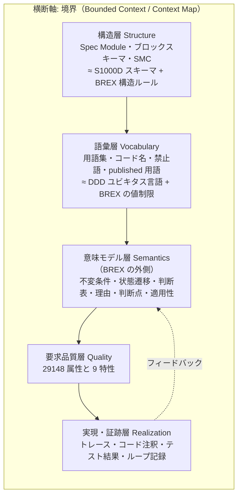
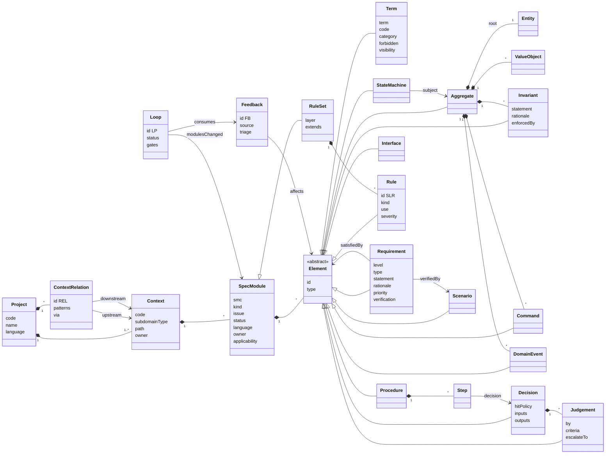
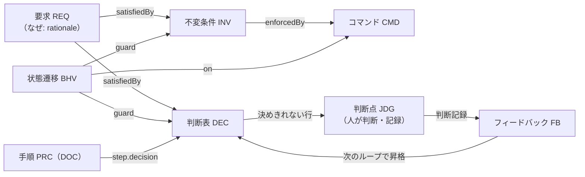

# 03. 概念モデル（メタモデル）

SpecLoop のメタモデルは、DDD・S1000D・ISO/IEC/IEEE 29148 から必要な概念だけを取り出し、1 つの小さなモデルに統合したものです。
S1000D や 29148 の全体を内部に持つのではなく、**対応づけ（マッピング）**として持ちます。

## 1. 全体像: 5 つの層と 1 つの横断軸

| 層 | 問い | 主な kind / 要素 | 検証層 |
|---|---|---|---|
| 構造 | 仕様は決められた形をしているか | すべての kind、front matter | L0 スキーマ、L1 構造ルール |
| 語彙 | 同じものを同じ言葉で呼んでいるか | glossary（TERM） | L2 語彙ルール |
| 意味 | 業務の順序・判断・理由は明示され、矛盾していないか | model（INV）、behavior（BHV）、decision（DEC, JDG） | L3 意味ルール |
| 品質 | 要求は 29148 の意味で良い要求か | requirements（REQ） | L4 品質ルール、人のレビュー |
| 実現 | 仕様は実装・テスト・文書に正しく反映されたか | scenarios（SCN）、trace、コード注釈 | L3 参照ルール、G2/G3 ゲート |
| 境界（横断） | この要素はどの範囲で有効か、越境は正当か | charter、context-map、interface（IFC）、REL | L3 境界ルール |

## 2. メタモデル（クラス図）

**モデルの不変条件（SpecLoop 自身の）**

1. 要素はちょうど 1 つのモジュールに属し、モジュールはちょうど 1 つのコンテキストに属する（要素 ID の第 2 セグメント = モジュールの context）。
2. 他コンテキストの要素への参照は、コンテキストマップの relation の向き（下流 → 上流。partnership / shared-kernel は双方向）に沿い、かつ published な要素に限る。ただしトレース用の参照（derivesFrom, satisfiedBy, verifiedBy, satisfies など）は published でなくてよい（向きの制約は適用）。
3. ルールセットは上位を狭めることしかできない。
4. approved なモジュールの inWork は 0。

## 3. DDD との対応

| DDD の概念 | SpecLoop での表現 | 補足 |
|---|---|---|
| 境界づけられたコンテキスト | Context（コード・ディレクトリ・charter モジュール） | ディレクトリ = コンテキスト。コード側は charter の `codeModule` で対応 |
| サブドメイン（core / supporting / generic） | `charter.subdomainType`、`context-map.contexts[].type` | — |
| ユビキタス言語 | glossary（TERM）: 正式表記・`code`・定義・別表記・禁止語 | `code` をクラス名・プロパティ名・状態名に使うことを L2 で強制 |
| コンテキストマップ | context-map: relation（patterns, via, translation） | パターン: partnership, shared-kernel, customer-supplier, conformist, anticorruption-layer, open-host-service, published-language, separate-ways |
| 公開言語 / OHS | interface（IFC）、published 用語 | 越境参照の唯一の経路 |
| 腐敗防止層（ACL） | relation の `anticorruption-layer` + `translation` | 変換の正本は下流側コンテキストに置く |
| 集約・集約ルート | model.aggregates（root エンティティ） | 集約外からの操作はコマンド経由 |
| エンティティ / 値オブジェクト | model.root / entities / valueObjects | 属性に term を付けて語彙と接続 |
| ドメインイベント | model.events（published 可） | policy（POL）でイベント → コマンド／IFC の反応を宣言 |
| ドメインサービス | policy / decision / interface で表現 | 状態を持たないロジックは判断表に寄せる |
| リポジトリ | 非対象（実装詳細） | 仕様には書かない（29148 appropriate） |
| 不変条件・業務ルール | model.invariants（INV）、decision（DEC） | 意味モデル層 |

## 4. S1000D との対応

SpecLoop は S1000D の**考え方**を借り、S1000D の**形式**は書き出し先（プロファイル）として扱います（[ADR-0012](adr/0012-s1000d-as-profile.md)）。

| S1000D | SpecLoop | 対応の内容 |
|---|---|---|
| Data Module（DM） | Spec Module | 独立して識別・版管理・検証・再利用される最小単位 |
| Data Module Code（DMC） | SMC | 階層的な意味を持つ識別子。種別コード（info code 相当）を末尾に持つ。`022` = ルールは BREX の info code 022 に揃え、`040` = 記述も S1000D の記述 DM（040）に揃えた。他のコードは SpecLoop 独自 |
| info code | kind / 種別コード | 内容の種類を表す |
| issueNumber / inWork | `issue.number` / `issue.inWork` | 承認版と作業中版の区別 |
| identAndStatusSection | YAML front matter | 識別・状態・適用性・参照ルール |
| CSDB | Git リポジトリの `specs/` | 共通のソース。履歴は Git |
| BREX DM（info code 022） | kind: rules（種別コード 022）のモジュール | ルール自体が仕様モジュールとして版管理される |
| default BREX | `SMC-SPECLOOP-CORE-RULES-022A`（ツール同梱） | すべてのプロジェクトが継承する既定ルール |
| BREX の階層（layered BREX） | ruleset.layer + extends（core → organization → project → context） | 下位は狭めるだけ |
| structureObjectRule: objectPath（XPath） | rule.select（JSONPath, RFC 9535）+ rule.path | 対象選択の言語を XML から Spec Graph（JSON）へ |
| allowedObjectFlag 0 / 1 / 2 | rule.flag 0 / 1 / 2 | 0 = 禁止、1 = 必須、2 = 任意（使うなら値は許可値） |
| objectValue（valueForm single / range / pattern） | rule.values[].form single / range / pattern | 許可値の宣言 |
| objectUse | rule.use | 人が読む規則文。違反メッセージ |
| brDecisionRef | rule.decisionRef | 業務ルール決定点への参照 |
| nonContextRules | kind: narrative | 機械判定できない合意事項 |
| SNS（標準番号体系） | SMC の `subject` セグメント（任意で SNS コードを使える） | S1000D プロファイルでは procedure.s1000d.systemCode で指定 |
| applicability（ACT/CCT/PCT） | applicability 式 + charter.properties | プロパティ宣言と式の評価に簡略化 |
| 警告・注意・注記 | procedure の safety（warning / caution / note） | S1000D の warning / caution / note に写像 |
| 手順 DM の preliminaryRqmts / mainProcedure / closeRqmts | procedure.preliminary / steps / closeout | 同じ 3 区分 |

## 5. BREX を超える層 — 意味モデル層（Domain Semantics Layer）

会話（第 2・3 回）の核心は「BREX は文書の**構造**のルールであり、業務の**順序・判断・理由**は持てない。そこを別の明示的なモデルで補えば、人と LLM が相互に理解できる文書になる」という点でした。SpecLoop はこれを**意味モデル層**として独立させます（[ADR-0006](adr/0006-domain-semantics-layer.md)）。

### 5.1 BREX が答えられる問い／答えられない問い

| 問い | BREX（構造層） | 意味モデル層 |
|---|---|---|
| この要素を使ってよいか、必須か | ✅ allowedObjectFlag | — |
| この属性に許される値は何か | ✅ objectValue | — |
| どの順序で行うか、いつ何ができるか | ❌ | ✅ 状態遷移（BHV） |
| 条件の組み合わせごとに何を選ぶか | ❌ | ✅ 判断表（DEC） |
| 常に成り立つべき業務上の条件は何か | ❌ | ✅ 不変条件（INV） |
| なぜそのルールがあるのか | ❌（objectUse は「何か」まで） | ✅ rationale（要求・不変条件・判断表の行・ルール） |
| 機械に決めさせてはいけない判断はどこか | ❌ | ✅ 判断点（JDG） |
| どの製品・条件で有効か | △（applicability は別機構） | ✅ applicability 式 |

### 5.2 構成要素

- **文書の構造と業務のルールを分離しつつ接続する**: 手順（DOC コンテキスト）は判断表（MNT コンテキスト）を `step.decision` で**参照**するだけで、判断ロジックを本文に書きません。手順書を読む人は判断表のビュー（図・表）を、LLM は判断表の構造を受け取ります。
- **判断表の検査**: hitPolicy `unique` の場合、全入力の組み合わせにちょうど 1 行が一致すること（重複なし・漏れなし）をバリデータが検査します（SLR-CORE-00205）。
- **状態遷移の検査**: 初期状態から全状態に到達できること、終了状態以外に出口があること、トリガーが対象集約のコマンドであること（SLR-CORE-00203/00204）。

### 5.3 判断点（JDG）— 暗黙知の境界

会話（第 5 回）で「構造化できない判断は、別の境界に切り出し、ループの外に置く」とした点を、SpecLoop は**判断点**として仕様の中に明示します。

- 判断点は `by`（判断するロール）、`criteria`（判断の観点）、`escalateTo`、`record`（判断結果を記録させるか）を持ちます。
- 機械（バリデータ・生成コード・LLM）は判断点で**決めません**。生成コードは「判断待ち」状態を返し、LLM の Context Pack には「この点は人が判断する」と明記されます。
- 判断結果は記録され、ループの Learn フェーズで集計されてフィードバック（FB）になります。十分に規則性が見えたら判断表の行に**昇格**させ、判断点を縮めます（[11](11-worked-example.md) の FB-0001 → LP-0002）。

これにより、暗黙知は「ないもの」として扱われず、**境界が明示され、少しずつ形式知へ移る**対象になります。

### 5.4 理由（rationale）の必須化

要求・不変条件では `rationale` をスキーマで必須にし、ルールと判断表の行でも任意で持てます。理由は Context Pack に必ず含め、LLM が「なぜ」を推測で補わないようにします。

### 5.5 範囲の限定

すべての業務知識を意味モデル層に押し込むと肥大化します（会話第 3 回）。そこで:

- charter の `outOfScope` を必須にし、扱わないことを宣言する。
- 判断表は「現場で実際に判断が分かれる点」に限り、それ以外は要求文や手順文で足りるとする。
- 意味モデル層の要素は必ず要求（REQ）から `derivesFrom` / `satisfiedBy` でたどれるようにし、理由のない構造物を作らない。

## 6. ISO/IEC/IEEE 29148 との対応

### 6.1 要求の属性

| 属性 | SpecLoop のフィールド | 必須 | 出典 |
|---|---|---|---|
| 識別（identification） | `id`（`REQ-{ctx}-{4 桁}`） | ✅ | 29148 の属性例 |
| 版（version） | モジュールの `issue` と Git 履歴 | ✅（モジュール単位） | 29148 の属性例 |
| 所有者（owner） | `owner`（省略時はモジュールの owner） | — | 29148 の属性例 |
| 優先度（priority） | `priority`（must / should / could） | ✅ | 29148 の属性例（値の区分は SpecLoop の選択） |
| リスク（risk） | `risk`（high / medium / low） | — | 29148 の属性例 |
| 理由（rationale） | `rationale` | ✅ | 29148 の属性例 |
| 難易度（difficulty） | `difficulty`（easy / nominal / difficult） | — | 29148 の属性例 |
| 種類（type） | `type`（functional, performance, interface, usability, safety, security, quality, constraint, process） | ✅ | 29148 の属性例（区分は SpecLoop の選択） |
| 検証方法と基準 | `verification.method`（inspection / analysis / demonstration / test）と `criteria` | ✅ | 29148 の検証方法の区分を採用 |
| 要求レベル | `level`（stakeholder / system / system-element） | ✅ | 29148 の要求の階層 |
| 出所 | `source` | — | SpecLoop 追加（necessary の根拠） |
| 有効期限・適用 | `validUntil`、`applicability` | — | 29148 の necessary（期限の明示）＋ SpecLoop の適用性 |
| 状態 | `status` | ✅ | SpecLoop 追加 |
| トレース | `trace`（derivesFrom, refines, satisfiedBy, verifiedBy, implementedBy, conflictsWith） | — | SpecLoop 追加 |

> [!NOTE]
> 29148 本文の条項番号・属性の完全な一覧は、規格書（有償）で確認してください。SpecLoop は特性名と属性名だけを参照し、規格本文は同梱しません。

文型は任意で EARS（Easy Approach to Requirements Syntax）のパターン名を `pattern` に記録できます（ubiquitous / event-driven / state-driven / unwanted-behaviour / optional-feature / complex）。

### 6.2 個々の要求の 9 特性と検査方法

| 特性 | 機械で検査する方法 | ルール | 人が見る点 |
|---|---|---|---|
| necessary（必要） | `source` の有無 | SLR-CORE-00306（info） | 本当に必要か |
| appropriate（適切） | stakeholder レベルに設計語がないか | SLR-CORE-00307 | 抽象度 |
| unambiguous（曖昧でない） | 曖昧語レキシコン（日本語・英語） | SLR-CORE-00301 | 文脈上の多義 |
| complete（完全） | TBD / 未定 などのプレースホルダ | SLR-CORE-00305 | 理解に他文書が要らないか |
| singular（単一） | 義務表現・接続詞の数 | SLR-CORE-00302 | — |
| feasible（実現可能） | 機械判定しない | SLR-CORE-00401（narrative） | コスト・期間・技術 |
| verifiable（検証可能） | 検証基準に数値・状態名・SCN ID があるか、must 要求に verifiedBy があるか | SLR-CORE-00303, 00207 | — |
| correct（正しい） | 機械判定しない | SLR-CORE-00402（narrative） | 元のニーズとの一致 |
| conforming（準拠） | 文型（〜しなければならない／shall） | SLR-CORE-00304 | — |

要求**集合**の特性（完全性・一貫性など）は、トレース（全 must 要求が検証されているか）と L5 の LLM 助言（矛盾・重複の候補提示, SLR-CORE-00501）で補います。一貫性の最終判断は人が行います。
