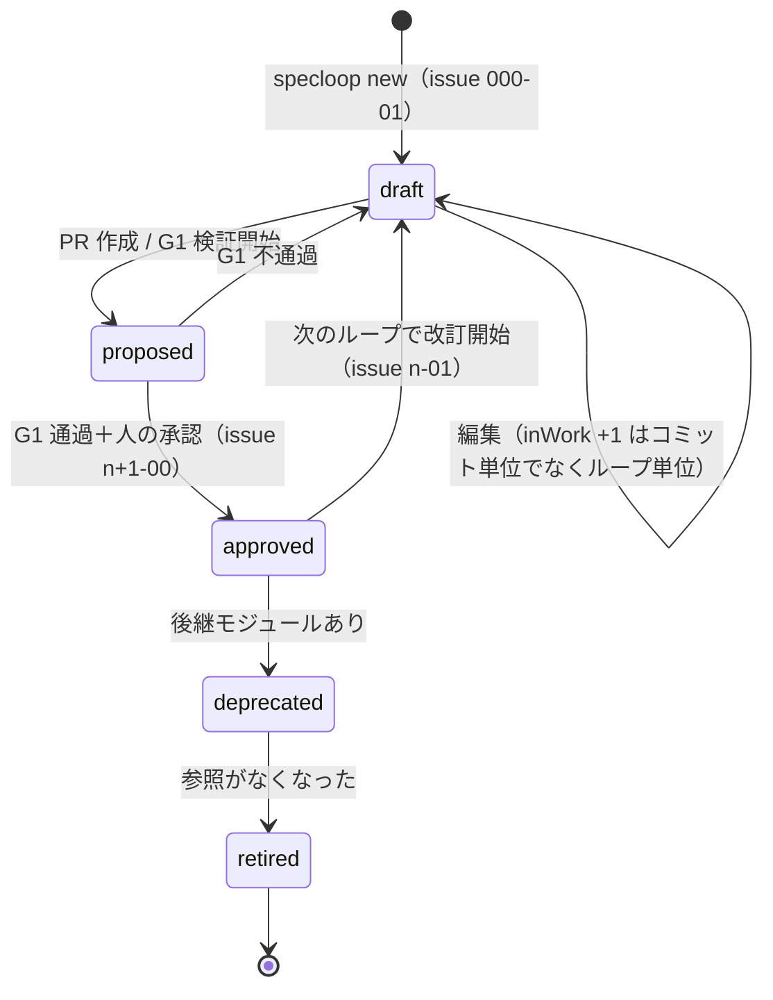
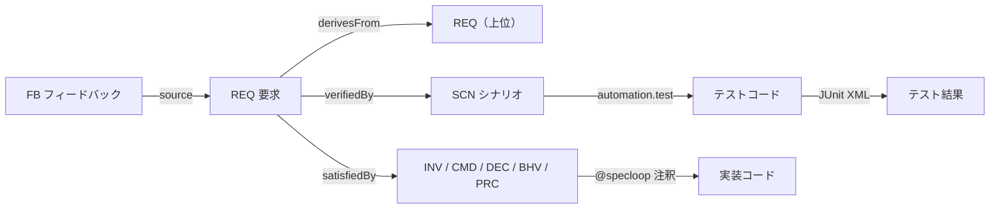

# 04. 仕様フォーマット

## 1. ワークスペースのディレクトリ構成

```text
<repo>/
├── specloop.yaml                 ← プロジェクト設定（schemas/specloop.config.schema.json）
├── specs/                        ← 正本（specRoot）。S1000D の CSDB に相当
│   ├── _project/                 ← context: PRJ（憲章・コンテキストマップ・プロジェクトルール）
│   │   ├── SMC-UAVM-PRJ-CHARTER-000A.md
│   │   ├── SMC-UAVM-PRJ-CONTEXTMAP-020A.md
│   │   └── SMC-UAVM-PRJ-RULES-022A.md
│   └── <context-dir>/            ← 1 ディレクトリ = 1 境界づけられたコンテキスト（context-map の path）
│       ├── SMC-…-CHARTER-000A.md ← 必須
│       ├── SMC-…-GLOSSARY-010A.md← 必須
│       └── SMC-…-<SUBJECT>-<kind><variant>.md
├── loops/
│   └── LP-0001/
│       ├── loop.yaml             ← ループ記録（schemas/loop.schema.json）
│       ├── proposal-*.json       ← LLM の Change Proposal（採否にかかわらず保存）
│       └── report-*.md           ← ゲート時の検証レポート
├── feedback/
│   └── FB-0001.yaml              ← フィードバック（schemas/feedback.schema.json）
├── src/ tests/                   ← 実装とテスト（@specloop 注釈でトレース）
└── .specloop/                    ← 生成物（Git 管理外を推奨。CI で再生成）
    ├── build/graph.json          ← Spec Graph
    ├── packs/                    ← Context Pack
    ├── reports/                  ← SARIF / Markdown / JSON
    └── export/s1000d/            ← S1000D DM（プロファイル有効時）
```

ルール:

- `specs/` 直下のディレクトリはコンテキストマップの `contexts[].path` と一致させる（SLR-CORE-00002）。`_project/` は PRJ 専用。
- 各コンテキストは charter（000）と glossary（010）を必ず持つ。
- ファイル名は `<SMC>.md`。

## 2. Spec Module の構造

1 つの Spec Module は 1 つの Markdown ファイルで、次の 4 部分から成ります。

```text
┌──────────────────────────────────────────────┐
│ ---                                          │ ① YAML front matter（識別・状態）      … 規範
│ specloop: "0.1"                              │    schemas/module.schema.json
│ smc: SMC-UAVM-MNT-WORKORDER-100A             │
│ kind: requirements                           │
│ ...                                          │
│ ---                                          │
│ # 作業指示 要求仕様                          │ ② H1 = title（1 つだけ）
│ ## 背景                                      │ ③ 説明（Markdown 本文）               … informative
│ ...                                          │
│ ```yaml specloop:requirements                │ ④ 規範ブロック（型付き YAML）           … 規範
│ requirements:                                │    schemas/blocks/<kind>.schema.json
│   - id: REQ-MNT-0001 ...                     │
│ ```                                          │
│ <!-- specloop:generated begin ... -->        │ ⑤ 生成ビュー（Mermaid）               … 生成物
│ ```mermaid ...```                            │
│ <!-- specloop:generated end -->              │
└──────────────────────────────────────────────┘
```

- **規範（normative）**: front matter と規範ブロック。バリデータ・生成器・Context Pack はここだけを「仕様」として扱う。
- **説明（informative）**: Markdown 本文。背景・意図・例。語彙ルール（禁止語）と参照解決の対象にはなるが、規範ではない。
- **生成ビュー**: `specloop render` が規範ブロックから生成する図。マーカーで囲み、手で編集しない（SLR-CORE-00209 で差分を検出）。
- 規範ブロックは CommonMark のフェンスで、info string の 1 語目を `yaml`（GitHub 等でハイライトされる）、2 語目を `specloop:<block>` とする。パーサーは info string の残り（meta）で判別する。

この形式を選んだ理由は [ADR-0003](adr/0003-single-source-module.md): 人の正本（Markdown）と機械の正本（YAML）を**同じファイル・同じコミット**に置くことで、同期のコストをなくす。

### 2.1 front matter

| フィールド | 必須 | 内容 |
|---|---|---|
| `specloop` | ✅ | フォーマット版 `"0.1"` |
| `smc` | ✅ | Spec Module Code（§3） |
| `kind` | ✅ | 種別（§3.1）。SMC の種別コードと一致（SLR-CORE-00001） |
| `title` | ✅ | 文字列、または `{ja: …, en: …}` |
| `summary` | — | 1 行要約（≤200 字）。Context Pack の目次・検索に使う |
| `context` | ✅ | コンテキストコード |
| `issue` | ✅ | `{ number, inWork }`（§6） |
| `status` | ✅ | draft / proposed / approved / deprecated / retired |
| `language` | ✅ | 正本の言語（`ja` など） |
| `owner` | ✅ | 責任者（ロールまたはアカウント） |
| `rules` | — | 追加で適用するルールモジュール（S1000D の BREX 参照に相当）。省略時はコンテキスト → プロジェクト → コアの順に継承 |
| `refs` | — | 依存するモジュール |
| `applicability` | — | モジュール全体の適用性 |
| `supersedes` | — | 置き換える旧モジュール |
| `tags` | — | 自由タグ |

## 3. SMC（Spec Module Code）

```text
SMC - UAVM - MNT - WORKORDER - 100 A
      │      │     │           │   └─ variant（A〜Z）: 同じ subject・kind の別版（例: 型式別）
      │      │     │           └───── 種別コード（kind code, 3 桁）
      │      │     └───────────────── subject（1〜20 文字の英大文字・数字）: 対象。SNS コードでもよい
      │      └─────────────────────── context（2〜6 文字）
      └────────────────────────────── project（2〜8 文字）
```

正規表現: `^SMC-[A-Z][A-Z0-9]{1,7}-[A-Z][A-Z0-9]{1,5}-[A-Z0-9]{1,20}-[0-9]{3}[A-Z]$`

### 3.1 種別コード

| コード | kind | 規範ブロック | 内容 | 備考 |
|---|---|---|---|---|
| 000 | charter | `specloop:charter` | コンテキスト（またはプロジェクト）の目的・範囲・答えられる問い・プロパティ・ロール | 各コンテキスト必須 |
| 010 | glossary | `specloop:glossary` | ユビキタス言語 | 各コンテキスト必須 |
| 020 | context-map | `specloop:context-map` | コンテキストと関係 | PRJ に 1 つ |
| 022 | rules | `specloop:rules` | SLRX ルールセット | S1000D の BREX（info code 022）に揃えた |
| 040 | description | なし | 記述（背景・概念説明） | S1000D の記述 DM（040）に揃えた |
| 100 | requirements | `specloop:requirements` | 29148 準拠の要求 | |
| 200 | model | `specloop:model` | 集約・エンティティ・値オブジェクト・不変条件・コマンド・イベント・ポリシー | |
| 300 | behavior | `specloop:behavior` | 状態遷移 | 意味モデル層 |
| 310 | decision | `specloop:decision` | 判断表・判断点 | 意味モデル層 |
| 400 | interface | `specloop:interface` | 公開言語・OHS | 越境の経路 |
| 500 | procedure | `specloop:procedure` | 手順 | S1000D 手順 DM に写像可能 |
| 600 | scenarios | `specloop:scenarios` | 受け入れシナリオ（Given/When/Then） | 検証の仕様 |

022 と 040 以外のコードは SpecLoop 独自で、S1000D の info code とは対応しません。S1000D へ書き出すときの info code は procedure の `s1000d.infoCode` などで個別に指定します（[10](10-s1000d-profile.md)）。

## 4. 要素 ID

形式: `{PREFIX}-{context}-{local}`。`local` は英大文字・数字・ハイフン。番号型は桁数を固定。

| PREFIX | 要素 | local の形式 | 定義する kind |
|---|---|---|---|
| TERM | 用語 | スラッグ（`WORK-ORDER`） | glossary |
| REQ | 要求 | 4 桁番号 | requirements |
| AGG / ENT / VO | 集約 / エンティティ / 値オブジェクト | スラッグ | model |
| INV | 不変条件 | 4 桁番号 | model |
| CMD / EVT / POL | コマンド / イベント / ポリシー | スラッグ / スラッグ / 4 桁番号 | model |
| BHV | 状態遷移 | スラッグ | behavior |
| DEC / JDG | 判断表 / 判断点 | スラッグ / 4 桁番号 | decision（JDG は procedure の step にも置ける） |
| PRC | 手順 | スラッグ。ステップは `PRC-…#S010` | procedure |
| SCN | シナリオ | 4 桁番号 | scenarios |
| IFC | インターフェース | スラッグ | interface |
| REL | コンテキスト関係 | スラッグ（`PRJ-MNT-DOC` 形式） | context-map |
| SLR | ルール | 5 桁番号 | rules |
| FB / LP | フィードバック / ループ | 4 桁番号（コンテキストなし） | feedback / loop.yaml |

- ID はプロジェクト内で一意（SLR-CORE-00005）、第 2 セグメントは所属モジュールの context と一致（SLR-CORE-00004）。
- **ID は再利用しない**。削除した要素の ID は欠番にする（トレースと過去のループ記録を壊さないため）。
- 採番は `specloop id next REQ --context MNT` で行う（ブランチ間の衝突は CI の一意性検査で検出）。

### 4.1 参照の書き方

- 規範ブロック内: ID をそのまま値に書く（`verifiedBy: [SCN-MNT-0001]`）。
- 説明（本文）内: ID をそのまま書く（`判断表 DEC-MNT-PROP-DISPOSITION に従う`）。特別な記法は使わない。本文中の ID 形式の文字列はすべて参照として解決され、解決できなければエラー（SLR-CORE-00201）。
- 用語は本文で**正式表記のまま**書く（`作業指示`）。用語 ID を本文に埋め込む必要はない。禁止語はバリデータが検出する。
- `specloop render --links` は、閲覧用 HTML/Markdown で ID を定義位置へのリンクに変換する（正本は変更しない）。

## 5. Markdown と Mermaid の規約

### 5.1 Markdown

- CommonMark + GFM の表。H1 は 1 つで title と一致（SLR-CORE-00007）。
- 推奨見出し: `## 背景` → `## 規範`（ブロック）→ `## 補足` → 生成ビュー。kind ごとのテンプレートは `templates/`。
- 規範的な内容（〜しなければならない）を本文に書かない。本文は説明に徹し、規範はブロックに書く。
- 1 文 1 事項。曖昧語・禁止語の検査は本文にも適用される（ただし本文は L4 品質ルールの対象外）。

### 5.2 Mermaid

| 種類 | 規範ブロック | 生成される図 |
|---|---|---|
| コンテキストマップ | context-map | `flowchart LR` |
| 集約 | model | `classDiagram` |
| 状態遷移 | behavior | `stateDiagram-v2` |
| 判断表 | decision | `flowchart TD`（判断の木） |
| 手順 | procedure | `flowchart TD` |
| トレース | requirements | `flowchart LR` |

- **生成ビュー**は `<!-- specloop:generated begin source=<SMC> view=<view> -->` 〜 `<!-- specloop:generated end -->` で囲む。`specloop render --check` が規範ブロックから再生成して差分があればエラー。
- **手書きの図**（概念図・背景説明）は自由に置けるが、規範ではない（バリデータは構文と ID 参照だけを検査する）。
- Mermaid を規範にしない理由: Mermaid は表示のための言語で、構文の解析・意味の検査・差分の扱いが YAML より難しい。図は「読むための形」、YAML は「判定するための形」と分ける（[ADR-0003](adr/0003-single-source-module.md)）。
- すべての Mermaid は CI で mermaid-cli により構文検証する。

## 6. 版管理（issue と status）



- `issue.number` は承認版の番号、`issue.inWork` は承認後の作業中番号。表示は `001-02` 形式（S1000D の issueNumber-inWork と同じ考え方）。
- approved は inWork 0 のみ（SLR-CORE-00006）。ループ開始時に `specloop loop start` が対象モジュールを `inWork +1`・status draft にし、G1 通過時に `specloop loop gate G1 --approve` が `number +1, inWork 0`・approved にする。
- Git のコミットが細かい履歴、issue がゲートを通った版、ループ記録の `modulesChanged` が「どのループでどの版になったか」を記録する。
- 互換性: フォーマット版 `specloop: "0.1"` が変わるときは `specloop migrate` を提供する。

## 7. トレーサビリティ



| リンク | 書く場所 | 向き |
|---|---|---|
| derivesFrom / refines | 要求・不変条件・判断表の `trace` | 下位 → 上位 |
| satisfiedBy | 要求の `trace` | 要求 → 実現する要素 |
| verifiedBy | 要求・判断表の `trace` | 要求 → シナリオ |
| verifies | シナリオ | シナリオ → 要求（verifiedBy と相互に照合） |
| satisfies | 手順ステップ | ステップ → 要求 |
| implementedBy | 要素の `trace`、またはコード注釈 `@specloop <ID>` | 要素 → コード |
| テスト結果 | シナリオ ID をテスト名に含め、JUnit XML を取り込む | シナリオ → 合否 |

- Spec Graph はすべてのリンクを**双方向のエッジ**として持つ（逆引き可能）。
- `specloop trace` は要求ごとの「実現要素・シナリオ・テスト・合否」の行列（Markdown / CSV / JSON）を出力し、G3 で must 要求のカバレッジ 100% を判定する。
- コード注釈は言語に依存しないコメント形式: `// @specloop CMD-MNT-START INV-MNT-0001`。

## 8. 人と LLM はどう読むか

| 読み手 | 読むもの | 形 |
|---|---|---|
| 人（レビュー） | Markdown 本文 + 生成ビュー（図）+ 規範ブロック | GitHub 等でそのまま表示。`specloop render --site` で静的サイト化も可 |
| 人（現場） | 手順・判断表のビュー、S1000D から作る IETM | プロファイル経由 |
| LLM | Context Pack（規範ブロックを正規化した構造 + 用語表 + 規則文 + 範囲宣言 + 出力契約） | Markdown + JSON（[09](09-llm-integration.md)） |
| ツール | Spec Graph（JSON） | schemas/graph.schema.json |

LLM に生の Markdown ファイル群をそのまま渡すことは推奨しません。Context Pack は「範囲の限定」「用語の固定」「規範と説明の区別」を保証するためのアクセス層です（会話第 3 回の「LLM 向けのアクセス層」）。

## 9. 多言語

- 正本の言語はモジュールごとに 1 つ（`language`）。
- `title` `statement` `definition` などは `{ja: …, en: …}` 形式で並記できる（localizedText）。並記した場合、正本言語の文が規範で、他言語は翻訳。
- 用語の英訳は glossary の `translations`、コード名は `code`。
- 語彙ルール・品質ルールは言語ごとのレキシコンを持つ（ja / en を同梱）。
