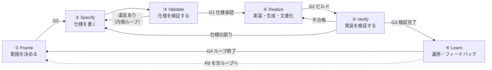
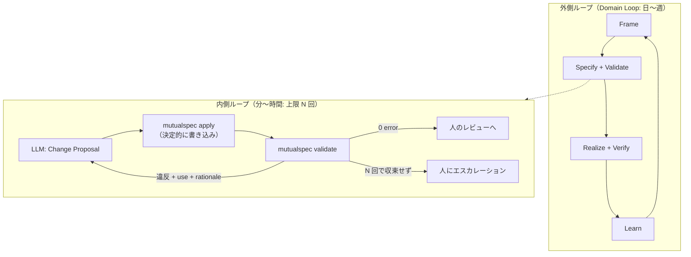
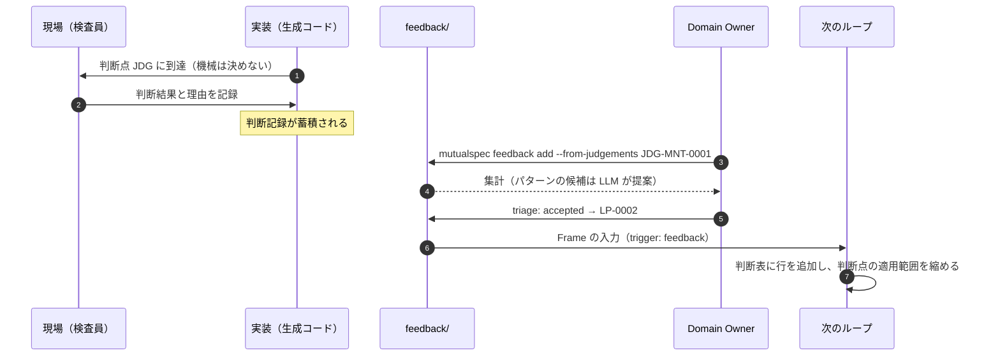

# 05. ループ（Domain Loop）

## 1. 全体図

1 周 = 1 つの Domain Loop（ID `LP-0001`）。1 ループは 1 つ以上のコンテキストを対象にしますが、**主対象は 1 コンテキスト**を推奨します（境界をまたぐ変更はコンテキストマップの関係ごとにループを分けるか、パートナーシップ関係のコンテキストだけをまとめる）。

## 2. フェーズ

| # | フェーズ | 目的 | 入力 | 出力（成果物） | 主担当 | LLM の役割 | 主なコマンド |
|---|---|---|---|---|---|---|---|
| ① | **Frame** | 今回のループの目的・対象コンテキスト・範囲を決める | トリガー（要望・変更要求・FB・不具合・規格更新・決定） | `loops/LP-xxxx/loop.yaml`（goal, contexts, trigger）、ブランチ | Domain Owner | 影響範囲の候補を挙げる（Spec Graph の逆引き結果を要約） | `mutualspec loop start` |
| ② | **Specify** | 仕様モジュールを作成・改訂する | Context Pack（specify 用）、テンプレート | 改訂された Spec Module（status draft）、Change Proposal | Spec Author（人）/ LLM drafter | 起草、Change Proposal の作成、未決の問いの列挙 | `mutualspec new`, `mutualspec pack`, `mutualspec apply` |
| ③ | **Validate** | 仕様を L0〜L4（＋L5 助言）で検証する | Spec Graph、ルールセット | 検証レポート（SARIF / Markdown） | Validator（ツール） | 違反の修正案（Change Proposal）。L5 助言 | `mutualspec validate`, `mutualspec render --check` |
| ④ | **Realize** | 仕様から実装・生成物・文書を作る | approved な仕様、Context Pack（implement 用） | コード、テスト、生成スケルトン、S1000D DM | Implementer（人）/ LLM implementer | 実装、テスト作成（シナリオから） | `mutualspec generate`, `mutualspec export s1000d` |
| ⑤ | **Verify** | 実装・文書が仕様に合っているかを検証する | コード、テスト結果（JUnit XML）、DM | トレース行列、検証レポート | Validator / CI | 失敗の原因が仕様か実装かの切り分け案 | `mutualspec trace`, `mutualspec verify` |
| ⑥ | **Learn** | 運用・現場・判断記録から知見を回収する | 判断記録、障害、レビュー指摘 | `feedback/FB-xxxx.yaml`、トリアージ結果 | Domain Owner / 現場 | 判断記録の集計・パターン抽出（提案のみ） | `mutualspec feedback add`, `mutualspec feedback triage` |

## 3. ゲート

| ゲート | 位置 | 機械条件（既定） | 人の承認（既定） | 証跡 |
|---|---|---|---|---|
| **G0** 範囲合意 | Frame → Specify | 対象コンテキストの charter と glossary が存在する。決定のプラグインが有効で `trigger.type` が `decision` のときは、`refs` の決定記録が Accepted | ✅ Domain Owner | loop.yaml |
| **G1** 仕様承認 | Validate → Realize | error = 0、warning ≤ 設定値、生成ビューが最新、未解決参照 0 | ✅ Domain Owner（PR レビュー） | SARIF、レポート、PR 承認 |
| **G2** ビルド | Realize → Verify | ビルド成功、生成物が最新（`generate --check`）、S1000D 書き出しの XSD / BREX 検証 0 エラー（プロファイル有効時） | — | CI ログ、SARIF |
| **G3** 検証完了 | Verify → Learn | must 要求のトレースカバレッジ 100%、関連テスト全合格、MSR-CORE-00207 を error として再評価 | — | トレース行列、JUnit XML |
| **G4** ループ終了 | Learn → 次ループ | 消費した FB がすべて done / deferred、ループ記録の必須項目が埋まっている | ✅ Domain Owner | loop.yaml（status closed） |

- 条件は `mutualspec.yaml` の `loop.gates` で調整できます（狭める方向のみ推奨）。
- **ゲートは「機械条件を満たす」ことが必要条件、「人の承認」が十分条件**です。機械条件を満たさないまま人が通すことは `waived` として記録され、理由（`waiverReason`）が必須です。
- G1 と G4 の人の承認は設定で外せません（[ADR-0009](adr/0009-gates-and-human-approval.md)）。

> [!NOTE]
> ループは、Accepted の決定記録を起点に始められます（`trigger.type: decision`）。このとき `refs` は必須で、起点にした決定記録の ID を 1 件以上書きます。`docs/adr` の ADR は `ADR-0019` の形で書きます。プラグインのモジュールの ID の形式は、ADR-0019 の D-4 で決めます。判断のループ（提案から決定まで。[ADR-0019](adr/0019-decision-loop-and-adr-plugin.md)）と、仕様のループをこれでつなぎます。
> このループの中で下した決定は `decisions`（出力）に書き、起点にした決定は `trigger`（入力）に書きます。`decisions` には、決定記録があればその ID を、無ければ決定の内容を文で書きます。
> 決定の記録は中核の kind ではなくプラグインです（[ADR-0017](adr/0017-core-and-plugins.md)、ADR-0019）。G0 が `refs` の Accepted を確かめるのは、決定のプラグインが有効なときだけです。プラグインが無いとき、G0 の機械条件は charter と glossary のままです。このとき `refs` の決定が Accepted かどうかは機械では確かめないので、G0 を承認する Domain Owner が確かめます（`docs/adr` で試す段階はこれに当たります）。Accepted は、`docs/adr` では状態が Accepted であること、プラグインのモジュールでは ADR-0019 の D-5（`status: approved` かつ `outcome: accepted`）に従います。

## 4. 内側ループと外側ループ

- **内側ループ**: LLM の起草 → 決定的な書き込み → 検証 → 違反をそのまま LLM に返す、を自動で繰り返す。上限は `loop.innerLoopMaxIterations`（既定 3）。上限に達したら人に渡す（LLM が同じ違反を繰り返す、範囲外の要求をしている、などのサイン）。
- 内側ループで LLM に返すのは**指摘そのもの**（ruleId、場所、`use`、`rationale`、修正候補）です。「もっと良くして」のような曖昧な指示は返しません。
- 回数は `phases[].innerIterations` に記録し、ループの健全性指標にします。
- **外側ループ**: 実装・運用の結果（テスト失敗、現場の判断記録、障害）を仕様に戻す。外側ループの終了条件は G4。

## 5. 役割（人と LLM の分担）

| ロール | 種別 | 権限・責任 |
|---|---|---|
| Domain Owner | 人 | コンテキストの範囲と語彙の最終責任。G0 / G1 / G4 の承認。FB のトリアージ |
| Spec Author | 人 | 仕様の作成・改訂。LLM の提案の採否 |
| Reviewer | 人 | PR レビュー。narrative ルール（feasible / correct など）の確認 |
| Implementer | 人 | 実装・テスト。LLM の実装の採否 |
| LLM drafter | LLM | Context Pack を読み、Change Proposal を返す。ファイルを直接書かない（既定） |
| LLM reviewer | LLM | L5 の助言（advisory）。合否を決めない |
| LLM implementer | LLM | 実装・テストの作成（コーディングエージェントとして）。成果物は G2 / G3 で検証される |
| Validator | ツール | 合否判定の唯一の主体。決定的（同じ入力に同じ出力） |

RACI（R = 実行、A = 最終責任、C = 相談、I = 通知）

| 活動 | Domain Owner | Spec Author | Reviewer | Implementer | LLM | Validator |
|---|---|---|---|---|---|---|
| ループの範囲決定（Frame） | A | R | C | I | C | — |
| 仕様の起草 | A | R | C | I | R（提案） | — |
| 仕様の合否判定 | I | I | I | — | — | R |
| 仕様の承認（G1） | A/R | C | R | I | — | C（証跡） |
| 実装 | I | C | C | A/R | R（提案・実装） | — |
| 実装の合否判定（G2/G3） | I | I | I | I | — | R |
| 判断点での判断 | A | — | — | — | — | — |
| FB のトリアージ・ループ終了（G4） | A/R | C | C | C | C（集計） | — |

## 6. フィードバックと判断点の昇格

- フィードバックの出所: field（現場）、implementation（実装中の発見）、test（テスト失敗の分析）、review、llm（LLM の助言を人が採用したもの）、incident、standard（規格・規程の改訂）。
- **判断点の昇格**: 判断記録に規則性が見えたら、判断表の入力・行を追加して判断点の範囲を縮める。昇格は必ずループ（G1 の人の承認）を通す。
- 却下・保留した FB も残す（`rejected` / `deferred` と理由）。同じ指摘が繰り返されたときの判断材料にする。

## 7. Git と CI への写像

| ループの概念 | Git / CI |
|---|---|
| ループ | ブランチ `loop/LP-0001-<slug>` と PR 1 本 |
| Frame | ブランチ作成 + `loops/LP-0001/loop.yaml` のコミット |
| Specify / Validate の内側ループ | コミット + CI の `mutualspec validate`（PR に SARIF を表示） |
| G1 | PR の必須レビュー（CODEOWNERS = コンテキストの owner）+ 必須チェック `mutualspec gate G1` |
| Realize / Verify | 同じ PR に実装コミット、CI のテスト + `mutualspec gate G2/G3` |
| G4 | `mutualspec loop close` のコミット、PR マージ |
| 履歴 | main のマージコミット = ループ単位の版 |

ループを PR と一致させることで、「どの仕様変更が、どの検証結果と、どの承認で入ったか」が Git の履歴だけで追えます（[ADR-0010](adr/0010-git-as-loop-ledger.md)）。
OpenSpec の delta spec（ADDED / MODIFIED / REMOVED）に相当する差分は、Git の差分とループ記録の `modulesChanged` で表します。

## 8. 複数のコンテキストにまたがる変更

- 上流（例 PRT）のインターフェースを変える場合は、**上流のループ**で interface を改訂し、下流（MNT）は**別のループ**で追随する。上流のループの G1 で、下流の参照箇所（Spec Graph の逆引き）を影響範囲として表示する。
- パートナーシップ（例 MNT ⇄ DOC）の場合は 1 つのループで両方を扱ってよい。その場合、両コンテキストの owner の承認が G1 で必要。
- shared-kernel を使う場合、共有部分は専用のコンテキスト（例 `SHK`）として切り出し、変更は全利用者の承認を要する。

## 9. ループの健全性指標

| 指標 | 計算 | 目安 |
|---|---|---|
| 内側ループ収束回数 | `innerIterations` の平均 | 3 を超えるなら Context Pack かルールの `use` 文を見直す |
| G1 waiver 率 | waived / 全 G1 | 0 を目標 |
| 判断点の比率 | 判断表の行のうち judgement 付きの割合 | ループごとに減少していること |
| FB 滞留 | accepted かつ未着手の FB 数 | — |
| トレースカバレッジ | must 要求のうち合格テストを持つ割合 | 100%（G3） |
