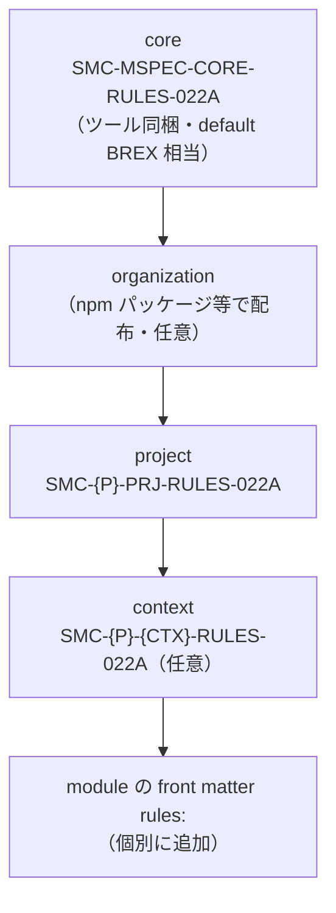
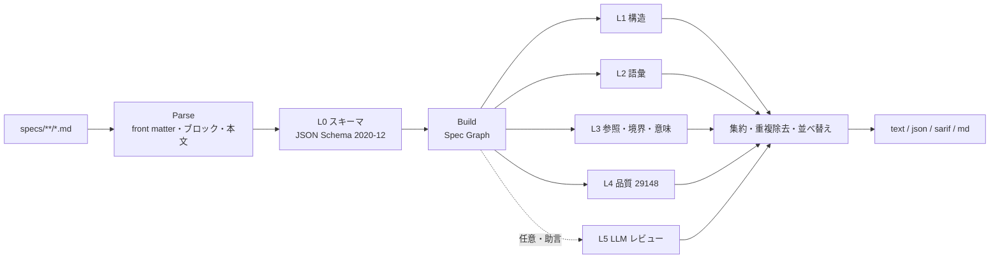

# 06. ルール層（MSRX）と検証層

## 1. 考え方

S1000D では、プロジェクトが許す DM の形を **BREX**（それ自体が DM）に機械可読な形で書き、検証ツールが DM を BREX に照らして検査します。
MutualSpec はこの仕組みを仕様全体に広げ、**MSRX（MutualSpec Rules eXchange）** と呼びます。

| 項目 | S1000D BREX | MutualSpec MSRX |
|---|---|---|
| ルールの置き場所 | BREX DM（info code 022） | kind: rules のモジュール（種別コード 022） |
| 対象 | DM の XML | Spec Graph（全モジュールを正規化した JSON） |
| 対象選択 | objectPath（XPath） | `select`（JSONPath, RFC 9535）+ `path`（相対フィールド） |
| 使用可否 | allowedObjectFlag 0 / 1 / 2 | `flag` 0 / 1 / 2 |
| 許可値 | objectValue（single / range / pattern） | `values[]`（form: single / range / pattern） |
| 規則文 | objectUse | `use` |
| 決定点への参照 | brDecisionRef | `decisionRef` |
| 機械判定できない合意 | nonContextRules | kind: `narrative` |
| 階層 | layered BREX（default → 組織 → プロジェクト） | core → organization → project → context |
| BREX にないもの | — | 語彙・参照・境界・意味・品質（29148）の組込みチェック、LLM 助言、`rationale`、severity |

## 2. ルールの種類

| kind | 層 | 何を検査するか | 書き方 |
|---|---|---|---|
| `structure` | L1 | 要素・フィールドの使用可否と許可値（BREX と同じ） | `select` + `path` + `flag` + `values`、または組込み `check` |
| `vocabulary` | L2 | 禁止語、用語参照の解決、コード名と用語の一致、表記ゆれ | `check`（glossary.* / lexicon）+ `patterns` |
| `reference` | L3 | 参照の解決、境界を越える参照の正当性 | `check`（refs.* / boundary.*） |
| `semantic` | L3 | 状態遷移・判断表・不変条件・適用性・判断点・生成ビュー | `check`（stateMachine.* / decision.* / …）+ `params` |
| `quality` | L4 | 29148 の特性 | `characteristic` + `check` または `patterns` |
| `narrative` | — | 機械判定できない合意（レビューで確認） | `use` のみ |
| `llm-review` | L5 | LLM による助言 | `prompt`、severity は `advisory` 固定 |

### 2.1 ルールの書式

```yaml
- id: MSR-PRJ-00001            # MSR-{context}-{5 桁}
  kind: structure
  select: "$.elements[?(@.type == 'requirement' && @.context == 'MNT')]"   # 対象（JSONPath）
  path: data.verification.method                                           # 対象からの相対パス
  flag: 2                       # 0=禁止 1=必須 2=任意（使うなら values のどれか）
  values:
    - { form: single,  allowed: test,          meaning: 自動テスト }
    - { form: pattern, allowed: "^demo-.*$",   meaning: 実演の派生 }
    - { form: range,   allowed: "500~599",     meaning: 範囲（文字列比較） }
  use: MNT の要求は test / demonstration / inspection のいずれかで検証する。   # 人と LLM が読む規則文
  rationale: analysis は MNT の安全要求に対する証拠として弱い。               # なぜ（任意）
  severity: error               # error | warning | info | advisory
  decisionRef: BRDP-UAVM-0003   # 業務ルール決定点（任意）
```

スキーマ: [schemas/blocks/rules.schema.json](../schemas/blocks/rules.schema.json)。既定ルールの全量: [rules/SMC-MSPEC-CORE-RULES-022A.md](../rules/SMC-MSPEC-CORE-RULES-022A.md)。

`flag` の判定（BREX の allowedObjectFlag と同じ意味）:

| flag | 値が存在しない | 値が存在し values に一致 | 値が存在し values に不一致 |
|---|---|---|---|
| 0（禁止） | OK | 違反 | 違反 |
| 1（必須） | 違反 | OK | 違反（values 指定時） |
| 2（任意） | OK | OK | 違反（values 指定時） |

### 2.2 Spec Graph（ルールの評価対象）

```json
{
  "modules":  [{ "smc": "SMC-UAVM-MNT-WORKORDER-100A", "kind": "requirements", "context": "MNT", "status": "approved", "issue": "001-00", "file": "specs/maintenance/…" }],
  "elements": [{ "id": "REQ-MNT-0001", "type": "requirement", "context": "MNT", "module": "SMC-UAVM-MNT-WORKORDER-100A",
                 "source": { "file": "specs/maintenance/…", "line": 30 }, "data": { "statement": "…", "priority": "must", "…": "…" } }],
  "edges":    [{ "from": "REQ-MNT-0001", "to": "SCN-MNT-0001", "type": "verifiedBy", "crossContext": false }]
}
```

スキーマ: [schemas/graph.schema.json](../schemas/graph.schema.json)。ルールは**ファイルではなく Graph に**対して書くため、ファイル分割や記述順に影響されません。

## 3. ルールセットの階層



- 下位は**ルールを追加して狭める**ことだけができる（P4 Narrow, never widen）。
- `overrides` で上位ルールの severity を**引き上げる**ことは自由。引き下げ・無効化（`disable`）は `reason` 必須で、**core と organization の error ルールは不可**（バリデータが拒否）。
- 有効なルール集合は `mutualspec rules list --module <SMC>` で確認できる（適用元のルールセットも表示）。
- ルールセットの変更自体もループを通す（ルールは仕様の一部）。

## 4. 検証パイプライン



| 層 | 実装 | 止まり方 |
|---|---|---|
| L0 | JSON Schema（Ajv） | L0 でエラーのモジュールは Graph に入れない（他の層の誤検出を防ぐ）。他モジュールの検証は続行 |
| L1〜L4 | MutualSpec ルールエンジン | すべて実行して全件報告（最初のエラーで止まらない） |
| L5 | LLM（任意） | `--advisory` 指定時または設定で有効時のみ。結果は advisory。失敗してもゲートに影響しない |

### 4.1 バリデータの性質

- **決定的**: 同じ入力（ソース + ルール + ツール版）に対して同じ出力。結果に入力ハッシュ（`sourceHash`）とツール版を記録する。L5 は決定的でないため別枠。
- **全件報告**: 1 回の実行で見つかる違反をすべて返す。
- **安定した並び順**: ファイル → 行 → ルール ID。差分レビューしやすくする。
- **状態による severity 調整**: 一部のルールは status やゲートで severity が変わる（例: MSR-CORE-00305 プレースホルダは draft で warning、approved で error。MSR-CORE-00207 は G3 で error）。調整はルール側の宣言に従い、暗黙には行わない。
- **インクリメンタル**: 変更モジュールと、Graph 上でそれに依存する要素だけを再検査する（`--changed`）。CI では全件。
- **ローカルと CI で同一**: 同じコマンド・同じ設定。

## 5. 組込みチェックの一覧

| check | 層 | 内容 |
|---|---|---|
| `module.kindCodeMatchesSmc` | L1 | SMC の種別コードと kind の一致 |
| `module.contextMatchesDirectory` | L1 | context とディレクトリの一致 |
| `module.allowedBlocks` | L1 | kind ごとに許される規範ブロック |
| `module.singleH1` | L1 | H1 が 1 つで title と一致 |
| `element.idContextMatchesModule` / `element.idUnique` | L1 | ID の形式・一意性 |
| `glossary.forbiddenTerms` | L2 | 禁止語（§5.2） |
| `glossary.termRefsResolve` | L2 | `term:` 参照の解決（自コンテキスト or 上流の published） |
| `glossary.codeMatchesModelName` | L2 | 集約・状態・コマンド・イベント名 = 用語の code |
| `glossary.unusedTerms` | L2 | 使われていない用語 |
| `lexicon` | L2 | 任意の語彙パターン（表記ゆれ・単位表記など） |
| `refs.resolve` | L3 | ID・SMC・FB・LP・コード参照の解決（本文・Mermaid・コード注釈を含む） |
| `boundary.crossContextViaPublished` | L3 | 越境参照の向きと公開性 |
| `stateMachine.wellFormed` / `stateMachine.commandsBelongToSubject` | L3 | 到達可能性・出口・トリガーの所属 |
| `decision.hitPolicy` | L3 | unique: 重複なし・漏れなし（区間の境界値で網羅検査） |
| `decision.inputsDeclared` | L3 | 行の when / then が宣言済みの入力・出力と値だけを使う |
| `invariant.enforced` | L3 | 不変条件の enforcedBy |
| `requirement.verifiedBy` | L3 | must 要求の検証シナリオ |
| `applicability.declaredProperties` | L3 | 適用性式のプロパティ |
| `render.generatedUpToDate` | L3 | 生成ビューの差分 |
| `judgement.roleDeclared` | L3 | 判断点のロール |
| `requirement.singleObligation` | L4 | singular |
| `requirement.measurableCriteria` | L4 | verifiable |
| `requirement.obligationKeyword` | L4 | conforming |
| `requirement.hasSource` | L4 | necessary |
| `requirement.noDesignAtStakeholderLevel` | L4 | appropriate |

拡張: 組織・プロジェクトは独自の `check` をプラグイン（TypeScript の関数: `(graph, rule) => Finding[]`）として追加できる。プラグインは決定的でなければならず、ネットワークアクセスを禁止する。

### 5.1 判断表の網羅検査

hitPolicy `unique` の判断表について、入力の型ごとに代表値を作り、全組み合わせで一致行数がちょうど 1 であることを確認します。

- boolean: true / false
- enum: 宣言された値すべて
- number: 各行の条件に現れる境界値 b について b−ε, b, b+ε と 0（下限）

条件の書式は DMN の unary tests を簡略化したもの: `"-"`（任意）、`true` / `false`、`"< 0.5"`、`">= 1.0"`、`"[0.5..1.0)"`（区間。`[` `]` は閉、`(` `)` は開）、`"a|b"`（列挙）。
境界値での重複（例: `[0.5..1.0]` と `>= 1.0` が 1.0 で両方一致）を確実に検出します（[11](11-worked-example.md) で実例）。

### 5.2 日本語の禁止語検査 — 最長一致マスキング

日本語には語境界がないため、単純な部分文字列一致では**正式な用語の中に禁止語が含まれる**場合に誤検出します。参照チェッカーの実装中に、次の誤検出が実際に起きました。

| 禁止語 | 正式な用語 | 誤検出の例 |
|---|---|---|
| ペラ（俗称） | プロペラ | 「プロペラ処置」で「ペラ」が一致 |
| 品番 | 部品番号 | 「部品番号」の中の「品番」が一致 |

そこで禁止語検査は次の手順で行います（MSR-CORE-00101 の規定動作）。

1. 対象テキスト中の、プロジェクト内の全用語の正式表記と許容別表記（aliases）のうち、禁止語を部分文字列として含み、かつ禁止語より長いものの出現箇所をマスクする（長いものから順に）。
2. マスク後のテキストで禁止語を探す。
3. 禁止語の `match` が `word` の場合は英数字の単語境界、`regex` の場合は正規表現で照合する。

将来、形態素解析（例: kuromoji.js、Sudachi）による語単位の照合をオプションで追加します（[13](13-open-questions-and-risks.md) Q-05）。

### 5.3 禁止語の適用範囲

- 用語の `forbidden` は、その用語が属するコンテキストのモジュールに適用されます。
- published な用語の `forbidden` は、その用語を使う下流コンテキストにも適用されます（例: MNT の「プロペラ」の禁止語「ペラ」は DOC の手順にも効く）。
- 検査対象は規範ブロックの文章フィールド（statement, rationale, text, criteria, question, given / when / then, definition, purpose, description, summary）と本文。用語集の `forbidden` / `aliases` 自体は対象外。

## 6. 報告形式

### 6.1 指摘（finding）

各指摘は [schemas/finding.schema.json](../schemas/finding.schema.json) に従い、必ず次を含みます（P8 Explain every violation）。

| 項目 | 内容 |
|---|---|
| ruleId / layer / severity | どのルールか |
| message | 具体的に何が違反か（要素 ID・該当値・抜粋） |
| use（＋rationale） | なぜ問題か（ルールの規則文と理由） |
| location | ファイル・行・SMC・要素 ID・フィールドパス |
| fix | 修正方針と候補。候補が 1 つだけで機械的に適用できる場合は `autoApplicable: true`（`mutualspec fix` で適用可能） |

### 6.2 出力形式

| 形式 | 用途 | 備考 |
|---|---|---|
| `text` | ターミナル | 1 行 1 件。`SEVERITY RULE FILE:LINE MESSAGE` |
| `json` | ツール連携・LLM への返却 | finding の配列 + サマリ + 入力ハッシュ |
| `sarif` | GitHub code scanning などの PR 注釈 | OASIS SARIF 2.1.0。layer・characteristic・elementId・smc は `properties` に入れる |
| `md` | ループ記録・人のレビュー | ルールごとの「なぜ問題か」と修正の表 |

例（text）:

```text
ERROR   MSR-CORE-00301  specs/maintenance/SMC-UAVM-MNT-WORKORDER-100A.md:31  REQ-MNT-0001: 曖昧語「適切に」
        なぜ: 要求・不変条件・手順文に曖昧語を使ってはならない（29148 unambiguous）。
        修正: 何をもって適切とするかを数値・基準・参照で示す
```

### 6.3 終了コード

| コード | 意味 |
|---|---|
| 0 | error なし（warning 以下のみ） |
| 1 | error あり（またはゲート条件の warning 上限超過） |
| 2 | 使い方・設定の誤り（mutualspec.yaml 不正、ルールセットの循環 extends など） |
| 3 | 内部エラー |

## 7. 既存のルール技術との関係

| 技術 | 関係 |
|---|---|
| JSON Schema | L0 の実装そのもの。ブロックスキーマは MutualSpec が配布 |
| Spectral（Stoplight） | YAML / JSON に JSONPath でルールを書く点で MSRX の構造ルールと近い。MSRX は複数ファイルを統合した Graph を対象にし、語彙・境界・意味の組込みチェックを持つ点が異なる。interface の外部契約（OpenAPI / AsyncAPI）の検査には Spectral をそのまま併用できる |
| Schematron（ISO/IEC 19757-3） | XML 向けのルール言語。S1000D プロファイルで書き出した DM に対して、BREX を補う追加ルールが必要な場合に使える（任意） |
| textlint / Vale | 文章の校正ツール。本文の文体（です・ます統一など）は既存ツールに任せ、MutualSpec は用語・曖昧語・文型など**仕様の意味に関わる**検査だけを持つ。textlint の prh 辞書を glossary から生成する機能を将来提供（[12](12-roadmap.md)） |
| s1000d-stack（s1000d-core） | S1000D プロファイルで書き出した DM の BREX・スキーマ・参照の検証に使う既定の検証器（[10](10-s1000d-profile.md)） |
| s1kd-brexcheck / s1kd-validate | 同じ検証の選択肢（`validator: s1kd-tools`） |
