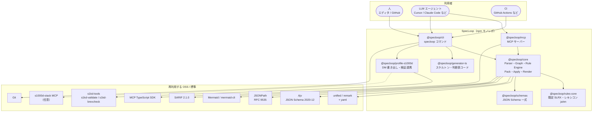
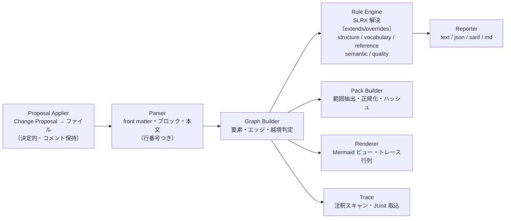

# 07. ツールチェーン・アーキテクチャ

## 1. 方針

会話（第 5 回）の結論「既存のオープンソースと標準を役割分担させれば、新規に大きな基盤を作る必要はない」に従い、**自作は継ぎ目だけ**に限定します（P10）。

- **再利用**: パース（remark / yaml）、スキーマ検証（Ajv）、図（Mermaid）、報告（SARIF）、LLM 接続（MCP）、S1000D 検証（s1kd-tools など）、版管理と CI（Git / GitHub Actions）。
- **自作**: Spec Graph の構築、SLRX ルールエンジンと組込みチェック、Context Pack 生成、Change Proposal の適用器、ビュー・スケルトン生成器、CLI、S1000D 書き出し器（写像部分のみ）。

## 2. コンポーネント構成



### 2.1 @specloop/core の内部



| モジュール | 責務 | 主な依存 |
|---|---|---|
| Parser | Markdown を front matter・規範ブロック・本文・Mermaid に分解。すべての要素に元ファイルの行番号を付ける | remark-parse, remark-frontmatter, remark-gfm, yaml（LineCounter で位置を取得） |
| Graph Builder | 要素の正規化、ID 索引、エッジ（trace / term / guard / emits / references）の構築、越境フラグ | — |
| Rule Engine | ルールセットの解決（階層・上書き・禁止された緩和の拒否）、ルール評価、severity 調整 | Ajv（L0）、JSONPath（L1） |
| Reporter | 指摘の集約・重複除去・並べ替え・出力 | SARIF 2.1.0 |
| Pack Builder | 目的別に Graph の部分集合を取り出し、決定的な順序で Markdown + JSON にする | — |
| Proposal Applier | Change Proposal を検証してから YAML ブロックへ適用。YAML のコメントと書式を保持 | yaml（Document API） |
| Renderer | 生成ビュー（Mermaid）の生成と差分検査、トレース行列 | — |
| Trace | `@specloop` 注釈のスキャン、JUnit XML の取り込み、カバレッジ計算 | — |

## 3. 再利用するもの / 作るもの

| 役割 | 採用する標準・OSS | 再利用 / 自作 | 備考 |
|---|---|---|---|
| 要求の品質基準 | ISO/IEC/IEEE 29148 | 再利用（概念） | 特性・属性名のみ参照。本文は同梱しない |
| 要求の文型 | EARS | 再利用（任意） | `pattern` フィールドに記録 |
| ドメインの境界と語彙 | DDD（戦略・戦術設計） | 再利用（概念） | charter / glossary / context-map / model |
| 文書の単位と業務ルール | S1000D（DM, DMC, BREX） | 再利用（概念）+ プロファイル | 写像と書き出しのみ自作 |
| 人の表現 | Markdown（CommonMark + GFM）、Mermaid | 再利用 | |
| Markdown パース | unified / remark | 再利用 | |
| YAML パース・書き戻し | yaml（npm） | 再利用 | コメント保持の書き戻しに使う |
| 機械の契約 | JSON Schema 2020-12 | 再利用 | スキーマ本体は SpecLoop が定義 |
| スキーマ検証 | Ajv | 再利用 | |
| ルールの対象選択 | JSONPath（RFC 9535） | 再利用 | 実装ライブラリは M1 で準拠度を評価して選定（候補: jsonpath-plus） |
| ルールエンジン・組込みチェック | — | **自作** | SLRX の評価、語彙・境界・意味・品質 |
| Spec Graph | — | **自作** | |
| 図の描画・構文検証 | Mermaid、@mermaid-js/mermaid-cli | 再利用 | ビューの生成ロジックは自作 |
| 検証結果の形式 | SARIF 2.1.0（OASIS） | 再利用 | GitHub code scanning に表示 |
| テスト結果の取り込み | JUnit XML（事実上の標準） | 再利用 | Vitest / Jest / pytest 等が出力可能 |
| 仕様駆動の流れ | OpenSpec / GitHub Spec Kit の考え方 | 再利用（概念）・併用可 | §7 |
| 版管理・レビュー | Git、PR、CODEOWNERS | 再利用 | ループ = ブランチ + PR |
| CI | GitHub Actions（他 CI も CLI で可） | 再利用 | §5 |
| LLM 連携 | Model Context Protocol（MCP）、TypeScript SDK | 再利用 | サーバーの tools は自作 |
| エージェント向け説明 | AGENTS.md（慣行） | 再利用 | `specloop agents-md` で生成 |
| S1000D の検証 | s1kd-tools（s1kd-validate, s1kd-brexcheck）、libxml2 | 再利用 | GPL-3.0。外部コマンドとして呼び出す |
| S1000D の LLM 向け読み書き | s1000d-stack（s1000d-brex-mcp / verify-mcp / reader-mcp / writer-mcp） | 再利用（任意） | 既存の MCP 群と役割が重ならないよう、SpecLoop は「仕様 → DM の写像」までを担う |
| 文章校正 | textlint（prh 辞書）、Vale | 併用（任意） | 文体は既存ツール、意味は SpecLoop |
| 外部契約の検査 | Spectral（OpenAPI / AsyncAPI） | 併用（任意） | interface の `contract` |
| コンテキストマップの図・分析 | Context Mapper（CML） | 将来連携（任意） | context-map → CML 書き出し |
| 状態遷移の交換 | SCXML（W3C） | 将来連携（任意） | behavior → SCXML 書き出し |
| 判断表の交換 | DMN（OMG） | 将来連携（任意） | decision ⇄ DMN decision table |

## 4. 実装スタック

- 言語・実行環境: TypeScript / Node.js（現行の LTS）。配布は npm（`npx specloop` で実行可能）。理由は [ADR-0011](adr/0011-implementation-stack.md)（Mermaid・Ajv・MCP SDK・remark が同じエコシステムにあり、s1000d-stack も npm で配布されている）。
- パッケージ構成（モノレポ）: `@specloop/core`, `@specloop/cli`, `@specloop/mcp`, `@specloop/schemas`, `@specloop/rules-core`, `@specloop/generator-ts`, `@specloop/profile-s1000d`。パッケージスコープ名は仮（[13](13-open-questions-and-risks.md) Q-08）。
- 外部コマンド（s1kd-tools）はプロファイル有効時のみ必要。見つからなければ G2 の S1000D 検査を `skipped` として明示する（黙って通さない）。

## 5. CI 連携

GitHub Actions の例（[examples/uav-maintenance/.github/workflows/specloop.yml](../examples/uav-maintenance/.github/workflows/specloop.yml)）:

```yaml
name: specloop
on:
  pull_request:
    paths: ["specs/**", "loops/**", "feedback/**", "src/**", "tests/**", "specloop.yaml"]
permissions:
  contents: read
  security-events: write   # SARIF のアップロード
jobs:
  spec:
    runs-on: ubuntu-latest
    steps:
      - uses: actions/checkout@v4
      - uses: actions/setup-node@v4
        with: { node-version: lts/* }
      - run: npm ci
      - name: Validate specs (L0-L4)
        run: npx specloop validate --format text,sarif --out .specloop/reports
      - name: Generated views are up to date
        run: npx specloop render --check
      - uses: github/codeql-action/upload-sarif@v3
        if: always()
        with: { sarif_file: .specloop/reports/specloop.sarif }
      - name: Gate G1 (machine conditions)
        run: npx specloop gate G1 --loop "$(npx specloop loop current)"
  realize:
    needs: spec
    runs-on: ubuntu-latest
    steps:
      - uses: actions/checkout@v4
      - uses: actions/setup-node@v4
        with: { node-version: lts/* }
      - run: npm ci
      - run: npx specloop generate --check
      - run: npx vitest run --reporter=junit --outputFile=reports/junit.xml
      - name: Gate G2/G3 (build, trace coverage)
        run: |
          npx specloop gate G2 --loop "$(npx specloop loop current)"
          npx specloop trace --format md --out .specloop/reports/trace.md
          npx specloop gate G3 --loop "$(npx specloop loop current)"
```

- G1 / G4 の**人の承認**は PR の必須レビュー（CODEOWNERS にコンテキストの owner を登録）で実現し、`specloop gate G1` は機械条件だけを判定します。マージ時に `specloop loop gate G1 --approve --by <reviewer>` 相当の記録をボット（または人）がコミットします。
- ブランチ保護で `specloop / spec` と `specloop / realize` を必須チェックにします。

## 6. 非機能要件（SpecLoop 本体）

| 項目 | 目標 |
|---|---|
| 性能 | 1,000 モジュール・20,000 要素で `validate` 全件 10 秒以内（L5 除く）、`--changed` で 2 秒以内 |
| 決定性 | L0〜L4 の出力は入力ハッシュとツール版で再現可能 |
| 安全性 | 検証・生成はネットワークに出ない。L5 と MCP 経由の LLM 呼び出しは明示設定時のみ。秘密情報を Context Pack に入れない（`.specloopignore` とフィールド単位の除外） |
| 移植性 | Linux / macOS / Windows。外部コマンドはプロファイルに限定 |
| 可観測性 | `--verbose` で適用ルールの解決過程を表示。`specloop doctor` で環境診断 |
| 互換性 | フォーマット版（`specloop: "0.1"`）ごとにスキーマを固定。破壊的変更は `migrate` を提供 |

## 7. 既存の仕様駆動ツールとの関係

| ツール | 中心にあるもの | SpecLoop との関係 |
|---|---|---|
| OpenSpec | `openspec/specs/`（現在の正）と `openspec/changes/`（提案: proposal / design / tasks / delta spec） | 「変更単位で提案して正に統合する」流れは SpecLoop のループと同型。SpecLoop は delta spec の代わりに Git 差分 + ループ記録を使い、境界・ルール・意味モデルを加える。将来 `specloop import openspec` で要求とシナリオを取り込む |
| GitHub Spec Kit | constitution → specify → plan → tasks → implement のエージェント向けコマンド群（`specs/<feature>/spec.md` など） | Spec Kit の constitution（原則）は SpecLoop の rules（narrative を含む）と charter に相当。Spec Kit の工程で作る spec.md を SpecLoop の requirements / scenarios に変換して検証する併用が可能 |
| s1000d-stack | S1000D の DM を LLM が正しく読み・検査し・作るための MCP 群（BREX 検査、XSD 検証、構造としての読み出し、XML を LLM に書かせない生成） | 対象は S1000D の CSDB。SpecLoop は「仕様 → DM」の写像と、その上流の要求・ドメイン・意味モデルを担う。S1000D プロファイルの検証・読み出し先として連携できる（[10](10-s1000d-profile.md)） |

SpecLoop 固有の価値は、**境界（DDD）を一次構造にし、BREX 型のルールで仕様そのものを検証し、BREX の外側の意味（状態遷移・判断表・判断点・理由）を明示する**点にあります。
