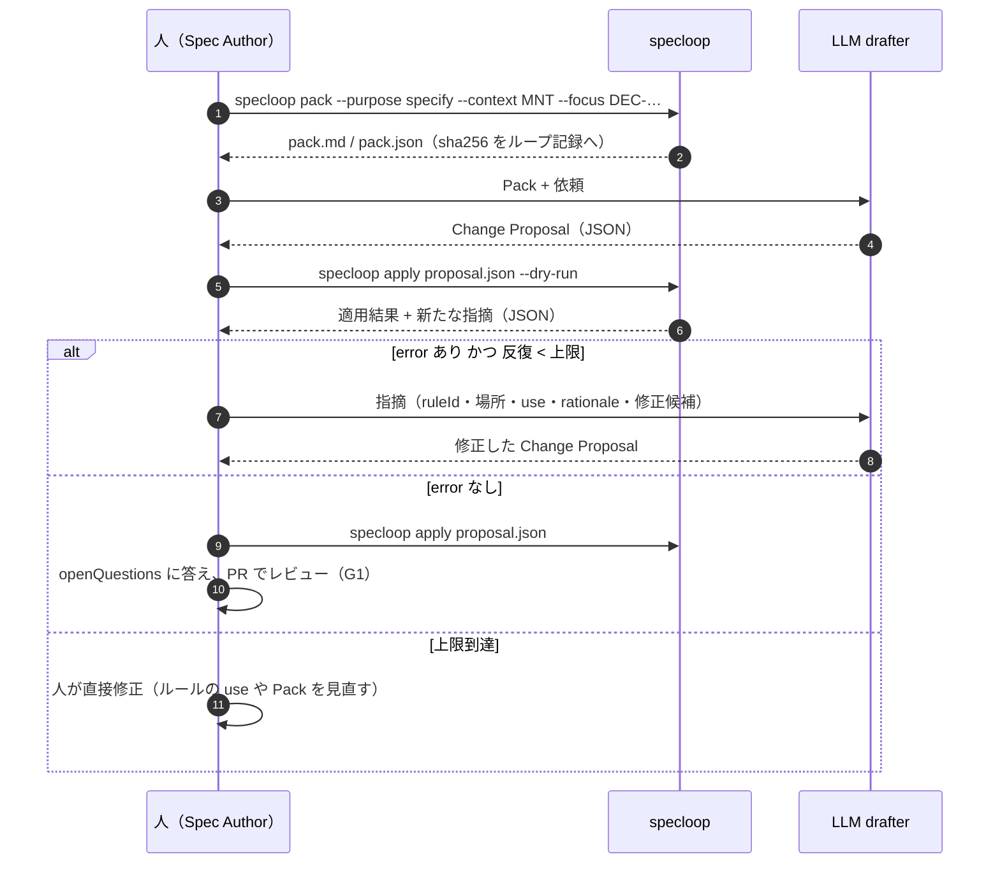

# 09. LLM 連携

## 1. 原則

| # | 原則 | 理由 |
|---|---|---|
| 1 | LLM には **Context Pack** を渡す（生のファイル群を渡さない） | 範囲の限定・用語の固定・規範と説明の区別を保証するアクセス層（会話第 3 回） |
| 2 | LLM の出力は **出力契約（JSON Schema）** に従わせ、**同じバリデータ**を必ず通す | LLM は構造を無視して自然文で答えることがある。出力後の検証を必須にする（会話第 3 回） |
| 3 | **LLM は提案し、ツールが書き、人が承認する** | 書き込みを決定的にして、差分と責任の所在を明確にする（[ADR-0008](adr/0008-deterministic-judgement.md)） |
| 4 | LLM のレビューは **advisory**（L5）。合否を決めない | 非決定的な判定をゲートに入れない |
| 5 | **判断点（JDG）は LLM も決めない** | 暗黙知の境界を守る。判断は人が記録する |
| 6 | **範囲外は範囲外と答えさせる** | `inScope: false` を出力契約に入れ、推測で埋めさせない |
| 7 | **再現性**: Pack はハッシュで同定し、ループ記録に残す | どの情報を前提に提案されたかを後から確認できる |
| 8 | **ベンダー中立**: Pack は Markdown + JSON、連携は MCP と CLI | 特定の LLM・エディタに依存しない |

## 2. Context Pack

### 2.1 目的（purpose）

| purpose | 使う場面 | 主な内容 |
|---|---|---|
| `specify` | 仕様の起草・改訂 | 範囲宣言、用語表、越境可能な要素、ルールの規則文、対象要素と 1 ホップの関連、入力（FB・指摘）、出力契約 |
| `review` | L5 の助言、人のレビュー補助 | 対象要素、関連要素、narrative ルール、llm-review ルールの prompt |
| `implement` | 実装・テスト作成 | 集約・状態遷移・判断表・不変条件・シナリオ、コード上の名前（glossary code）、トレース注釈の規約、生成済みスケルトンのパス |
| `answer` | 現場・利用者の質問への回答（RAG 的な利用） | answerableQuestions、手順・判断表のビュー、範囲外の応答方法 |

### 2.2 構成（固定順）

1. **ヘッダ**（コメント）: purpose、loop、context、focus、sourceHash、予算、生成器の版
2. **役割と範囲**: ロール、目的、answerableQuestions、範囲外の扱い、判断点の扱い、用語の扱い、出力形式
3. **用語表**: 正式表記・code・定義・禁止語（自コンテキスト全語 + 使用する上流の published 語）
4. **境界を越えて使える要素**: context-map の via と published 要素、経路
5. **守るべきルール**: 対象の kind に適用されるルールの `use`（と `rationale`）。narrative も含む
6. **対象の仕様**: focus 要素の規範ブロック（正規化済み YAML）と 1 ホップの関連要素の要約
7. **今回の入力**: FB、前回の検証指摘、人の指示
8. **出力契約**: スキーマへの参照と必須項目

例: [examples/uav-maintenance/loops/LP-0002/pack-specify-MNT.md](../examples/uav-maintenance/loops/LP-0002/pack-specify-MNT.md)

### 2.3 生成規則

- **範囲**: 既定は 1 コンテキスト。越境要素は via / published のものだけを含める（非公開要素は含めない）。
- **順序**: 決定的（セクション順 → 要素 ID 順）。同じ Graph と引数なら同じバイト列 → 同じ sha256。
- **予算**: `--budget` を超える場合、削る順は「1 ホップ関連の要約 → 説明の抜粋 → 未使用の用語」。**範囲宣言・用語表の禁止語・ルールの use・出力契約は削らない**。削った場合はヘッダに記録する。
- **除外**: `.specloopignore` と、フィールド単位の `x-specloop-private: true`（将来）で機密情報を除外する。
- **形式**: 同内容の Markdown（人が確認できる）と JSON（ツール・構造化入力用）を出す。

## 3. 出力契約: Change Proposal

スキーマ: [schemas/llm/change-proposal.schema.json](../schemas/llm/change-proposal.schema.json)

| フィールド | 内容 |
|---|---|
| `loop` / `context` | どのループ・どのコンテキストに対する提案か |
| `inScope` / `outOfScopeReason` | 依頼が charter の範囲内か。範囲外なら operations は空 |
| `operations[]` | `add-element` / `replace-element` / `remove-element` / `set-field` / `add-module` / `edit-prose`。各操作に `rationale` と `addresses`（対応する指摘や FB） |
| `termsUsed` | 使用した用語 ID（未知の語の混入を検出する） |
| `newTerms` | 新しい用語の提案（glossary の要素スキーマに準拠） |
| `openQuestions` | 人の判断が必要な点。推測で埋めずにここに書く |

例: [examples/uav-maintenance/loops/LP-0002/proposal-1.json](../examples/uav-maintenance/loops/LP-0002/proposal-1.json)（スキーマ検証済み）

### 3.1 2 つの作業モード

| モード | 設定 `llm.outputContract` | 流れ | 向いている環境 |
|---|---|---|---|
| **Proposal モード**（既定） | `change-proposal` | LLM → Change Proposal → `specloop apply`（検証してから書き込み） | チャット型 LLM、API 経由の自動化、レビュー重視 |
| **Direct-edit モード** | `direct-edit` | コーディングエージェントがファイルを直接編集 → `specloop validate` を必ず実行 | Cursor / Claude Code などのエージェント |

どちらのモードでも、**ゲートを通るのはバリデータを通った成果物だけ**です。Direct-edit モードでは、AGENTS.md（§5）でエージェントに「編集後に必ず `specloop validate --changed --json` を実行し、error が 0 になるまで修正する（最大 N 回）」ことを指示します。

### 3.2 内側ループの往復



## 4. MCP サーバー（`specloop mcp`）

LLM エージェントが SpecLoop を道具として呼べるようにします。**読み取りと検証が中心で、書き込みは `propose` だけ**（提案ファイルを保存するのみ。正本への適用は人または CLI が行う）。

| tool | 入力 | 出力 | 副作用 |
|---|---|---|---|
| `get_context_pack` | purpose, context, focus[], budget | Pack（Markdown + JSON）と sha256 | Pack ファイル保存 |
| `lookup_term` | text（語または ID）, context | 一致する用語（正式表記・code・定義・禁止語の判定） | なし |
| `get_element` | id | 要素の規範データ・参照元・参照先 | なし |
| `impact` | id | 影響範囲（越境を含む） | なし |
| `validate` | paths[] / changed: bool | finding[]（JSON） | なし |
| `explain_rule` | ruleId | use・rationale・適用元ルールセット・例 | なし |
| `check_proposal` | Change Proposal | スキーマ検証結果 + dry-run の指摘 | なし |
| `propose` | Change Proposal | 保存先パス | `loops/LP-xxxx/proposal-n.json` を保存 |
| `trace` | id? | トレース行列 | なし |

resources: `specloop://glossary/{context}`、`specloop://rules/{context}`、`specloop://charter/{context}`（範囲宣言を常時参照できるようにする）。

s1000d-stack の設計原則（LLM に XML を書かせず、サーバーが判定した結果だけを返す）と同じ考え方で、SpecLoop の MCP も**判定結果だけを返し、判定そのものを LLM に委ねません**。

## 5. AGENTS.md

`specloop agents-md --write` は、リポジトリの AGENTS.md に次の節を生成・更新します（エージェント向けの慣行ファイル）。

```markdown
## SpecLoop

このリポジトリの仕様は SpecLoop 形式です（specs/ 以下、1 ファイル = 1 Spec Module）。

- 仕様の規範は ```yaml specloop:<kind> ブロックと front matter だけです。本文は説明です。
- 用語は各コンテキストの glossary（SMC-*-GLOSSARY-010A）の正式表記と code だけを使ってください。禁止語を使わないでください。
- 他コンテキストの要素は specs/_project/SMC-*-CONTEXTMAP-020A の via に列挙されたものだけ参照できます。
- 判断点（JDG）で機械が決めるコードや仕様を書かないでください。
- 生成ビュー（<!-- specloop:generated --> の間）は編集せず `npx specloop render` を実行してください。
- 仕様を編集したら必ず `npx specloop validate --changed --json` を実行し、error が 0 になるまで修正してください（最大 3 回。収束しなければ人に報告）。
- 実装には `// @specloop <ID>` 注釈を付け、テスト名にシナリオ ID（SCN-…）を含めてください。
- 作業の前に `npx specloop loop current` で現在のループと対象コンテキストを確認してください。
```

## 6. L5（LLM レビュー）の扱い

- ルールの kind `llm-review` に観点（`prompt`）を書く。結果は severity `advisory` の finding として報告され、**ゲートの合否に影響しない**。
- advisory を人が採用した場合は、FB（source: llm）または通常の修正としてループに入れる。
- 誤検出を減らすため、prompt には「根拠となる ID と文言を引用し、確信が持てない場合は挙げない」を含める（コアルールの例を参照）。
- 実行は設定またはフラグで明示的に有効にしたときだけ（コストと非決定性のため）。

## 7. 評価（SpecLoop が LLM 連携の質を測る方法）

| 指標 | 計算 |
|---|---|
| 初回適合率 | 最初の Change Proposal を apply した直後の error 0 の割合 |
| 内側ループ収束回数 | error 0 までの往復回数 |
| 範囲外の誤答率 | 範囲外の依頼に `inScope: false` を返さなかった割合（評価用の問いのセットで測る） |
| 未知語混入率 | `termsUsed` / 本文に glossary にない語が混入した割合 |
| 採用率 | 人が採用した operations / 提案された operations |

これらを Pack の構成やルールの `use` 文の改善に使います（ルールの文面も「人と LLM の両方が読む仕様」であるため）。
