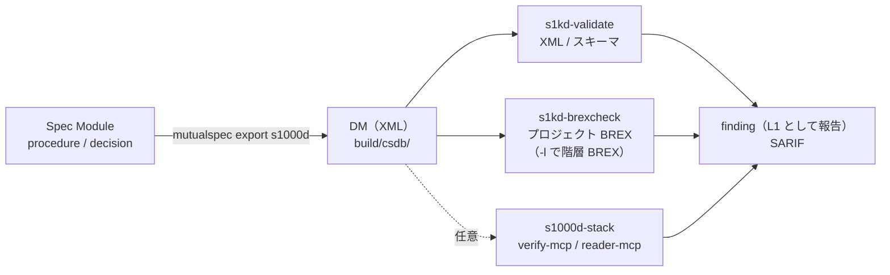

# 10. S1000D プロファイル

S1000D は MutualSpec の**考え方の源泉**（DM・DMC・BREX）であると同時に、**書き出し先の形式**の 1 つです。
コアは S1000D に依存せず、S1000D はプロファイル `profiles.s1000d` として足します（[ADR-0012](adr/0012-s1000d-as-profile.md)）。

> [!IMPORTANT]
> S1000D® は ASD の登録商標です。S1000D の仕様書・XML スキーマ・デフォルト BREX は再配布が認められていないため、MutualSpec は同梱しません。利用者が s1000d.org から入手し、s1kd-tools などの検証ツールに与えてください。

## 1. 範囲

| やること | やらないこと |
|---|---|
| procedure（500）と description（040）、decision（310）の一部を DM に書き出す | CSDB の管理（DML、発行、配信） |
| 書き出した DM を XSD とプロジェクト BREX で検証する（外部ツール） | IETM / IETP の表示 |
| 用語の S1000D 要素へのマッピングヒントを保持する | S1000D 全スキーマの内部モデル化 |
| 適用性（applicability）を S1000D の applic に写す | ACT / CCT / PCT の管理 |
| 書き出した DM の issue を Spec Module の issue と同期する | DM 側の手編集の取り込み（一方向。逆方向は FB として扱う） |

## 2. 設定

```yaml
profiles:
  s1000d:
    enabled: true
    modelIdentCode: UAVM        # DMC の modelIdentCode
    issue: "7"                  # 対象 Issue（4.2 / 5.0 / 6 / 7）
    brex: path/or/DMC-of-project-BREX
    csdbDir: build/csdb         # 書き出し先
    validator: s1kd-tools       # s1kd-tools | s1000d-stack-mcp
```

## 3. 識別子の写像（SMC → DMC）

| DMC の構成要素 | 値の出どころ | 例 |
|---|---|---|
| modelIdentCode | `profiles.s1000d.modelIdentCode` | UAVM |
| systemDiffCode | 既定 `A`（procedure.s1000d で上書き可） | A |
| systemCode / subSystemCode / subSubSystemCode / assyCode | `procedure.s1000d.systemCode` など（SNS）。未指定は `00` 系 | 61-00-00 |
| disassyCode / disassyCodeVariant | 既定 `00` / `A` | 00A |
| infoCode / infoCodeVariant | `procedure.s1000d.infoCode` / SMC の variant | 920 / A |
| itemLocationCode | `procedure.s1000d.itemLocationCode` | A |

例: `SMC-UAVM-DOC-PROPREPL-500A` → `DMC-UAVM-A-61-00-00-00A-920A-A`（info code 920 は S1000D で「交換（取り外しと取り付けを 1 つにまとめた手順）」）。

- SMC と DMC の対応は `.mutualspec/export/s1000d/dmc-map.json` に記録し、DMC は一度割り当てたら変えない（S1000D 側の参照を壊さないため）。
- issue: Spec Module の `issue.number` / `issue.inWork` を DM の issueNumber（3 桁）/ inWork（2 桁）にそのまま写す。

## 4. 内容の写像（procedure → 手順 DM）

| MutualSpec | S1000D 手順 DM | 備考 |
|---|---|---|
| front matter（title, language, issue, applicability） | identAndStatusSection（dmTitle, language, issueInfo, applic） | 言語は `ja` → languageIsoCode `ja`、countryIsoCode は設定で指定 |
| `procedure.preliminary.personnel` | preliminaryRqmts / reqPersons | ロール名を人員区分へ |
| `procedure.preliminary.tools` | preliminaryRqmts / reqSupportEquips | |
| `procedure.preliminary.parts` | preliminaryRqmts / reqSpares | 部品番号は PRT の published 用語から解決 |
| `procedure.preliminary.safety` | preliminaryRqmts / reqSafety（warning / caution） | |
| `procedure.preliminary.conditions` | preliminaryRqmts / reqCondGroup | |
| `steps[]`（入れ子可） | mainProcedure / proceduralStep（入れ子可） | step.text → para |
| `step.safety` | proceduralStep 内の warning / caution / note | |
| `step.expected` | proceduralStep 内の para（確認文） | プロジェクト BREX が別要素を求める場合はプロファイル設定で変更 |
| `step.decision`（DEC 参照） | 判断表を記述 DM（040）の表として書き出し、dmRef で参照 | §5 |
| `step.judgement` | note（「検査員が判断し記録する」）+ 判断の観点 | 判断点であることを明示 |
| `closeout[]` | closeRqmts | |
| `applicability` | applic（assert: applicPropertyIdent / applicPropertyValues）と displayText | charter.properties を製品属性として扱う |
| glossary の `s1000d.element` | 要素選択のヒント | 例: 「警告」→ warning |

## 5. 判断表の扱い

S1000D の手順 DM は「構造」を持ちますが、判断表のような**判断ロジックの表現**は MutualSpec の意味モデル層の役割です（会話第 2・3 回）。書き出しは次の方針です。

1. **既定**: 判断表（DEC）を記述 DM（info code 040）に**表**として書き出し、手順ステップから dmRef で参照する。手順 DM には「判断表 DMC-… に従って処置を決める」というステップ文を生成する。
2. **判断点（JDG）**: 該当行に「検査員が判断し、理由を記録する」旨と判断の観点を書き、note として手順側にも出す。
3. **将来**: 分岐を含む手順を S1000D の process DM や fault isolation DM の分岐構造に写す選択肢を検討する（[13](13-open-questions-and-risks.md) Q-03）。

これにより、**文書（DM）は構造、判断ロジックは判断表**という分離を S1000D 側でも保ちます。

## 6. 検証



- `mutualspec export s1000d --check` は書き出し後に `s1kd-validate` と `s1kd-brexcheck` を呼び、結果を MutualSpec の finding（ruleId は `S1000D-XSD` / `S1000D-BREX:<brDecisionIdentNumber>`）に変換して、**元の Spec Module の行**に対応づけて報告します。違反の原因が MutualSpec 側（写像）か仕様側かを区別できるようにします。
- s1kd-tools は GPL-3.0 の外部コマンドとして呼び出します（リンクしない）。
- validator を `s1000d-stack-mcp` にした場合は、s1000d-verify-mcp（XSD + BREX + 参照切れ）を呼び出します。
- G2 の条件: 書き出した DM の XSD・BREX エラー 0（プロファイル有効時）。

## 7. BREX と MSRX の関係

| | MSRX（MutualSpec） | BREX（S1000D） |
|---|---|---|
| 対象 | 仕様（Spec Graph） | DM（XML） |
| いつ効くか | Specify / Validate（G1） | Realize の書き出し後（G2） |
| 誰が書くか | プロジェクト（MutualSpec 利用者） | 顧客・プロジェクト（S1000D の契約） |
| 関係 | 仕様の段階で BREX 違反を**予防**するルールを MSRX に書ける（例: 「手順は必ず安全情報を持つ」MSR-PRJ-00002） | 最終的な合否は BREX で判定 |

- 顧客の BREX を読み、MSRX に予防ルールの候補を提案する機能（`mutualspec s1000d brex-suggest`）を将来提供します。BREX の objectUse は「何が要求されているか」の文として MSRX の `use` にそのまま使えます。
- 逆に、MSRX から BREX を生成することはしません（対象が異なるため）。

## 8. 既存 DM からの取り込み（将来）

既存の CSDB を出発点にする場合、DM を構造として読み出し（例: s1000d-reader-mcp）、procedure モジュールの**下書き**を作る `mutualspec import s1000d` を検討します。取り込んだモジュールは status draft・inWork 1 で作られ、通常のループ（G1 の人の承認）を通ります。
