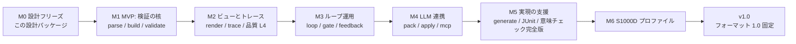

# 12. ロードマップ

期間は 1 人〜少人数で進める前提の目安です（[13](13-open-questions-and-risks.md) の A-04）。各マイルストーンの終わりに、MutualSpec 自身を MutualSpec で管理する（ドッグフーディング）範囲を広げます。

| マイルストーン | 目安 | 内容 | 完了条件 |
|---|---|---|---|
| **M0 設計フリーズ** | 現在 | 本パッケージ。ADR の承認。Q-01（会話中の「XDL」は XSD の誤記）は解決済み。Q-08（名前空間）は解決済み（名称を MutualSpec に変更。npm `mutualspec` + `@shuji-bonji/mutualspec-*`、CLI `mutualspec`、`$id` は GitHub Pages。[ADR-0015](adr/0015-rename-to-mutualspec.md)）。商標の確認は未了 | ADR が accepted、サンプルが参照チェッカーで error 0 |
| **M1 MVP: 検証の核** | 3〜4 週 | `init` / `context add` / `new` / `build` / `validate`（L0・L1・L2・L3 の参照と境界）、コアルール（L1〜L3 の主要部）、text / json / sarif 出力、終了コード、GitHub Actions 例 | サンプルで本パッケージの参照チェッカーと同じ指摘を再現。1,000 モジュールの合成データで性能目標 |
| **M2 ビューとトレース** | 2〜3 週 | `render`（context-map / class / state / decision / procedure / trace の Mermaid 生成と `--check`）、`trace`（注釈スキャン）、L4 品質ルール（ja / en レキシコン）、`fmt`、`show` / `impact` | 生成ビューの差分検査が CI で動く。トレース行列が出る |
| **M3 ループ運用** | 2〜3 週 | `loop start/status/close`、`gate G0〜G4`、`feedback add/triage`、issue 番号の自動更新、md レポート | サンプルの LP-0001 を CLI だけで再現できる |
| **M4 LLM 連携** | 3〜4 週 | `pack`（4 purpose、予算、ハッシュ）、`apply`（Change Proposal、dry-run、コメント保持）、`mcp`（§4 の tools）、`agents-md`、L5 advisory | 内側ループがエージェント（Cursor / Claude Code など）で回る。評価指標（[09](09-llm-integration.md) §7）を計測 |
| **M5 実現の支援** | 3 週 | `generate ts`（判断表コード・集約スケルトン・シナリオのテスト雛形）、JUnit 取り込み、`verify`、意味チェックの完全版（適用性、判断点ロール、未使用語、不変条件） | サンプルの src / tests を生成＋実装で再現 |
| **M6 S1000D プロファイル** | 4 週 | `export s1000d`（procedure → 手順 DM、decision → 記述 DM の表、applic）、s1kd-tools 連携、finding の逆写像、DMC 対応表 | 書き出した DM が s1kd-validate / s1kd-brexcheck（default BREX）で 0 エラー |
| **v1.0** | — | フォーマット `mutualspec: "1.0"` 固定、`migrate`、ドキュメントサイト、プラグイン API（check / generator / profile）の安定化 | 外部プロジェクト 1 件以上での利用 |

## 1.0 以降の候補

| 候補 | 内容 |
|---|---|
| 形態素解析による語彙検査 | kuromoji.js / Sudachi などで語単位の照合（Q-05） |
| 交換形式の書き出し | context-map → Context Mapper（CML）、behavior → SCXML、decision ⇄ DMN |
| 取り込み | `import openspec`、`import s1000d`（DM → procedure の下書き） |
| BREX からの予防ルール提案 | `s1000d brex-suggest`（顧客 BREX → MSRX 候補） |
| 文章校正連携 | glossary → textlint prh 辞書の生成 |
| 他言語の生成器 | C# / Python のスケルトン生成 |
| 閲覧サイト | ID リンク・図・トレースを持つ静的サイト（IETM ではない） |
| 組織ルールの配布 | 組織 MSRX を npm パッケージとして配布・版管理 |
