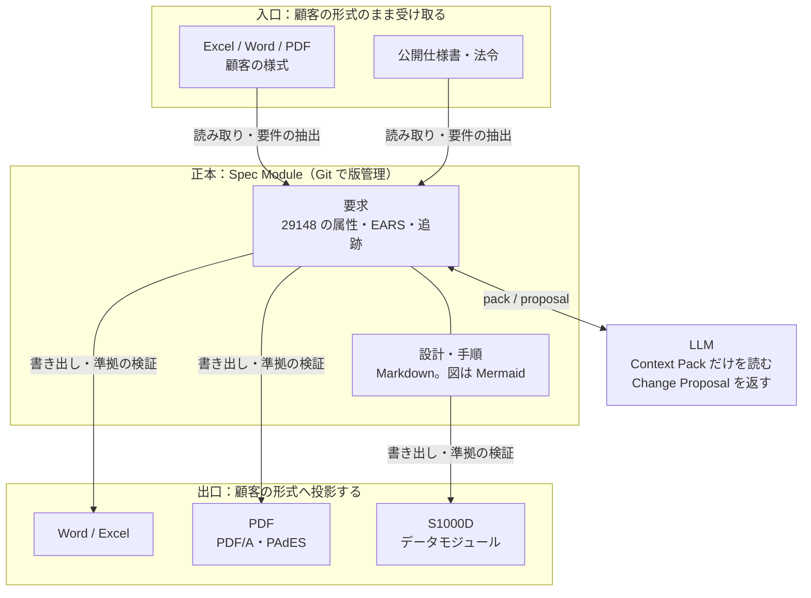

# 14. 将来の拡張候補：取り込みと投影（正本と投影の分離）

> [!NOTE]
> これは **将来の拡張候補** です。採用は決まっていません。MVP にも v1.0 にも含めません。
> スキーマ、CLI、マイルストーンは、採るかどうかの判断（[13](13-open-questions-and-risks.md) の Q-13）が下りるまで変えません。
> この文書は決定記録（ADR）ではありません。

## 1. 背景と動機

出典は、リポジトリ所有者による「仕様文書の正本化と追跡自動化の提案」（2026-11-09 時点のアイデア）です。契約の条件ではなく、顧客の検収様式を残したまま、仕様を機械がたどれる形にする考え方の記録です。

ウォーターフォール型の受託では、要件定義書・基本設計書・テスト仕様書を顧客の Excel・Word・PDF で納めることが前提になります。そのファイル自体を仕様の正本にすると、次が重なります。

- 様式を決めているのは顧客であり、検収の形は契約上そのまま残す必要がある。
- 組織や前身会社ごとにテンプレートが違い、一つに揃えると別の顧客との約束が壊れる。
- 様式は長年の書き方そのものであり、変えることは専門性の入れ物を捨てるように受け取られる。

この三つは提案でも変えません。変えるのは、受け取ったあとの社内の形だけです。

ファイルが正本のままだと、LLM に渡せる単位がありません。要件 1 件が独立しておらず、列の意味は結合セルや位置にしかなく、要件とテストの対応は人の照合に残ります。LLM はまず表の構造を復元することになり、復元の精度が結果の精度になります。提案の主張は、AI の前に、読ませる構造化された入力が無い、ということです。

## 2. 提案の骨子

社内に構造化された仕様データを一つ持ち、それを正本にする。顧客向けの Excel・Word・PDF、および S1000D の刊行物は、正本からの出力（投影）にする。入口と出口の見た目は顧客の形式のままです。

- **入口**: 顧客の Excel / Word / PDF（様式には手を加えない）、公開仕様書、法令を読み、要件を抽出する。
- **正本**: 要件（ISO/IEC/IEEE 29148 の属性を持つ構造）、設計・手順（Markdown。図は Mermaid）、追跡（要件・設計・テスト）、承認の記録。版は Git で持つ。
- **LLM**: 正本だけを読む。顧客の表計算を復元しない。「この要件を変えるとどのテストに影響するか」は追跡をたどって列挙し、採否は人が決める。
- **出口**: 同じ正本から、Word / Excel の様式、PDF（PDF/A、PAdES）、S1000D のデータモジュールへ書き出し、準拠を検査する。

S1000D がデータモジュール（正本）から刊行物（投影）を作る構造と同じ分け方です。提案の文面では、読み取り・検証・書き出しの道具は個別に公開済みで、未完成として挙がっているのは「29148 の属性を JSON / YAML でどう持つか」と「承認・署名を Git の上に載せる部分」の二つです。前者は MutualSpec の Spec Module が既に担い、後者はゲートの承認記録までが既存で、電子署名は未着手です（§3）。

## 3. 提案の要素と、既存の MutualSpec 概念の対応

提案が新しく求めるものの多くは、名前は違っても既存の概念に載ります。足りない部分は §4 に限って列挙します。

| 提案の要素 | 提案での意味 | 既存の MutualSpec | 状態 |
|---|---|---|---|
| 正本 | 構造化された仕様データ。29148 の属性を持ち、Git で版管理する | Spec Module（[04](04-spec-format.md)）。要求ブロックは 29148 の属性（識別子、理由、優先度、検証方法、`level` など。[03](03-conceptual-model.md) §6.1）。文型は任意の EARS `pattern`（[ADR-0014](adr/0014-quality-by-29148.md)）。版はモジュールの issue と Git 履歴。Git はループの台帳（[ADR-0010](adr/0010-git-as-loop-ledger.md)） | 正本の置き場所は決まっている。顧客ファイルを第二の正本にはしない |
| 追跡 | 要件、設計、テストの対応。のちに層の間の対応 | `trace` の derivesFrom / refines / satisfiedBy / verifiedBy / implementedBy（[04](04-spec-format.md) §7）。`mutualspec trace` が行列を出す | 辺の種類はある。三層の仕様書としての必須化はしていない（§4.1） |
| 承認 | 稟議に相当する承認記録 | G1（仕様承認）と G4（ループ終了）。この二つの人の承認は外せない（[05](05-the-loop.md)、[ADR-0009](adr/0009-gates-and-human-approval.md)）。証跡は PR レビューとループ記録 | 承認記録はある |
| 署名 | 押印に相当する電子署名 | なし | 候補（§4.4）。承認記録の代わりにはしない |
| LLM の入出力 | 正本だけを読み、変更の影響を述べる | LLM に渡すのは Context Pack だけ（[09](09-llm-integration.md)）。戻りは Change Proposal。ツールが検証してから書き、人がゲートで承認する | 読みの境界は既にある。入口で作った抽出結果も、Pack の代わりに顧客ファイルを渡す形にはしない |
| 出口 | Word / Excel、PDF/A・PAdES、S1000D。書き出し後に準拠を検査する | S1000D はプロファイル（[10](10-s1000d-profile.md)、[ADR-0012](adr/0012-s1000d-as-profile.md)）。写像のあと、既定では s1000d-stack（`@shuji-bonji/s1000d-core` をライブラリとして呼ぶ）で検証し、finding を元の Spec Module へ戻す。s1kd-tools は任意で、同じ DM の突き合わせに使う（[ADR-0016](adr/0016-s1000d-stack-as-default-validator.md)） | S1000D だけがある。他形式は、このプロファイルの形を顧客向け出力へ広げる候補（§4.3） |
| 入口 | 顧客様式、公開仕様、法令から要件を抽出する | 1.0 以降の増分候補に `import openspec` と `import s1000d` がある（[12](12-roadmap.md)、[10](10-s1000d-profile.md) §8）。顧客の事務文書用の importer はない | 候補。importer は正本を直接書かず Change Proposal を出す（§5） |

原則 P2（正本は一つ、図も XML も Context Pack も生成物）と P11（コアは小さく、形式はプロファイル）は、提案の「正本と投影を分ける」と同じ向きです。顧客のセル意味を定義するファイルと、Word / Excel / PDF / ReqIF への写像は、まだプロファイルとしてありません。

## 4. 足りない点（採用する場合の拡張候補）

ここから先は、採ると決めたときに足すものの候補です。この文書の時点ではスキーマにも CLI にも入れません。

### 4.1 要求の三層と、層の間の追跡

ISO/IEC/IEEE 29148 は要求を三つの仕様書に分けます。日本の工程とのおおまかな対応は次のとおりです。顧客に渡す文書の分け方は変えず、正本の要求 1 件ごとに層を持つのが提案のやり方です。

| 29148 の仕様書 | 何を書くか | MutualSpec の `level` との関係 |
|---|---|---|
| StRS（利害関係者要求仕様） | 発注者・利用者が業務上達成したいこと | `stakeholder` に近い |
| SyRS（システム要求仕様） | システム全体（ソフトウェア、ハードウェア、運用を含む）が何をするか | `system` に近い |
| SRS（ソフトウェア要求仕様） | システム要求のうちソフトウェアが担う部分 | `system-element` とは一致しない。`system-element` はシステムの要素一般であり、ソフトウェア要求仕様という文書種別ではない |

現場では StRS と SyRS が「要件定義書」に混ざり、SRS は「基本設計書」の中で設計と一緒に書かれがちです。提案は、顧客側の束ね方はそのままにし、正本側で層を属性にして、どの業務要求がどのシステム要求になり、どのソフトウェア要求になったかを追跡します。

既存の `level`（stakeholder / system / system-element）は要求の階層であり、三つの仕様書種別ではありません。層をまたぐ derivesFrom / refines も、今日は任意です。採用するなら、種別を `level` の読み替えにするか別属性にするか、層間の追跡をどの辺で必須にするかを、その時点で決めます。

提案書自身は、最初の試作を「SyRS に相当する機能要求とテスト仕様書の対応だけ」に限り、StRS への遡りと SRS への展開は次の段階に置いています。その段階の切り方は提案の進め方であり、MutualSpec の M0〜v1.0 ではありません。

### 4.2 様式定義（取り込みと書き出しの両方に使う）

顧客ファイルの見た目は顧客のものです。機械に必要なのは、見た目とは別の「この列は要件 ID、この結合セルは補足、この備考は前の行に掛かる」という意味の定義です。提案が指摘するとおり、その意味は今は書式と位置にしかありません。

候補は、様式定義ファイルを MutualSpec 側に置き、同じ定義を両方向に使うことです。

- **取り込み**: 定義に沿ってセルを読み、要求の属性へ写す。定義できない箇所は、要求として採用せず「読めなかった理由」の一覧に残す。
- **書き出し**: 正本のフィールドを、同じ定義のセルへ流し込む。様式のファイル自体は顧客のテンプレートのままにする。

様式定義は正本ではありません。正本は Spec Module のままです。定義が双方向であることは、顧客ファイルを編集して正本に逆流させてよい、という意味ではありません（§6、§7）。

### 4.3 顧客向けの出力プロファイル

[10](10-s1000d-profile.md) の S1000D プロファイルは、「コアは形式に依存しない。写像し、検証し、finding を元のモジュールへ戻す」という形です（[ADR-0012](adr/0012-s1000d-as-profile.md)）。既定の検証器は s1000d-stack で、s1000d-core をライブラリとして呼びます。s1kd-tools は同じ DM を突き合わせるための任意の外部コマンドです（[ADR-0016](adr/0016-s1000d-stack-as-default-validator.md)）。採用するなら、この形を次の投影へ広げます。S1000D プロファイルをコアへ取り込んだり、置き換えたりはしません。

| 投影 | 候補の中身 | 準拠の検査 |
|---|---|---|
| Word / Excel | 様式定義（§4.2）に従い、顧客テンプレートのセルへ流し込む | 必須列の欠落、様式定義とセルの不一致 |
| PDF | PDF/A（ISO 19005）での長期保存と、PAdES（ETSI EN 319 142）での署名 | PDF/A の準拠。提案は PDF/UA の検査も含む |
| ReqIF | OMG Requirements Interchange Format。要件管理ツールとの交換用の生成物 | ReqIF として読めること |
| S1000D | 既存の `profiles.s1000d`（手順 DM、判断表は記述 DM の表） | 既定は s1000d-stack（s1000d-core をライブラリとして呼ぶ）。s1kd-tools は任意で、同じ DM の突き合わせに使う（[ADR-0016](adr/0016-s1000d-stack-as-default-validator.md)） |

### 4.4 電子署名と Git の承認記録

G1 / G4 は「誰が、どのループの、どの改訂を承認したか」を Git 上の記録として残します。提案の「押印 = 電子署名」は、その記録に署名を結び付ける拡張です。

候補としての結び方は一つに決めていません。署名の対象は、承認済みのコミット、ループ記録、出口の PDF、のいずれか（またはそれらの組）になり得ます。いずれの場合も、署名はゲートの人の承認を置き換えません。正本の改訂を有効にするのは G1 / G4 であり、署名はその承認を納品物側で示する証跡に留めます。証明書、タイムスタンプ、鍵の保管は、フレームワークの外の運用です。

## 5. 入口と出口を既存の仕組みに載せる場合

採ると決めたときの載せ方の候補です。コマンド名は仮です。

**入口（importer）** は、顧客様式・公開仕様・法令を読み、Change Proposal（または status draft・inWork の下書きモジュール）を出します。`mutualspec apply` が検証し、G1 の人の承認を通るまで正本の approved にはしません。抽出の失敗は finding として残し、推測で要求文を埋めません。

呼び得る道具は次です。S1000D のスキーマや顧客ファイルはコアに同梱しません。

- 書き出した DM の検証は、既定で s1000d-stack です。s1000d-core をライブラリとして呼びます。s1kd-tools は任意の外部コマンドで、同じ DM の突き合わせに使います（[ADR-0016](adr/0016-s1000d-stack-as-default-validator.md)、[10](10-s1000d-profile.md)）。
- 既存 DM を構造として読む場合は、s1000d-stack の読み出し（[10](10-s1000d-profile.md) §8 の `import s1000d`。例: s1000d-reader-mcp）を候補にします。これは検証器の既定経路とは別です。検証器の値 `s1000d-stack-mcp` は廃止されています（ADR-0016）。
- PDF・Word の構造抽出、法令・規格の条文取得、PDF/A や電子署名の検証については、提案者が個別に公開しているツールを候補にします。パッケージ名とライセンスは、採用を検討する時点で確かめます。コアの依存関係には名前を固定せず、選んだときだけ外部コマンドまたは MCP として呼びます。

**出口（export）** は `mutualspec export s1000d` と同じ手順です。プロファイルごとに写像し、検証結果を元の Spec Module の行へ戻します。S1000D の既定の検証器は s1000d-core（ライブラリ）です（[ADR-0016](adr/0016-s1000d-stack-as-default-validator.md)）。投影の向きの既定は、正本から投影への一方向です。投影側の手直しは、フィードバックか、新しい importer の Change Proposal として仕様へ戻します。S1000D で既に採っている扱い（[ADR-0012](adr/0012-s1000d-as-profile.md)）を、他の投影にも広げます。

## 6. この候補を読むときの前提

- 顧客の様式、組織ごとのテンプレート、技術者の書き方は変えない。
- 正本の形式は [ADR-0003](adr/0003-single-source-module.md) のまま（1 ファイルに YAML front matter、型付き YAML ブロック、Markdown 本文）。JSON だけの第二の正本は作らない。ReqIF や書き出し用 JSON は投影である。
- LLM の規範入力は Context Pack のまま（[09](09-llm-integration.md)）。抽出前の Excel や Word を Pack の代わりに渡さない。
- 適合の判定は決定的なツール、承認は人。抽出と人の判断の一致は、ゲートの外で人が数える材料であり、自動承認の根拠にはしない。
- 規格本文、顧客の実ファイル、署名鍵はリポジトリに同梱しない。
- 提案が第 2 段階以降に置いた工程の枠（12207 / 15288）、品質特性（25010）、テスト項目の属性（29119）、AI マネジメントの記録（42001）は、この候補の説明に含めても、スキーマには足さない。

## 7. リスクと、決めるときに残る問い

| 論点 | 内容 |
|---|---|
| 様式定義の維持 | 顧客が列や結合を変えると定義が壊れる。壊れた定義で書き出すと、検収様式を守ったつもりで別物になる |
| 抽出の誤り | 誤って取り出した文が正本に入ると、以降の追跡と投影がそれを増幅する。draft と G1 を外さない。読めなかった箇所の一覧を、採用した要求と混ぜない |
| 双方向と一方向 | 様式定義を両方向に使うことと、投影の編集を正本へ直接戻さないことは、衝突しやすい。可逆にする範囲は未決 |
| 署名の正 | 電子署名と Git の承認記録を両方持つと、どちらが有効か曖昧になる。署名は承認の投影側の証跡に限る、が候補の初期方針 |
| 署名の運用 | PDF/A と PAdES は証明書とタイムスタンプを要する。フレームワークが鍵を持つかは未決であり、持たない側に寄せる |
| 条文と公開仕様 | 法令・標準仕様の取り込みは、再配布の条件を確認してからにする。条文の本文を正本へコピーすることは既定にしない |
| 外部ツール | 公開済みの抽出ツールのライセンス、入出力、保守範囲は未確認。DM の検証は s1000d-core をライブラリとして呼ぶところまで決まっている（[ADR-0016](adr/0016-s1000d-stack-as-default-validator.md)、Q-11）。残るのは、書き出しに `buildDataModule` を使うかどうか |
| 三層の表現 | `level` を拡張するか、仕様書種別を別フィールドにするかは未決。`system-element` を SRS と呼ぶ読み替えはしない |
| 範囲の膨張 | 入口から出口までを一度に足すと、M1 の検証の核より大きい。提案の段階判断（一致率を見て止める、納品が検収を通るかを見て止める）を、MutualSpec のマイルストーンに読み替えない |

採るかどうか、採るならいつか、は [Q-13](13-open-questions-and-risks.md) です。

## 8. 決めるまで範囲に入れないもの

> [!IMPORTANT]
> Q-13 で採ると決めるまで、次はスコープ外です。ロードマップの M0〜v1.0 にも、「1.0 以降の候補」の実装約束にも含めません。

- 顧客の Excel / Word / PDF、公開仕様書、法令からの importer
- 様式定義ファイルと、そのスキーマ
- Word / Excel、PDF/A、PAdES、ReqIF の出力プロファイル
- 電子署名と、G1 / G4 の承認記録との結び付け
- StRS / SyRS / SRS を要求の必須な三層にすること、および層間追跡の必須化
- 12207 / 15288、25010、29119、42001 を正本のスキーマへ足すこと
- 提案書の試作（要件定義書 1 本とテスト仕様書から対応表を作る作業）を、MutualSpec のマイルストーンにすること

この候補に依存せず、これまでどおり進めるものは次です。

- Spec Module、29148 の属性、任意の EARS、既存の `trace`
- G1 / G4 と、Git を台帳にするループ記録
- Context Pack と Change Proposal
- M6 の S1000D プロファイル
- 1.0 以降の増分として既に挙がっている `import openspec` と `import s1000d`

## 9. 関連

- ロードマップ上の位置: [12](12-roadmap.md)（将来の拡張候補。未採用）
- 採否の問い: [13](13-open-questions-and-risks.md) Q-13
- 正本と要求属性: [03](03-conceptual-model.md) §6、[04](04-spec-format.md)、[ADR-0003](adr/0003-single-source-module.md)、[ADR-0014](adr/0014-quality-by-29148.md)
- 承認と台帳: [05](05-the-loop.md)、[ADR-0009](adr/0009-gates-and-human-approval.md)、[ADR-0010](adr/0010-git-as-loop-ledger.md)
- LLM の入出力: [09](09-llm-integration.md)
- 出口の先例: [10](10-s1000d-profile.md)、[ADR-0012](adr/0012-s1000d-as-profile.md)。既定の検証器は [ADR-0016](adr/0016-s1000d-stack-as-default-validator.md)
