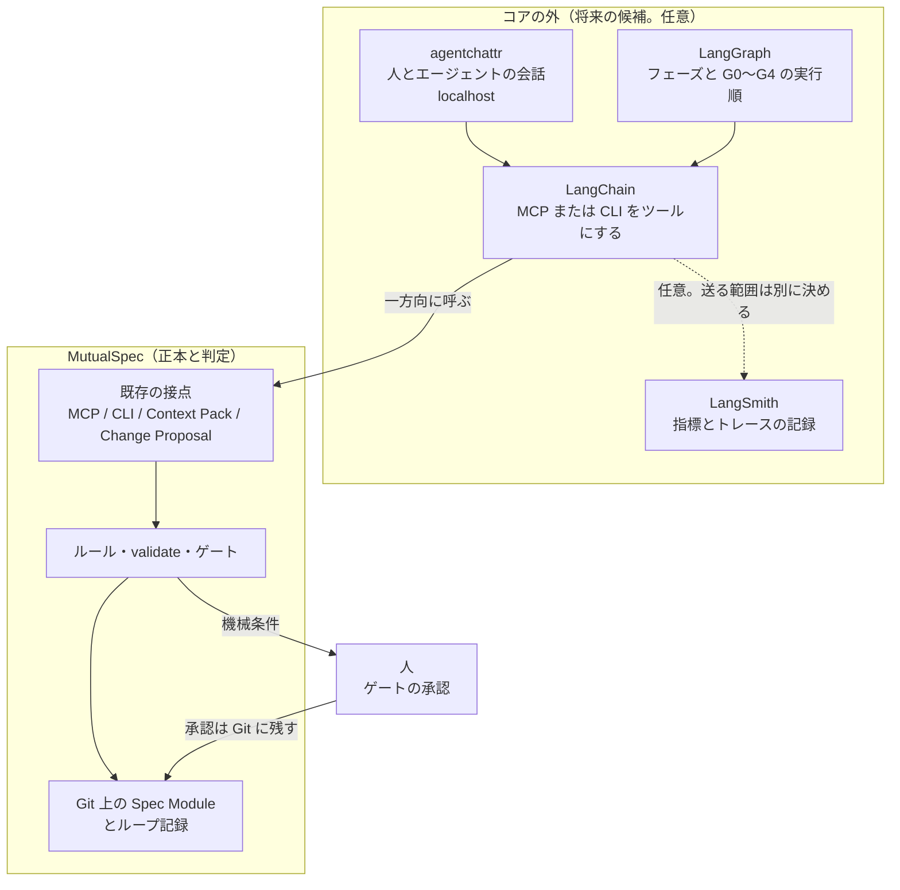
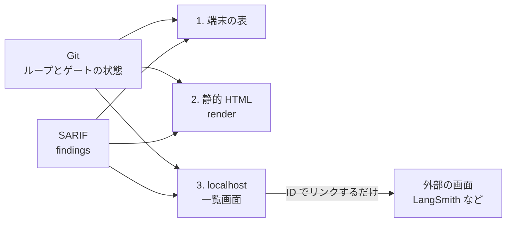

# 15. 将来の拡張候補：エージェント編成（agentchattr / LangChain / LangGraph / LangSmith）

> [!NOTE]
> これは **将来の拡張候補** です。採用は決まっていません。MVP から v1.0 までの範囲には含めません。
> スキーマ、CLI、コアの依存関係は、採るかどうかの判断（[13](13-open-questions-and-risks.md) の Q-14、ビューは Q-15）が下りるまで変えません。
> この文書は決定記録（ADR）ではありません。

## 1. 原則

MutualSpec が持つものは、正本と、その正本に対する判定です。ルール、ゲート、識別子の採否は MutualSpec が決めます。ここで挙げる道具は、**誰がいつ走るか**を並べ、**走った記録**を残すだけです。

つなぐ場所は、今の設計にある次の四つに限る候補です。新しい入出力契約は足しません。

| 接点 | 役割 | 場所 |
|---|---|---|
| MCP サーバー | 読み取りと検証が中心。書き込みは `propose`（提案ファイルの保存）まで。正本への適用は人または CLI | [09](09-llm-integration.md) §4 |
| CLI の JSON / SARIF | 同じ判定を、エージェントがプロセスとして呼べる形で返す | [08](08-cli.md)、[ADR-0013](adr/0013-sarif-reporting.md) |
| Context Pack | LLM に渡す規範の範囲。生のファイル群を渡さない | [09](09-llm-integration.md) §2 |
| Change Proposal と `apply` | LLM の出力契約。ツールが検証してから書き、人がゲートで承認する | [09](09-llm-integration.md) §3 |

依存の向きは一方向です。MutualSpec のコアは、これらの道具に依存しません。足すなら、コアの外の任意アダプタ（またはプラグイン）だけです。外さないものは次です。

- LLM の権限境界（[09](09-llm-integration.md)）。判定はツール、提案は LLM、承認は人。L5 は advisory。判断点は LLM も決めない。
- ゲートの人の承認。G0 / G1 / G4 は人が承認し、G1 と G4 の人の承認は外せない（[05](05-the-loop.md)、[ADR-0009](adr/0009-gates-and-human-approval.md)）。

## 2. agentchattr

[agentchattr](https://github.com/bcurts/agentchattr) は、MIT ライセンスの、ローカルで動く Python のチャットサーバです。MCP を使えるコーディングエージェント（Claude Code や Codex など）と人が、メンションで同じチャンネルに集まります。チャンネルごとにループガードがあります。候補では、次のように載せます。

- エージェントは MutualSpec の MCP（[09](09-llm-integration.md) §4）に接続する。正本の読み書きの契約は増やさない。
- 起草するエージェントと、`check`（検証）を回すレビュー用のエージェントで、内側ループ（起草 → 検証 → 修正）を進める。
- チャンネルのループガードは、内側ループの反復上限（[ADR-0009](adr/0009-gates-and-human-approval.md)。既定は 3 回）に対応させる。上限を超えたら人に戻す。
- ゲートの承認は人のままです。チャット上の合意を、G1 / G4 の承認記録の代わりにはしません。
- サーバは localhost に限る候補です。仕様を公開のネットワークへ出しません。

## 3. LangChain

LangChain は、エージェントが呼ぶツールの並べ方の候補です。MutualSpec 側の中身は変えません。

- MutualSpec の MCP ツールを、MCP アダプタ経由で載せる。
- あるいは、CLI（JSON / SARIF）をツールとして包む。
- 実装の本体は TypeScript / Node.js なので（[ADR-0011](adr/0011-implementation-stack.md)）、載せるなら LangChain.js が近い。Python 側に置くかは §6 で未決です。

ツールが返せるのは、MCP と CLI が今返すもの（Pack、finding、Change Proposal の検査結果）までです。LangChain の実行結果を、正本のもう一つの版にはしません。

## 4. LangGraph

LangGraph は、ループの進み方をグラフにする候補です。ノードは [05](05-the-loop.md) のフェーズとゲート G0〜G4 に対応させ、ゲートでは human-in-the-loop の割り込みで人に渡します。

> [!IMPORTANT]
> ループ状態の正は、Git 上のファイル（`loops/LP-xxxx/loop.yaml` の status、ゲートの証跡、Spec Module の issue）です（[ADR-0010](adr/0010-git-as-loop-ledger.md)）。
> LangGraph の状態やチェックポイントは、実行中の写しに限る候補です。両方を正にすると、どちらが承認済みか分からなくなります。

グラフが先に進んでよいかは、MutualSpec の機械条件（`validate` の error、ゲートの判定）で決めます。グラフの辺そのものを合否にしません。

## 5. LangSmith

LangSmith は、走った記録を比べる候補です。送る対象は、M4 で測る評価指標（[09](09-llm-integration.md) §7。初回適合率、内側ループ収束回数、範囲外の誤答率、未知語混入率、採用率）と、トレースです。トレースには、Context Pack のハッシュ、ループ ID、ゲート ID をタグとして付け、どの Pack を前提にどのゲートまで進んだかをあとから比べられるようにします。

> [!WARNING]
> SaaS に送ると、仕様の本文が第三者の環境に残ります。顧客の文書を扱うときは、セルフホストにするか、送るものを識別子・ハッシュ・指標だけに限る候補です。
> S1000D の配布物を同梱しない [R-06](13-open-questions-and-risks.md) と同じく、外に出してよい範囲は狭く決め、仕様本文の送付を既定にしません。

Pack のハッシュをタグにしても、Pack 本文を一緒に送れば秘匿にはなりません。何を送るかは §7 の未決です。

## 6. 自分用のビュー

ループとゲートと指摘を、自分が見るための表示の候補です。編成（§2〜§5）を採らなくても、この節だけを後から足せます。採否は [Q-15](13-open-questions-and-risks.md) です。

状態の正は、すでに Git 上のファイル（ループとゲートの status。[ADR-0010](adr/0010-git-as-loop-ledger.md)）と、検証結果の SARIF にあります。ビューはそれを**読むだけ**です。書き戻しません。承認の記録にもしません。

[ADR-0017](adr/0017-core-and-plugins.md) の拡張点は check / generator / profile の三つで、view という種別はありません。ビュー（Mermaid）と Render は generator に置いてあります。この節の表示も、同じ **generator（render）** のプラグインとして読みます。新しい種別は作りません。中核は変えません。段 1 と段 2 はサーバを要しません。

| 段 | 重さ | 何をするか | サーバ |
|---|---|---|---|
| 1. 端末 | 軽い | 今ある CLI の出力を、表や木にする。例は `mutualspec loop status`（[08](08-cli.md)）。ループ、ゲート、未解決の指摘を、ファイルを開かずに見る | 不要 |
| 2. 静的 HTML | 中 | `mutualspec render` で HTML を書き、手元で開くか GitHub Pages に置く。CI で作り直す。中身はループ・ゲート・指摘・トレースへのリンク | 不要 |
| 3. 手元の一覧 | 重い | 例として `mutualspec serve`（コマンド名は仮）。localhost だけで、ループ、ゲート、finding、トレースを一つの画面に出す | この段だけがサービスに近い |

段 2 は、ロードマップに既にある「閲覧サイト」（ID リンク・図・トレースの静的サイト）と同じ向きです。段 1 は、今の `loop status` / `render` / `trace` を置き換えません。出力を読みやすくする候補です。

LangGraph と LangSmith は、実行の様子を見る画面を既に持っています。それを MutualSpec 側で作り直しません。MutualSpec の画面の主キーは、ループ ID、ゲート ID、要求 ID です。外部の実行記録（例: LangSmith のトレース）へは、その ID でリンクするだけです。

> [!WARNING]
> 段 3 は localhost に限る候補です。顧客の仕様を公開のネットワークへ出しません。
> 画面から LangSmith などへリンクする場合も、[§5](#5-langsmith) と同じです。SaaS に仕様本文を送ることは既定にせず、顧客の文書では識別子・ハッシュ・指標に限るか、セルフホストにします。

## 7. あとで決めること

採ると決めたときにだけ決める項目です。この文書では決めません。

| 項目 | 候補の幅 | 今は決めない理由 |
|---|---|---|
| アダプタの置き場所 | コアの外の任意パッケージ。スコープの例は `@shuji-bonji/mutualspec-*`（[ADR-0015](adr/0015-rename-to-mutualspec.md)） | コアの依存にすると、使わない利用者まで引きずる |
| 実装の言語 | TypeScript（LangChain.js。本体と同じ）か、Python（agentchattr と同じ）か、両方を薄く橋渡しするか | 本体は TypeScript。会話サーバは Python。どちらを正のアダプタにするかは未決 |
| LangSmith に送るもの | 識別子、Pack のハッシュ、ループ ID、ゲート ID、§7 の指標だけにするか、トレースに本文を含めるか | 顧客文書では本文を送らない側が安全。セルフホストなら範囲を広げられる |
| 内側ループの担い手 | agentchattr のチャンネル上の二つのエージェントにするか、LangGraph のノードだけにするか | どちらも「誰がいつ走るか」であり、判定の置き場所は変わらない。併用の要否は未決 |
| ゲートの割り込み | グラフの割り込みのあと、人が Git 上の `gate --approve` を残す手順 | チャットやグラフ上の停止を、承認記録の代わりにしないため |
| ビューの段 | 段 1（端末）だけにするか、段 2（静的 HTML）までにするか、段 3（localhost）まで進むか | 状態の正は Git と SARIF のまま。段が上がるほど運用が増える。編成（Q-14）とは別に決める |

## 8. 決めるまで範囲に入れないもの

> [!IMPORTANT]
> Q-14 と Q-15 で採ると決めるまで、次はスコープ外です。M0〜v1.0 のマイルストーンには入れません。M4（LLM 連携）が終わる前に、この編成や一覧画面を前提にした実装もしません。

- agentchattr、LangChain、LangGraph、LangSmith への依存（コアにも、既定のインストールにも）
- これらの道具向けのアダプタ、プラグイン、設定キー
- ループ状態の第二の正（グラフのチェックポイントを承認の根拠にすること）
- 仕様本文を外部の SaaS へ送ること
- チャットやグラフ上の停止を、G1 / G4 の人の承認の代わりにすること
- 端末出力の増強、静的 HTML の閲覧サイト、localhost の一覧（`mutualspec serve` は仮名。Q-15）
- 表示を、ループ状態や SARIF の代わりの正にすること

この候補に依存せず、これまでどおり進めるものは次です。

- Context Pack、Change Proposal、`apply`、MCP（M4）
- 決定的な検証と、G1 / G4 の人の承認
- Git をループの台帳にすること
- 今の設計にある `loop status`、`render`、`trace`（出力の形を増やすのは Q-15 のあと）

## 9. 関連

- 採否の問い: [13](13-open-questions-and-risks.md) Q-14（編成。M4 以降）、Q-15（ビューの段）
- 中核とプラグイン: [ADR-0017](adr/0017-core-and-plugins.md)（ビューは generator。view 種別は作らない）
- ロードマップ上の位置: [12](12-roadmap.md)（1.0 以降の候補。未採用）
- 権限と接点: [09](09-llm-integration.md) §2–§4、§7
- ループとゲート: [05](05-the-loop.md)、[ADR-0009](adr/0009-gates-and-human-approval.md)
- 台帳: [ADR-0010](adr/0010-git-as-loop-ledger.md)
- 名前空間: [ADR-0015](adr/0015-rename-to-mutualspec.md)
