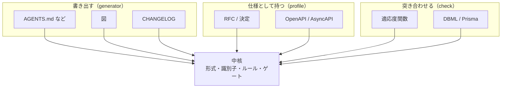

# 16. 将来の候補：開発プロセスの周辺プラクティスとの接続

> [!NOTE]
> これは **将来の拡張候補** です。採用は決まっていません。MVP から v1.0 までの範囲には含めません。
> この文書の候補は、中核に何も足しません。足すなら [ADR-0017](adr/0017-core-and-plugins.md) の拡張点（check / generator / profile）だけです。
> ただし、プラグインが kind を定義する候補は、中核の `kind` を広げる [ADR-0019](adr/0019-decision-loop-and-adr-plugin.md) の D-3 が実施されていることが前提です。
> この文書は決定記録（ADR）ではありません。採否と、最初にどれから試すかは [13](13-open-questions-and-risks.md) の Q-16 です。

## 1. 置き方

周辺のプラクティスは、役割で三つに分けます。中核（形式、識別子、ルール評価、ゲート）は知りません。

| 役割 | 拡張点 | 向き |
|---|---|---|
| 書き出す | generator（図は render） | 正本から案内・図・履歴を作る。正本にはしない |
| 仕様として持つ | profile（プラグインが定義する kind を含む。ADR-0019 の D-3 が前提） | 境界をまたぐ契約や、決定の前段を構造で持つ |
| 実装と突き合わせる | check | Verify で、用語や MUST の決定が実装とずれていないかを見る |

投影（有効なものだけを外へ出す）は [14](14-future-ingest-and-projection.md)、誰がいつ走るかは [15](15-future-agent-orchestration.md) に譲ります。

## 2. 判断のループを広げる

決定そのもののループ（提案から決定、形式の検査、人が採否を決める、Rejected も残す、置き換えのリンク）は [ADR-0019](adr/0019-decision-loop-and-adr-plugin.md) で扱っています。ADR-0019 は Proposed で、置き換えのリンクの持ち方（D-6）は未決です。ここには、そのプラグインに足しうる入口と出口だけを書きます。決定の kind は中核に入れません。

### 2.1 RFC（設計の提案）

RFC は、判断のループの入口です。ADR より前の提案で、Rust の RFC や Python の PEP が例です。ADR-0019 の「問いを立て、代替案を出す」段階に相当し、別の中核の kind にはしません。拡張点は profile（決定プラグインの Proposed）です。優先度は高です。

### 2.2 適応度関数

出口です。MUST の決定が、今もルールとテストで守られているかを check が確かめます。決定から MSRX の規則、またはテストへの参照を持たせます。

[Zenn の記事](https://zenn.dev/ncdc/articles/ad8bdc27c199b6)（「ADRはAI駆動開発の武器になるが、負債にもなるかもしれない」）が指摘するのは、古くなった ADR を AI が守り続けること、数が増えること、抽象的な原則は偽と証明できないことです。候補としての答えは次です。ADR-0019 が既に扱っているのは、置き換えのリンク（持ち方は D-6 で未決）と、機械が確かめるのは形式だけという線です。次の項目はそこにはありません。

- `review-by`（見直し期限）と `assumptions`（前提）。前提は要求やコンテキストの ID を指し、Spec Graph が変更の影響を決定まで辿れるようにします。
- エージェントに渡すのは、今も有効な決定だけです。置き換えられた決定は Git に残し、投影（[14](14-future-ingest-and-projection.md)）から外します。
- 強さを MUST / SHOULD で持ちます。MUST は検証方法かルール参照を必須にします。検証できないものは SHOULD、または原則に落とします。

> [!WARNING]
> 検証を強くすると、決定が固着します。ゲートは「まだ守られているか」と「見直し期限を過ぎたか、前提がまだ成り立つか」を同じ重さで見ます。原則が今も有効かは、人が決めます。

拡張点は check（遵守）と、有効な決定だけを出す generator（投影）です。優先度は高です。

## 3. 書き出すもの

正本にはしません。generator が正本から作ります。

- **AGENTS.md / CLAUDE.md / .cursorrules**。エージェントが読む案内であり、仕様ではありません。手で写すと正本とずれます。有効な決定、用語集、ルールの要約から生成します（[14](14-future-ingest-and-projection.md) の投影の別の先）。`mutualspec agents-md` は AGENTS.md の節を既に生成します（[09](09-llm-integration.md) §5）。候補は、その入力に有効な決定を含め、CLAUDE.md と .cursorrules にも出すことです。最初に試す価値が最も高いです。
- **Diagram as Code**。Mermaid は既に使い、`check:mermaid` で構文を見ています。PlantUML と D2 は、Spec Graph のコンテキストマップと状態遷移を描く render の追加先です。中核の図の形式にはしません。
- **Conventional Commits と CHANGELOG**。1 ループは 1 PR です（[ADR-0010](adr/0010-git-as-loop-ledger.md)）。変更履歴はループごとに generator がまとめます。

## 4. 仕様として持つもの

- **OpenAPI / AsyncAPI**。コンテキストの境界をまたぐ interface の契約です。書き出し（interface から定義を作る）と取り込み（既存の定義を読む）の両方向を、profile の候補にします。外部契約の検査に Spectral を併用できることは、今の設計にあります（[07](07-toolchain-architecture.md)）。
- **BDD（Gherkin の Given / When / Then）**。シナリオを要求 ID に結び、G3 でトレースのカバレッジを見るところまでは、今の設計が持っています。候補は `.feature` の入出力プラグインだけで、拡張点は generator です。シナリオのブロックは中核のままです。

## 5. 実装と突き合わせるもの

Verify で、check が実装側と仕様のずれを見ます。

- **DBML / Prisma Schema**。実装側のデータの形です。用語集の語と、表や列の名前が揃っているか（ユビキタス言語が実装まで届いているか）を check します。
- **事後検討（Postmortem）**。FB の出所が incident のとき（[05](05-the-loop.md)）の書き方です。非難のない記録にします。拡張点は check（incident の FB が、その項目を持つか）です。項目のひな型はプラグインのテンプレートにし、中核の FB には足しません。

## 6. 状況次第、または採らないもの

- **C4 model / arc42**。図のスタイルだけ借りられます。範囲と境界は charter と context-map が既に持ちます。新しいモデルにはしません。優先度は低です。
- **脅威モデル（STRIDE）**。顧客の案件が求めたときに profile として足します。常時は持ちません。優先度は低です。
- **Definition of Done**。機械条件は G1〜G4 が既に持っています。この候補としては採りません。

## 7. 一覧

| 対象 | MutualSpec での役割 | 拡張点 | 優先度 |
|---|---|---|---|
| AGENTS.md / CLAUDE.md / .cursorrules | 有効な決定・用語・ルール要約から読む案内を生成する。正本ではない | generator（[09](09-llm-integration.md) の agents-md を広げる） | 高 |
| RFC | 判断のループの入口。ADR の前の提案 | profile（決定プラグイン。[ADR-0019](adr/0019-decision-loop-and-adr-plugin.md)） | 高 |
| 適応度関数 | MUST の決定が今も守られているかを検査する。前提が崩れた決定を Spec Graph で見つける | check。有効な決定だけの投影は generator（[14](14-future-ingest-and-projection.md)） | 高 |
| OpenAPI / AsyncAPI | 境界をまたぐ interface の契約。書き出しと取り込み | profile | 中 |
| 図（PlantUML / D2） | Spec Graph からコンテキストマップと状態遷移を描く。Mermaid は既に検査する | generator（render） | 中 |
| DBML / Prisma | 用語と表・列の名前を突き合わせる | check | 中 |
| Conventional Commits / CHANGELOG | ループ（PR）ごとの変更履歴 | generator（[ADR-0010](adr/0010-git-as-loop-ledger.md)） | 中 |
| BDD の .feature | シナリオの入出力だけ。中身は既存の scenarios | generator | 低 |
| 事後検討 | incident の FB の書き方 | check | 低 |
| 脅威モデル（STRIDE） | 顧客が求めたときだけ持つ | profile | 低 |
| C4 / arc42 | 図のスタイルだけ借りる。範囲は charter と context-map | generator（render） | 低 |
| Definition of Done | G1〜G4 の機械条件が既に持つ。採らない | — | 採らない |

## 8. 関連

- 採否: [13](13-open-questions-and-risks.md) Q-16
- ロードマップ: [12](12-roadmap.md)（1.0 以降の候補。未採用）
- 拡張点: [ADR-0017](adr/0017-core-and-plugins.md)
- 判断のループ: [ADR-0019](adr/0019-decision-loop-and-adr-plugin.md)
- ループと PR: [ADR-0010](adr/0010-git-as-loop-ledger.md)
- 投影: [14](14-future-ingest-and-projection.md)
- 編成: [15](15-future-agent-orchestration.md)
