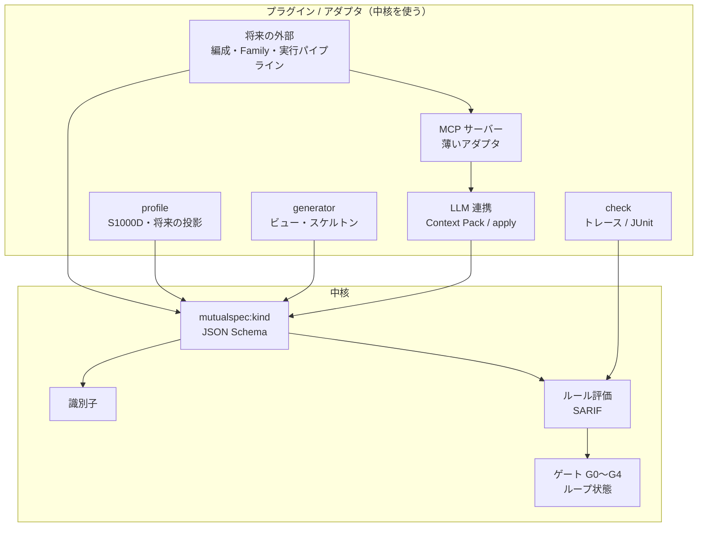

# ADR-0017: 中核の範囲とプラグインの線引き

- 状態: Accepted
- 日付: 2026-11-19
- 改訂対象: [ADR-0015](0015-rename-to-mutualspec.md)（`@shuji-bonji/mutualspec-core` の中身）

## 状況

MutualSpec は、所有者の他のプロジェクトの中核になる想定である。エージェントの実行パイプライン（meta-agent-pipeline）、専門エージェントの方法（specialized-agent。MCP と Skill の Family）、S1000D と s1000d-stack、LLM 連携、そして将来候補の取り込み・投影（[14](../14-future-ingest-and-projection.md)）と編成（[15](../15-future-agent-orchestration.md)。LangGraph / LangChain / LangSmith / agentchattr）が、同じ仕様の形を使う。

中核がそれらの知識を抱えると、使わない側まで依存と概念を引きずる。[ADR-0015](0015-rename-to-mutualspec.md) は `@shuji-bonji/mutualspec-core` に Parser・Graph・Rule Engine に加えて Pack・Apply・Render を置いていた。[07](../07-toolchain-architecture.md) の自作一覧も、Context Pack、適用器、生成器、S1000D 写像を中核と並べていた。自作であることと、中核であることは別である。

## 決定

中核は次の四つだけを持つ。

| # | 中核 | 既存の決定 |
|---|---|---|
| 1 | 型付きブロック `mutualspec:<kind>` と、その JSON Schema。既定の kind のスキーマを含む | [ADR-0003](0003-single-source-module.md)、[04](../04-spec-format.md) |
| 2 | 識別子（SMC と要素 ID） | [ADR-0004](0004-smc-and-element-ids.md) |
| 3 | ルール評価と SARIF 出力。評価が読む Spec Graph と、既定ルールセットはここに含む | [ADR-0005](0005-msrx-rule-model.md)、[ADR-0008](0008-deterministic-judgement.md)、[ADR-0013](0013-sarif-reporting.md) |
| 4 | ゲート G0〜G4 と、それが読むループ状態のファイル（`loops/LP-xxxx/loop.yaml`） | [ADR-0009](0009-gates-and-human-approval.md)、[ADR-0010](0010-git-as-loop-ledger.md) |

それ以外は、中核を使うプラグインまたはアダプタである。

| もの | 置き場所 | 拡張点 |
|---|---|---|
| S1000D プロファイルと s1000d-stack / s1kd-tools | プラグイン | profile（[ADR-0012](0012-s1000d-as-profile.md)、[ADR-0016](0016-s1000d-stack-as-default-validator.md)） |
| LLM 連携（Context Pack、Change Proposal の適用） | プラグイン | generator。書いたあとの合否は中核の validate が返す |
| MCP サーバー | 中核の外の薄いアダプタ | 中核の validate / 要素参照と、LLM プラグインを stdio で渡すだけ。判定は持たない（[09](../09-llm-integration.md) §4） |
| ビュー（Mermaid）、スケルトン生成、トレースと JUnit 取り込み | プラグイン | generator（ビュー・生成）、check（トレースと JUnit。ゲートは結果の数値だけを見る） |
| 取り込みと投影（[14](../14-future-ingest-and-projection.md)） | 将来のプラグイン。未採用 | profile |
| 編成ツール（[15](../15-future-agent-orchestration.md)） | 将来の外部アダプタ。未採用 | プラグイン API の外から、既存の CLI / MCP を呼ぶ。中核はこれらの名前を知らない |
| specialized-agent の Family マニフェスト | 将来のプラグイン | プラグインが定義する `mutualspec:<kind>` と、そのスキーマ。中核は Family の語彙を持たない |
| meta-agent-pipeline | 中核の利用者 | MutualSpec の中には入れない |

依存は一方向である。プラグインから中核へ向かう。中核はプラグインも外部ツールも import せず、名前も知らない。拡張点はプラグイン API の三つだけである（check / generator / profile。ロードマップの v1.0 で安定化する）。`mutualspec` CLI は合成の入口であり、プラグインを読み込んでよい。読み込むのは CLI であり、`@shuji-bonji/mutualspec-core` ではない。

中核に足してよいものの基準は、次をすべて満たすことである。一つでも欠ければプラグインにする。

- すべての利用（すべての profile を含む）がそれなしでは成り立たない。
- 判定が決定的である。
- 外部ツールもネットワークも要らない。

npm の名前は [ADR-0015](0015-rename-to-mutualspec.md) のままとする。変えるのは中身の線引きである。`@shuji-bonji/mutualspec-schemas` と `@shuji-bonji/mutualspec-rules-core` はパッケージとしては分かれたままで、役割は中核（形式と既定ルール）である。`@shuji-bonji/mutualspec-mcp`、`-generator-ts`、`-profile-s1000d` はプラグインである。Pack・Apply・Render は `-core` から出す。

## 検討した代替案

- 太い中核: Pack・Apply・Render を `-core` に残す（ADR-0015 のパッケージ表のまま）。LLM も図も S1000D も使わない利用者（実行パイプラインや Family の検証だけが欲しい側）が、それらを依存として受け取る。
- 断片ごとに別リポジトリで、共有の中核を持たない: 形式・識別子・ルールの判定がプロジェクトごとにずれ、ゲートの意味が揃わない。

## 結果

- 中核ライブラリは remark / yaml / Ajv / JSONPath / SARIF だけで動作する。Mermaid、MCP SDK、s1000d-core、s1kd-tools はプラグインの依存である。
- ゲートの機械条件のうち、プロファイルやテスト由来のものは、check / profile が結果を渡し、中核はその結果とループ記録を見て合否を記録する。S1000D の検証を中核は呼ばない。
- 適用器は LLM プラグインが持つ。中核は「検証してから書く」関数を持たない。プラグインがファイルを書いたあとに、中核の validate を通す。
- [ADR-0002](0002-compose-existing-standards.md) の「自作」リストは、作る範囲の上限であり、中核の定義ではない。
- docs/14 と docs/15 は未採用のままである。この決定は、採用したときに置く場所をプラグイン側に固定するだけで、採用を決めない。
