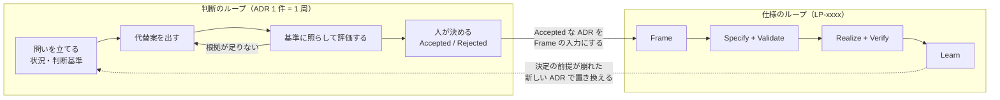

# ADR-0019: 判断のループ: ADR を提案から決定まで回し、決定の記録をプラグインとして提供する

- 状態: Proposed
- 日付: 2026-11-20（起票）
- 関連: [ADR-0008](0008-deterministic-judgement.md)、[ADR-0009](0009-gates-and-human-approval.md)、[ADR-0010](0010-git-as-loop-ledger.md)、[ADR-0017](0017-core-and-plugins.md)、[05](../05-the-loop.md)、[15](../15-future-agent-orchestration.md)

> [!NOTE]
> この ADR は、決定の前に書いた最初の ADR である。「決定」と「結果」は採択するときに書く。
> 代替案の表にある「起票時の推奨」は LLM の提案であり、採否は所有者が決める（[ADR-0008](0008-deterministic-judgement.md)）。

## 状況

ADR-0001〜0018 は、すべて決定のあとに書かれた（状態は Accepted、日付は 2026-11-19）。提案の段階にある ADR は無い。仕様のループ（[05](../05-the-loop.md)）は Frame から始まり、Frame より前に「どの案を採るか」を決める手順は定義されていない。

所有者は 2026-11-20 に次の方針を示した。

- ADR を「決まったことの記録」としてだけでなく、「提案から決定までのループ」として回す。このループを、仕様のループの一段手前に置く。
- このやり方を、MutualSpec を使う側のプロジェクトにも提供する。境界や語彙を決める前に「なぜそう決めたか」を残す場面は顧客の案件でも出る。決定の記録が仕様と ID でつながっていれば、要求を変えるときに、どの決定に関わるかを辿れる。
- 中核には入れない。公式のプラグインとして、決定のスキーマ、状態遷移のルール（Proposed から Accepted、置き換えのリンク、検討した案が 2 つ以上あるか）、要求の ID との関連チェック、テンプレート 1 つを出す。使う側は profile に 1 行足すだけで有効にできるようにする。
- 議論、下書きの作成、検索は外に任せる（チャット、[adr-skill](https://github.com/vercel/ai)、[@adrkit/mcp](https://github.com/mbeacom/adrkit) など）。形式は [MADR](https://adr.github.io/madr/) と互換にする。
- 最初は MutualSpec 自身の `docs/adr` で試し、使えると分かったものだけを公式のプラグインにする。

この方針を今のスキーマに当てると、次の食い違いがある（2026-11-20 に `schemas/` を確認）。

| # | 方針 | 今の状態 |
|---|---|---|
| 1 | 決定の kind を `mutualspec:decision` にする | `decision`（種別コード 310）は判断表として既定の kind である（[04](../04-spec-format.md)）。要素 ID の接頭辞 `DEC-` も判断表が使っている |
| 2 | プラグインが kind を定義する | `common.schema.json` の `kind` は 12 個の固定の enum である。`mutualspec.config.schema.json` の `profiles` は `s1000d` だけを持ち、`additionalProperties: false` である。[ADR-0017](0017-core-and-plugins.md) は「プラグインが定義する `mutualspec:<kind>`」を認めているが、それを受け入れる手段がスキーマに無い |
| 3 | ID は今ある仕組みを使う | `elementId` の接頭辞は固定の列挙（`REQ`、`TERM`、…、`MSR`）である。新しい接頭辞を持つ ID は `elementRef` の検査を通らない |
| 4 | 状態は Proposed から Accepted へ進む | モジュールの `status` は `draft / proposed / approved / deprecated / retired` である。Rejected に当たる値が無い |
| 5 | 置き換えは両方向にリンクする | front matter にあるのは `supersedes`（新しい側から古い側へ）だけである |
| 6 | 決定が仕様のループを始める | D-8 で解消。`trigger.type` に `decision` を足した。`refs` は起点にした ADR または決定記録の ID。`decisions` はこのループで下した決定（出力） |

2 は ADR に限らない。specialized-agent の Family マニフェストをプラグインの kind にするときも、同じ箇所で止まる。

外部の道具について確認したことは次のとおりである（2026-11-20）。

- adr-skill は、提案・作成・採否の更新を扱う Skill で、MADR のテンプレートを同梱している。
- `@adrkit/mcp` は読み取り専用の MCP サーバーである。adrkit は 1 決定 1 ファイルの Markdown と、独自の型付き front matter を前提にする。決定が影響する対象を `affects` というフィールドで持つ。MADR 互換にするだけで `@adrkit/mcp` が読めるかは未確認である。
- MADR のファイルは、MutualSpec のモジュールに必須の front matter（`mutualspec`、`smc`、`kind`、`context`、`issue`、`owner` など）を持たない。そのままではモジュールとして検証を通らない。

## 判断基準

議論の前に固定する。各問いの案は、この基準で比べる。

| # | 基準 | 根拠 |
|---|---|---|
| C1 | 決定の記録を使わない利用者に、概念も依存も足さない | [ADR-0017](0017-core-and-plugins.md) の中核に足してよいものの基準 |
| C2 | 機械が判定するのは形式だけで、判定は決定的である。案の良し悪しは人が決める | [ADR-0008](0008-deterministic-judgement.md)、[ADR-0009](0009-gates-and-human-approval.md) |
| C3 | 要求から決定へ、決定から要求へ、ID で辿れる | 所有者の方針（この機能を提供する理由） |
| C4 | 同じ事実を 2 か所に書かせない。状態の正は Git 上の 1 か所である | [ADR-0010](0010-git-as-loop-ledger.md) |
| C5 | 決定 1 件のために書く必須項目を増やしすぎない | [13](../13-open-questions-and-risks.md) の R-01 |
| C6 | 段階 1（`docs/adr` での試行）は、中核とスキーマを変えずに始められる | 所有者の方針（使うものだけ作る） |

## 判断のループの形（案）

仕様のループから流用する決まりは次のとおりである。

| 仕様のループ | 判断のループ |
|---|---|
| 判定はツール、提案は LLM、承認は人（[ADR-0008](0008-deterministic-judgement.md)） | 代替案と評価は LLM が出してよい。採否は人が決める |
| 機械条件は必要条件、人の承認が十分条件（[ADR-0009](0009-gates-and-human-approval.md)） | 機械条件は形式だけである。Accepted にするのは人である |
| 内側ループは上限回数で人に渡す（既定 3） | 「代替案 → 評価」の往復に上限を置く |
| 1 ループ = 1 ブランチ + 1 PR（[ADR-0010](0010-git-as-loop-ledger.md)） | 1 ADR = 1 ブランチ + 1 PR。マージで Accepted になる |
| 却下・保留した FB も残す | Rejected の ADR も残す |

仕様のループには合否を決める `validate` があるが、設計判断の中身が正しいかを決定的に判定するツールは無い。判断のループが機械で確かめるのは、形式（判断基準が書かれているか、代替案が 2 件以上あるか、参照先が実在するか）だけである。

## 決める問いと代替案

### D-1 `docs/adr` の ADR の形式と状態（段階 1）

| 案 | 内容 | 起票時の推奨 |
|---|---|---|
| a | 今の 4 節（状況・決定・検討した代替案・結果）に「判断基準」を足し、状態に Proposed / Rejected / Superseded を使う。Proposed の間は「決定」と「結果」を空にする | 推奨。既存の 18 件を書き換えずに済む（C5、C6） |
| b | 見出しを MADR 4.0 の節（Context and Problem Statement、Decision Drivers、Considered Options、Decision Outcome）に合わせて、既存の 18 件も移す | 外部の道具に読ませやすいが、段階 1 で 18 件を書き換える作業が出る |
| c | 今のまま変えない。提案の段階は ADR に書かず、Issue や Discussions で進める | 提案の段階の記録が Git に残らない（C4） |

### D-2 決定の kind の名前（段階 2）

| 案 | 内容 | 起票時の推奨 |
|---|---|---|
| a | `adr`（ブロックは `mutualspec:adr`）。種別コードは空いている番号から選ぶ（例: 030） | 推奨。判断表の `decision` と語が重ならない |
| b | `design-decision` | 意味は明確だが、`decision` と並ぶと読み違えやすい |
| c | 判断表を `decision-table` に改名し、`decision` を決定の記録に明け渡す | 既定の kind、テンプレート、サンプル、`DEC-` の説明を変える。C1 に反する |

### D-3 プラグインが kind を登録する手段（段階 2）

| 案 | 内容 | 起票時の推奨 |
|---|---|---|
| a | 中核の `kind` を「既定の 12 個、または有効な profile が登録した kind」に広げる。`profiles` はプラグインごとの設定を受け付ける形にする | 推奨。中核に足すのは登録の手段であり、決定の記録ではない（C1）。Family マニフェストも同じ手段を使える |
| b | 中核の enum に `adr` を足す | 使わない利用者にも kind が見える（C1 に反する） |
| c | モジュールにしない。`docs/adr` の Markdown のままにして、プラグインは別のファイル群として読む | 中核は変えずに済むが、要求と同じ Spec Graph に入らず、C3 を満たすには別の参照の仕組みが要る |

### D-4 決定の識別子（段階 2）

| 案 | 内容 | 起票時の推奨 |
|---|---|---|
| a | 決定 1 件を 1 モジュールにして、SMC を識別子にする。要求からは `trace.derivesFrom` で SMC を参照する | 推奨。`elementRef` は SMC を受け付けるので、接頭辞を足さずに C3 を満たす |
| b | 要素 ID の接頭辞（例: `ADR-`）を足す。1 モジュールに複数の決定を書ける | 接頭辞の列挙を広げる変更が中核に要る。プラグインが接頭辞を登録する手段も決めることになる |

### D-5 状態の持ち方（段階 2）

| 案 | 内容 | 起票時の推奨 |
|---|---|---|
| a | モジュールの `status` だけを使う。Proposed = `proposed`、Accepted = `approved`、Superseded = `deprecated`。Rejected は `retired` に写す | 状態が 1 か所になる（C4）。`retired` は「一度採ってやめた」とも読めるので、Rejected と区別できない |
| b | `status` は a と同じに写し、ブロックに `outcome`（`accepted / rejected`）を持つ。check が `status` と `outcome` の組み合わせを検査する | 推奨。Rejected を区別でき、中核の enum を変えない。項目が 1 つ増える（C5） |
| c | 中核の `status` に `rejected` を足す | すべての kind に `rejected` が現れる（C1 に反する） |

### D-6 置き換えのリンク（段階 2）

| 案 | 内容 | 起票時の推奨 |
|---|---|---|
| a | 新しい側の `supersedes` だけを書く。逆方向は Spec Graph の逆引きで出す。check は「置き換えられた側の `status` が `deprecated` か」を見る | 推奨。同じ事実を 2 か所に書かない（C4） |
| b | 両方に書く（`supersedes` と `supersededBy`）。check が対になっているかを見る | ファイル単体で読めるが、片方の書き忘れが起きる。front matter に項目を足す変更が中核に要る |

### D-7 判断のループをいつ通すか

| 案 | 内容 | 起票時の推奨 |
|---|---|---|
| a | 任意にする。通す目安だけを文書に書く（代替案が 2 つ以上あり、あとから戻しにくい変更。例: 境界の引き直し、識別子の体系、外部標準の採否） | 推奨。書く量を増やさない（C5） |
| b | G0 の機械条件に「対象コンテキストに関わる Proposed の決定が残っていない」を足す。プラグインを有効にしたときだけ効く | 未決のまま仕様を書き始めることを防げる。ゲートが check の結果を読む経路は [ADR-0017](0017-core-and-plugins.md) にあるが、G0 に足す前例は無い |
| c | すべての仕様のループの前に必須にする | 小さな変更でも ADR が要る（C5 に反する） |

### D-8 Frame とのつなぎ

| 案 | 内容 | 起票時の推奨 |
|---|---|---|
| a | `trigger.type` は今の値（`initiative` か `change-request`）を使い、`trigger.refs` に決定の SMC を書く | 推奨。スキーマを変えない（C6） |
| b | `trigger.type` に `decision` を足す | 集計はしやすいが、中核のスキーマを変える |

### D-9 MADR との互換の範囲

| 案 | 内容 | 起票時の推奨 |
|---|---|---|
| a | 本文の見出しを MADR に対応させ、対応表を文書に書く。既存の MADR ファイルは、front matter を付け替える取り込みの手順（generator）で入れる | 推奨。「そのまま読める」とは書かず、取り込みの手順があると書く |
| b | MADR の front matter（`status`、`date`、`decision-makers` など）もそのまま受け付ける | モジュールの必須項目と二重になる（C4） |
| c | 互換を求めない | 既存の ADR を持つ利用者が入れにくい |

`@adrkit/mcp` で検索できるかは、D-1 と D-9 が決まったあとに、実際に `docs/adr` を読ませて確かめる。

## 段階 1 の試行

採択の前に、D-1 の案 a を `docs/adr` で試す。中核とスキーマは変えない。

1. この ADR を最初の題材にする。議論は ADR の PR 上か、手元のチャット（agentchattr など）で行う。チャットの履歴は ADR からリンクするだけにして、根拠と結論は ADR に書く。
2. 「代替案 → 評価」の往復は 3 回までとし、収束しなければ所有者が論点を絞り直す。
3. `scripts/check-design.mjs` に、`docs/adr` の形式の検査を足すかを決める（状態の値、Proposed のときに判断基準があるか、代替案が 2 件以上あるか、README の表と状態が一致するか）。
4. 次の 2 件以上の ADR をこの手順で通す。

試行を終える条件は次のとおりである。

- 3 件の ADR が Proposed から Accepted または Rejected まで進んだ。
- 使わなかった節と、足りなかった節を記録した。
- D-2〜D-9 のうち、試行で必要だと分かったものだけを段階 2 に残した。

## 決定

全体は未決である（状態は Proposed のまま）。所有者が選んだ案を、選んだ順に書く。

| 問い | 選んだ案 | 選んだ日 | 選んだことで決まること・残ること |
|---|---|---|---|
| D-3 | a: 中核の `kind` を「既定の 12 個、または有効な profile が登録した kind」に広げる | 2026-11-20 | 中核のスキーマ（`common.schema.json` の `kind`、`mutualspec.config.schema.json` の `profiles`）を変える。[ADR-0017](0017-core-and-plugins.md) の改訂として扱うかは未決。登録の書き方（profile が kind 名・種別コード・スキーマを渡す形）は段階 2 で決める |
| D-5 | b: `status` は `proposed` / `approved` / `deprecated` に写し、ブロックに `outcome`（`accepted / rejected`）を持つ | 2026-11-20 | 状態に関わる項目が `status` と `outcome` の 2 つになる（C4）。check で組み合わせを検査することが前提になる。Rejected のときの `status` の値は未決 |
| D-7 | a: 任意にする。通す目安だけを文書に書く | 2026-11-20 | G0 の機械条件は変えない。目安の文面は段階 1 の試行で決める |
| D-8 | b: `trigger.type` に `decision` を足す。`refs` は起点の ADR または決定記録の ID | 2026-11-20 | 中核の enum に値を 1 つ足す。決定の kind は中核に入れない（C1）。D-7 で採らなかったのは「未決の Proposed を G0 で止める」こと。足す検査は、`type` が `decision` のとき `refs` が Accepted かだけで、決定のプラグインが有効なときに限る（[05](../05-the-loop.md)） |

D-1、D-2、D-4、D-6、D-9 は未決である。

## 結果

採択するときに書く。
