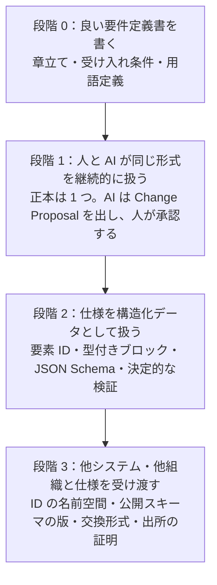
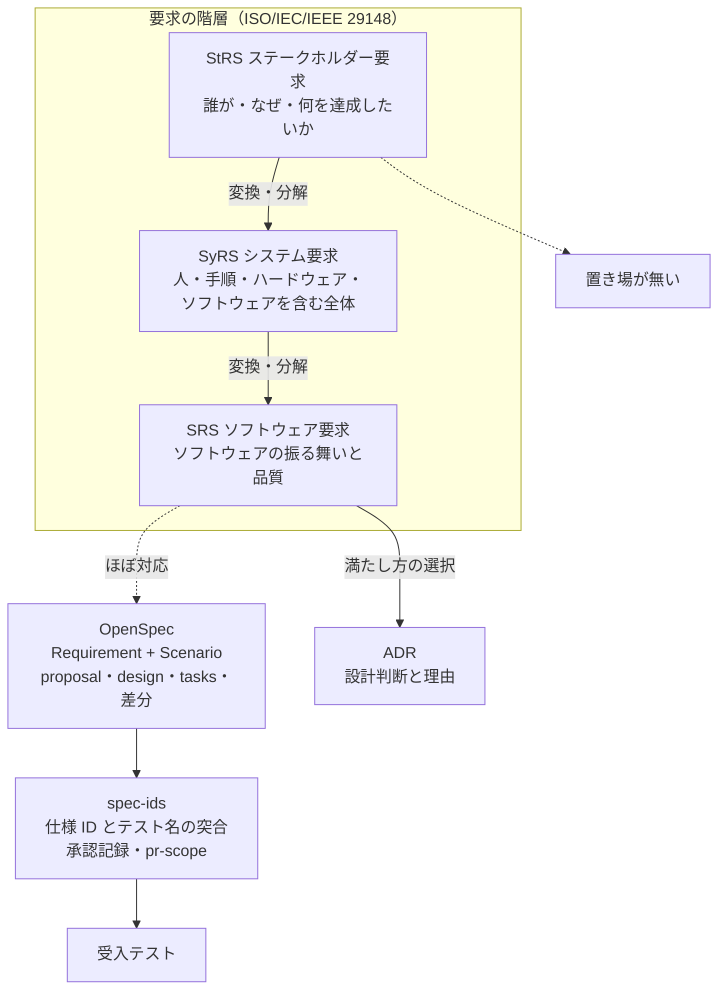
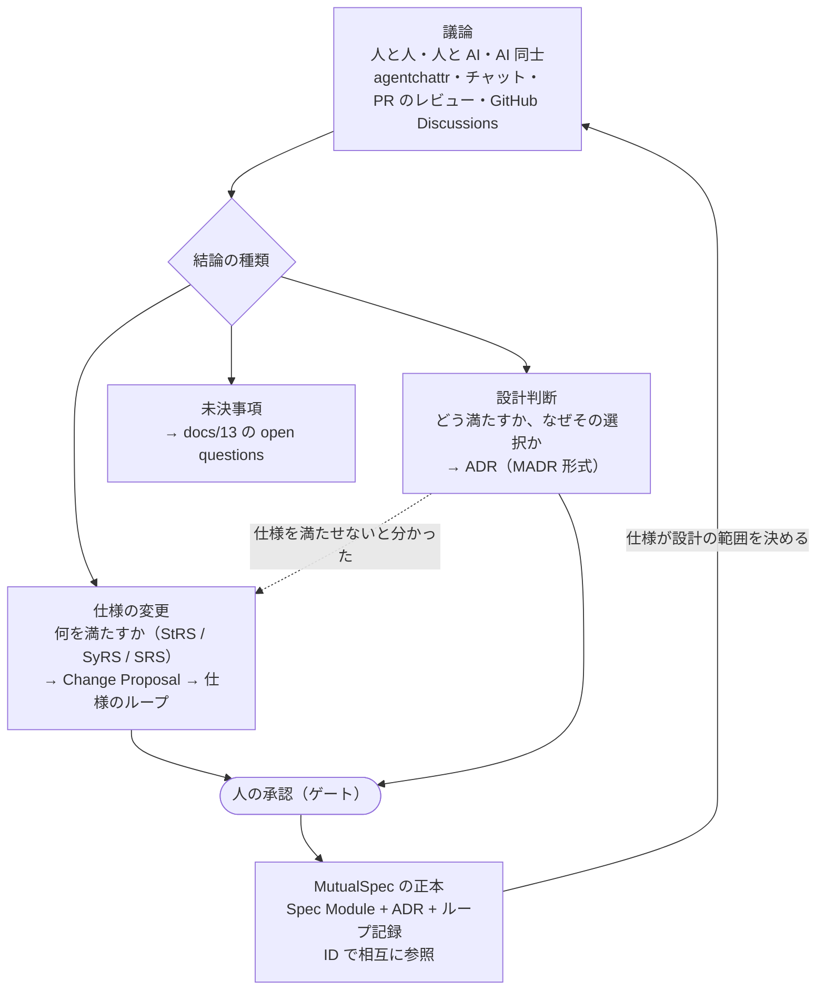
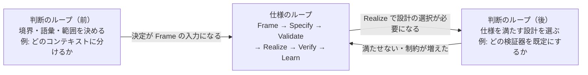
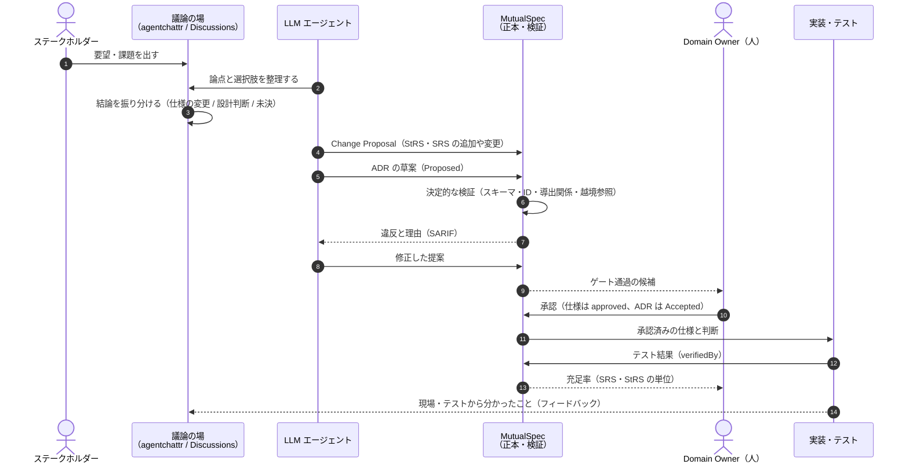
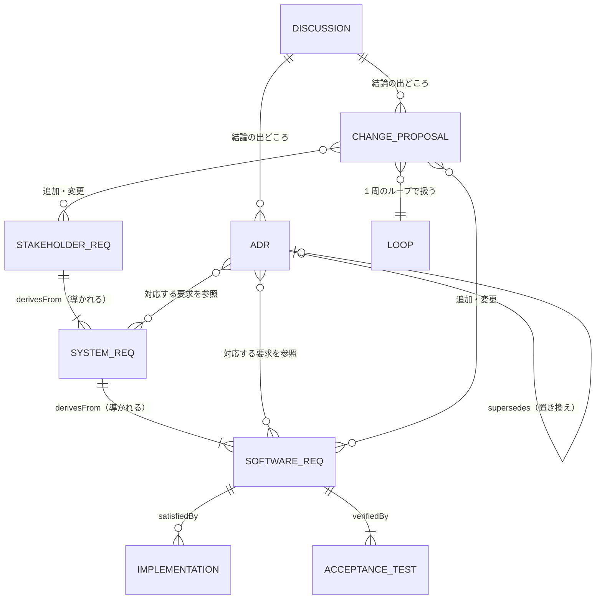

# 要求・仕様・設計・議論の関係と、MutualSpec が受け持つ範囲

> [!NOTE]
> これは議論のための下書きです（2026-11-21 JST）。決定ではありません。
> 合意できた部分は ADR に起こし、仕様の変更が必要な部分は Change Proposal として扱います。
> 関連: [ADR-0019 判断のループ](https://github.com/shuji-bonji/mutualspec/blob/main/docs/adr/0019-decision-loop-and-adr-plugin.md)（Proposed）、[15 エージェント編成](https://github.com/shuji-bonji/mutualspec/blob/main/docs/15-future-agent-orchestration.md)、[全体の俯瞰図](https://github.com/shuji-bonji/mutualspec/blob/main/docs/ecosystem-overview.md)

## 1. きっかけ

Qiita で広く読まれている要件定義書のテンプレート記事（[要件定義書テンプレート・要件定義書の書き方](https://qiita.com/syantien/items/9a8a7cbaeca2be3ef0d7)）は、AI 時代だからこそ要件定義が重要だと述べています。章立てや、合否を判定できる受け入れ条件、AI 特有の非機能要求の整理は有用です。

一方で、この記事は「1 つのプロジェクトの中で、人が読む要件定義書を 1 冊書く」ところで止まっています。要件そのものの ID、規格（ISO/IEC/IEEE 29148）、要求同士のトレーサビリティには触れていません。次の 3 点は扱われていません。

- 人と AI が同じ形式を継続的に扱うこと
- 仕様を構造化データとして扱い、ツールで機械的に処理すること
- 他システム・他組織と仕様を受け渡すための標準化（共通のスキーマと規約）

MutualSpec はこの 3 点を扱うためのフレームワークです。この文書では、そのための考え方を整理します。

## 2. 要件定義書が納品物にとどまる理由

日本の受託開発では、要件定義の工程と開発の工程を別の契約にし、工程ごとに検収することがよくあります。この形では次のことが起きます。

1. 要件定義書は「要件定義工程が終わったこと」を示す成果物として検収され、受け取られた時点で役目を終えます。
2. 検収された文書を変えると契約の変更になるため、開発中に分かったことは要件定義書に戻らず、仕様書・課題管理表・議事録に散らばります。
3. 要件定義書は「ある時点で合意した内容」の記録になり、「今満たすべき要求」の正本ではなくなります。

要求の変更は手戻りの大きな原因ですが、その影響は要件定義書には記録されず、仕様書やチケットの変更として現れます。要件定義書が開発のサイクルに影響しないように見えるのは、影響が記録されていないためです。

読んで合意するための文書なら要件 ID は要りません。ID が必要になるのは、後から機械や他の文書から参照するときです。テンプレート記事に要件 ID が無いのは、この位置づけと一致しています。

## 3. 仕様の扱いの段階

| 段階 | MutualSpec での対応 | 状態 |
|---|---|---|
| 1. 人と AI が同じ形式を扱う | 1 ファイル = 1 Spec Module。YAML front matter と型付きブロックが規範（ADR-0003）。LLM の出力は Change Proposal の JSON Schema に従わせ、同じバリデータに通す（docs/09） | 設計済み |
| 2. 構造化データとして扱う | SMC と要素 ID（ADR-0004）、JSON Schema 2020-12 による L0 検証、MSRX ルール、Spec Graph、SARIF での報告（ADR-0013）、29148 の品質特性（ADR-0014） | 設計済み |
| 3a. コンテキスト間の連携 | コンテキストマップの relation と `visibility: published`。越境参照は published な要素に限る（`boundary.crossContextViaPublished`） | 設計済み（同じリポジトリ内） |
| 3b. 交換形式 | ReqIF・SCXML・DMN・CML への書き出しは投影として記載（docs/07、12、14） | 未着手 |
| 3c. 組織をまたぐ連携 | 別のリポジトリや別の組織の仕様を参照する方法 | 未定義 |

組織内で閉じる多くのプロジェクトには段階 3 は不要です。コアは段階 1〜2 にとどめ、段階 3 はプラグイン（ADR-0017）として扱うのが整合的です。

## 4. 29148 の階層と、今使っている道具

ISO/IEC/IEEE 29148（JIS X 0166）は、要求をステークホルダー要求（StRS）、システム要求（SyRS）、ソフトウェア要求（SRS）の階層に分けます。上の階層から下の階層へ、変換と分解によって要求を導きます。

階層が分かれていると、「このツールはどの階層の何を扱うのか」を言えるようになります。一冊の要件定義書にまとめる書き方では、どの章がどの階層の要求なのかが区別されないため、ツールの対象範囲も言えません。

| 29148 の階層 | 今の構成での対応 | 状態 |
|---|---|---|
| StRS | OpenSpec の `proposal.md` の「Why」に断片的に書かれる程度。変更ごとの理由であり、ステークホルダー要求の一覧として残らない | 未対応 |
| SyRS | ソフトウェアだけで完結する対象では SRS と区別しなくてよい。人の作業やハードウェアを含む対象（S1000D の整備手順など）では必要 | 対象次第 |
| SRS | OpenSpec の `### Requirement:` と `#### Scenario:` | 対応済み |
| SRS と検証の対応 | spec-ids の `check` | 対応済み |
| StRS から SRS への導出関係 | 記録する場所が無い | 未対応 |

OpenSpec + spec-ids の構成は、MutualSpec の SRS と検証の部分を先に実際に運用している状態と見ることができます。MutualSpec の Spec Graph には、導出関係が `derivesFrom` として既に定義されています。

## 5. 仕様（Spec）と設計（Design）を分ける

| | 仕様（Spec） | 設計（Design） |
|---|---|---|
| 書くこと | 何を満たすか | どう満たすか、どの選択肢からなぜ選んだか |
| 性質 | 守るべき約束。設計の範囲を決める | 仕様が決めた範囲の中で選ぶもの |
| 正本 | Spec Module（StRS / SyRS / SRS） | ADR（MADR 形式） |
| 変え方 | 版を上げて書き換える | 書き換えず、新しい ADR で古い ADR を置き換える（superseded） |
| 関係する規格 | ISO/IEC/IEEE 29148 | ISO/IEC/IEEE 42010（アーキテクチャ記述と判断の理由） |

ADR と要求の関係は 2 方向です。

- **要求から ADR へ**：非機能要求（性能・保守性・ライセンスなど）が設計の選択を迫ります。ADR は「どの要求に対応する判断か」を参照として持ちます。
- **ADR から要求へ**：判断の結果、新しい制約が要求として加わることがあります（例：「正本は Markdown + YAML とする」という判断が、ツールに対する要求を生む）。

なお、OpenSpec の `changes/<id>/design.md` は変更ごとの技術的な判断を書く場所で、軽い ADR に当たります。ただし変更をアーカイブすると変更の単位で閉じてしまい、判断の一覧として後から引けません。

## 6. 議論の結論を振り分ける

人と人、人と AI、AI 同士（agentchattr など）の議論からは、設計判断だけでなく仕様の変更も出てきます。結論を ADR に一本化せず、種類ごとに振り分けます。

振り分ける理由は次のとおりです。

- **仕様は設計の範囲を決める**：議論で「この要求は満たせない」「この要求は不要」と分かった場合、それは設計判断ではなく仕様の変更です。ADR に書くと、仕様の正本に戻らないまま判断だけが残ります。
- **要求の変更の理由は ADR に書ける**：要求の範囲や優先度を変える判断にも理由があります。この場合は仕様の変更を正本に入れ、理由を ADR に書いて ID で結びます。正本は仕様側、理由は ADR 側です。
- **変え方が違うものを同じ置き場に混ぜない**：仕様は版を上げて書き換え、ADR は置き換えで積み上げます。

### 6.1 判断のループの位置

ADR-0019 は判断のループを「仕様のループの一段手前」に置く案です。この整理では、判断のループは次の 2 か所で仕様のループと関わります。

## 7. 一連の流れ（シーケンス）

議論から正本に入り、実装とフィードバックを経て次の議論に戻るまでの流れです。

## 8. 要素の関係

議論の記録そのものは正本に入れません。正本には結論と、議論への参照（URL や ID）だけを入れます。

## 9. AI 同士の議論を受け入れるときに要ること

AI 同士が議論すると、人の議論より結論の数が増え、出どころも見えにくくなります。

1. **議論の記録は外部に置く**：議論のログは agentchattr やチャットに置き、正本には結論とログへの参照だけを入れます（ADR-0019 の「議論・下書き・検索は外部に任せる」と同じ方針です）。
2. **出どころを記録する**：どのエージェントが提案し、どの仕様やどの ADR を根拠にしたかを、Change Proposal や ADR の項目として持たせます。
3. **承認は人が行う**：AI 同士で合意しても提案です。「判定はツール、提案は LLM、承認は人」の原則をそのまま適用します。

## 10. アジャイルでの要求の充足率

要求を段階的に満たしていき、その割合をイテレーションごとに測る方法です。

ストーリーポイントの消化量と違い、利用者の要求に対してどこまで届いたかを示せます。運用には次の 3 点を決める必要があります。

1. **分母を版で固定する**：イテレーションの開始時点の要求の集合を版として固定し、その版に対する割合として出します。分母が動くと、割合の変化が進捗なのか要求の減少なのか区別できません。
2. **「未実装」を状態として持つ**：spec-ids の `check` は ID の集合が一致しないと PR を止めます。段階的に満たす運用では、まだ実装しない要求を明示した状態（例：`status: planned`）として許し、それ以外の食い違いだけを止めます。
3. **細かく分けると割合が上がる問題**：割合を目標値にすると、満たしやすい要求を細かく分けて割合を上げる動きが出ます。StRS の単位で数える、優先度で重み付けする、などで抑えます。

## 11. 組織をまたいで仕様を受け渡すときに決めること

| # | 決めること | 内容 |
|---|---|---|
| 1 | ID の名前空間 | SMC はプロジェクト内で一意。組織をまたぐと衝突するため、発行元を ID に含めるか、参照する側で別名を付けるかを決める |
| 2 | 公開する契約の版 | コンテキストマップの published-language を、リポジトリの外に公開するスキーマ（用語・インターフェース・イベント）として切り出し、semver で版を付ける |
| 3 | 交換形式 | 正本の形式は変えず（ADR-0003）、ReqIF・OSLC RM・DMN・SCXML を投影として出す（docs/14 の方針） |
| 4 | 出所と改ざん検知 | 受け取った仕様が、発行元が承認した版のままかを確かめる。署名付きのリリースや Manifest of Authenticity が候補 |
| 5 | 上流の変更の通知 | 上流の published な要素が変わったとき、下流のループに Feedback として入れる経路。conformist・anticorruption-layer などのパターンごとに取り込み方が変わる |

## 12. 次にすること（案）

- [ ] StRS の置き場を作る（例：`specs/stakeholder/` に `STR-領域-3 桁`）。OpenSpec の外に置き、spec-ids で採番と形式を検査する
- [ ] OpenSpec の Requirement に導出元（`derivesFrom: STR-…`）を書き、spec-ids の `check` に「導出元が存在するか」「どの SRS からも参照されない StRS が無いか」を加える
- [ ] ADR-0019 の「判断のループの位置」を、6.1 の前後 2 か所の形で見直すか検討する
- [ ] 11 の 5 点を docs/13 の未決事項に追加する

## 参考

- [要件定義書テンプレート・要件定義書の書き方](https://qiita.com/syantien/items/9a8a7cbaeca2be3ef0d7)（一冊の要件定義書の章立て）
- [要求工学を学んで健康的なエンジニアライフを送ろう](https://qiita.com/shoki_kitajima/items/0f6ac36602a8a9044cb1)（要望・要求・要件・仕様の区別）
- [howanpin5525 さんの記事](https://qiita.com/howanpin5525/items/dda01037624623a8e7ca)（29148 のステークホルダ要件・システム要件・ソフトウェア要件の三段階）
- [ju-kosaka さんの記事](https://qiita.com/ju-kosaka/items/3674294dc301f5dcf453)（SDD を仕様の網羅ではなくチーム間の契約として捉え、Specification と Design を分ける）

3 本の記事は、語の区別・階層の区別・仕様と設計の区別までを扱っています。区別した要求同士を ID でつなぎ、導出関係をたどり、機械で検証・集計する部分が、spec-ids と MutualSpec の扱う範囲です。
