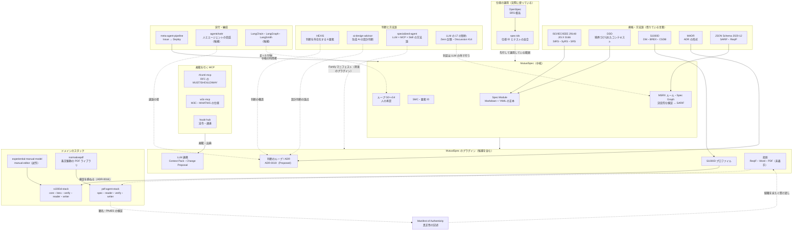
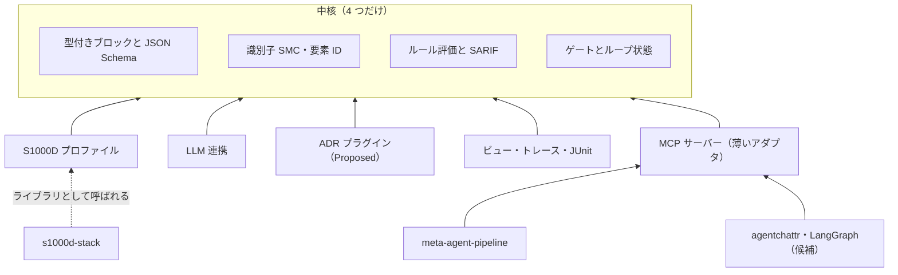
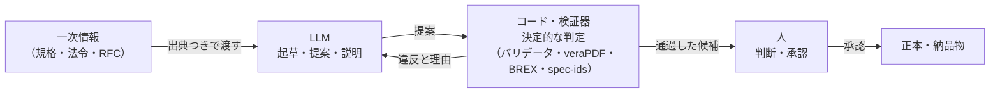
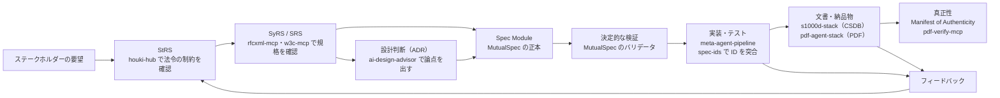
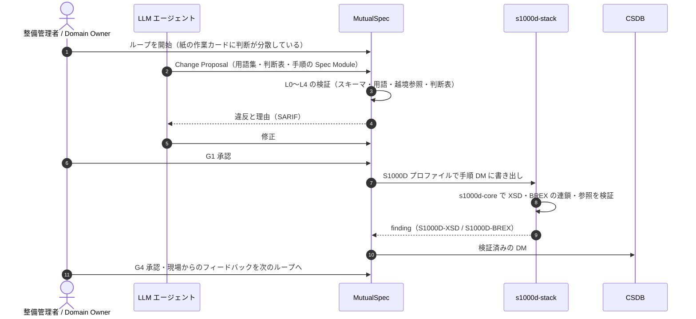

# MutualSpec と関連プロジェクトの俯瞰図

> [!NOTE]
> MutualSpec を中心に、所有者（shuji-bonji）が作ってきたリポジトリ・MCP サーバー・Skill と、参照している規格・外部の道具の関係を 1 か所にまとめた参照資料です（2026-11-21 JST 時点）。
> 状態は各リポジトリの README の記載に基づきます。採用が決まっていないものは「候補」と書いています。
> 考え方の整理は [要求・仕様・設計・議論の関係](drafts/spec-design-decision-loops.md) を参照してください。

## 1. ひとことで

MutualSpec は、人と LLM が同じ構造と語彙で仕様を扱うための中核です。周りのプロジェクトは、次のどれかの役割で MutualSpec とつながります。

| 役割 | 内容 | 主なプロジェクト |
|---|---|---|
| 規範を引く | 規格・法令・RFC などの一次情報を、出典つきで LLM に渡す | rfcxml-mcp、w3c-mcp、houki-hub、pdf-spec-mcp、s1000d-brex-mcp |
| ドメインで判定する | 特定の形式（PDF、S1000D）について、読む・検証する・作るをコードで行う | pdf-agent-stack、s1000d-stack |
| 仕様を運用する | 仕様の ID・テストとの突合・承認の記録 | spec-ids、OpenSpec |
| 判断を記録する | 設計判断とその理由を構造として残す | ADR（ADR-0019）、ai-design-advisor、HEXIS |
| 作り方を定める | 汎用 LLM × MCP × Skill で専門領域に入る方法論 | specialized-agent、LLM の 17 の制約 |
| 実行・編成する | エージェントを動かし、議論させ、記録する | meta-agent-pipeline、agentchattr、LangChain / LangGraph / LangSmith、localllm-mcp |
| 真正性を示す | 誰が何にいつ署名したかを検証できるようにする | Manifest of Authenticity、pdf-verify-mcp |

## 2. 全体相関図

実線は今ある関係、点線は候補・将来の関係または考え方の上での関係です。

## 3. 依存の向き

ADR-0017 により、依存は一方向です。プラグインと外部の道具が中核を使い、中核はそれらを import せず、名前も知りません。

中核に足してよいのは、すべての利用で必要で、判定が決定的で、外部ツールもネットワークも要らないものだけです。

## 4. プロジェクトごとの説明

### 4.1 中核と仕様の運用

| プロジェクト | 役割 | MutualSpec との関係 | 状態 |
|---|---|---|---|
| [mutualspec](https://github.com/shuji-bonji/mutualspec) | Specs of Domain Loops の考え方に基づくフレームワーク。ドメインの境界を明示し、仕様・検証・フィードバックをループとして回す | 中核 | 設計版 0.1（設計完結、実装前） |
| [spec-ids](https://github.com/shuji-bonji/spec-ids) | 仕様の見出しの ID とテスト名の ID を突き合わせ、食い違いがあれば CI で PR を止める CLI。採番、承認記録の検査、PR の種類ごとの変更範囲の検査も行う。OpenSpec の置き場も読める | SRS と検証の対応を先に運用している部分。Spec Graph の `verifiedBy` に当たる | npm 公開（0.5 系） |
| OpenSpec（外部） | 変更提案と差分で仕様を管理する仕組み。Requirement と Scenario で書く | 29148 の SRS にほぼ対応。StRS の置き場は無い | 利用中 |

### 4.2 規範を引く MCP

| プロジェクト | 役割 | MutualSpec との関係 |
|---|---|---|
| [rfcxml-mcp](https://github.com/shuji-bonji/rfcxml-mcp) | LLM が RFC 文書を構造的に理解するための MCP サーバー。規範性要件（MUST/SHOULD/MAY）の抽出・構造化 | 外部規格から要求を引くときの出典。規格由来の要求を SRS に入れるときの根拠 |
| [w3c-mcp](https://github.com/shuji-bonji/w3c-mcp) | W3C・WHATWG・IETF の Web 仕様（WebIDL、CSS プロパティ、HTML 要素）を AI に渡す MCP サーバー | 同上（Web 標準） |
| [houki-hub](https://github.com/shuji-bonji/houki-hub) | 日本の法令・通達・行政解釈を、出典と鮮度つきで引く MCP・ライブラリ・Skill 群。法律と通達を混ぜずに返す | 法令から来る要求（StRS の制約）の出典。個別事案への当てはめは行わない方針 |

### 4.3 ドメインのスタック

| プロジェクト | 役割 | MutualSpec との関係 |
|---|---|---|
| [s1000d-stack](https://github.com/shuji-bonji/s1000d-stack) | S1000D の技術文書を LLM が正しく読み、BREX に照らして検証し、作るための MCP・ライブラリ・Skill 群（core・brex・verify・reader・writer、4 つの Skill） | S1000D プロファイルの既定の検証器（ADR-0016）。`@shuji-bonji/s1000d-core` をライブラリとして呼ぶ |
| [experiential-manual-model](https://github.com/shuji-bonji/experiential-manual-model) / manual-editor（試作） | 体験型の操作マニュアルの共通データモデルと、画面の上で作る Web アプリ | experience-to-s1000d の Skill で CSDB に変換する入力 |
| [pdf-agent-stack](https://github.com/shuji-bonji/pdf-agent-stack) | PDF を読む・調べる・反証する・書くを LLM から決定論的に扱う MCP・ライブラリ・Skill 群。宣言・適合・検証を区別する | 投影（PDF/A・PAdES）の出力先の候補。組織をまたぐ受け渡しでの署名検証 |
| [normativepdf](https://github.com/shuji-bonji/normativepdf) | すべての挙動を ISO の条項に紐づける、純 TypeScript の PDF ライブラリ | pdf-agent-stack の部品。「条文に紐づけられないものは主張しない」は MutualSpec の決定的な判定と同じ考え方 |

### 4.4 判断と方法論

| プロジェクト | 役割 | MutualSpec との関係 |
|---|---|---|
| [HEXIS](https://github.com/shuji-bonji/HEXIS) | Canon・Structure・Judgment・Action・Procedure・Evaluation の 6 要素で判断を外在化し、正しい判断と偶然当たった判断を区別できるようにする参照アーキテクチャ（Draft v0.1） | 判断のループ（ADR）を設計するときの参照。5 章の対応表を参照 |
| [ai-design-advisor](https://github.com/shuji-bonji/ai-design-advisor) | 生成 AI システムの設計判断を支援する Skill。決まっていないことを名指しし、言える範囲だけ返す | 生成 AI を含むシステムで、ADR の論点（モデルクラス・RAG・エージェント化など）を洗い出す入力 |
| [specialized-agent](https://github.com/shuji-bonji/specialized-agent) | 汎用 LLM × MCP × Skill で専門領域に入るための方法論。中核の主張は「判定はコード、説明は LLM」 | MutualSpec の LLM 権限境界の論拠。Family マニフェストは将来のプラグインの kind |
| [LLM の 17 の制約](https://zenn.dev/shuji_bonji/articles/llm-17-constraints)・[Discussion #14](https://github.com/shuji-bonji/zenn-articles/discussions/14) | LLM の制約を 5 分類し、ハーネスでの対処を整理した記事と、自作の MCP・Skill がどの制約にどう対処しているかの整理 | 「LLM の出力を LLM 自身に検証させない」原則。MutualSpec のバリデータとゲートの根拠 |

### 4.5 実行・編成

| プロジェクト | 役割 | MutualSpec との関係 | 状態 |
|---|---|---|---|
| [meta-agent-pipeline](https://github.com/shuji-bonji/meta-agent-pipeline) | 個人開発者のための自律 AI 開発パイプライン。Issue から Deploy までを Meta-agent と Sub-agent で動かす | 中核の利用者。MutualSpec の中には入れない（ADR-0017） | Phase 1a（雛形構築中） |
| agentchattr（外部） | AI コーディングエージェントと人がリアルタイムに会話するローカルのチャットサーバー | 議論の場の候補。結論だけを正本に入れる | 候補（docs/15、Q-14） |
| LangChain・LangGraph・LangSmith（外部） | エージェントの組み立て、状態を持つ実行の制御、実行の記録と評価 | 誰がいつ走るかを並べ、走った記録を残す道具の候補。判定とゲートは MutualSpec が持つ | 候補（docs/15） |
| [localllm-mcp](https://github.com/shuji-bonji/localllm-mcp) | ローカル LLM を Claude から構造化ツールとして呼べるようにする MCP サーバー | 提案（下書き・要約）を安いモデルに振る場合の経路 | 利用中 |

### 4.6 真正性

| プロジェクト | 役割 | MutualSpec との関係 |
|---|---|---|
| [Manifest of Authenticity](https://github.com/shuji-bonji/Manifest-of-Authenticity) | 文書・データ・構造モデルなどの真正性（誰が・何に・いつ署名したか）を統一的に記述するオープン仕様（Draft v0.95） | 組織をまたいで仕様を受け渡すとき、発行元が承認した版のままかを確かめる手段の候補 |

## 5. 共通している考え方

### 5.1 判定・提案・承認の分担

どのプロジェクトも、LLM に判定させず、判定はコードと検証器が行い、LLM は説明と提案を受け持ちます。MutualSpec ではこれに「承認は人」が加わります。

### 5.2 宣言・適合・検証の区別

pdf-agent-stack と HEXIS が共通して述べている区別です。MutualSpec のゲートを通ったことも「この検査では落ちなかった」という意味であり、仕様が正しいことの証明ではありません。

| 語 | 意味 |
|---|---|
| 宣言 | 自分で書いたラベル。書いてあることは証拠にならない |
| 適合 | 規格どおりであること。全部を証明する手段は無く、違反を見つけることしかできない |
| 検証 | 検証器が自分の検査項目で見た結果。通過は「この検査では落ちなかった」 |

### 5.3 HEXIS の 6 要素と MutualSpec の対応（案）

対応づけはこの文書での案です。HEXIS 側・MutualSpec 側のどちらでも決まっていません。

| HEXIS の要素 | MutualSpec で当たるもの | 周辺のプロジェクト |
|---|---|---|
| Canon（正典） | Spec Module の正本、published な用語 | rfcxml-mcp、w3c-mcp、houki-hub、pdf-spec-mcp |
| Structure（構造） | SMC・要素 ID、Spec Graph、コンテキストマップ | spec-ids |
| Judgment（判断） | ADR（判断のループ）、ゲートでの人の承認 | ai-design-advisor |
| Action（行為） | Realize（実装・文書化）、Change Proposal の適用 | meta-agent-pipeline、s1000d-writer-mcp、pdf-writer-mcp |
| Procedure（手順） | ループの 6 フェーズ、Skill | specialized-agent、各 Skill |
| Evaluation（評価） | 決定的な検証 L0〜L4、SARIF、充足率 | s1000d-verify-mcp、pdf-verify-mcp |

## 6. 全体の流れ

ステークホルダーの要求から納品物までと、各プロジェクトが関わる場所です。

## 7. 例: 整備手順の要求から S1000D の手順 DM まで

MutualSpec の worked example（小型 UAV のプロペラ点検・交換）に沿った流れです。

## 8. 未着手・未決のもの

| 項目 | 状態 | 記載場所 |
|---|---|---|
| MutualSpec の実装 | 設計完結、実装前 | README |
| 判断のループと ADR プラグイン | Proposed | ADR-0019 |
| StRS の置き場と、StRS から SRS への導出の検査 | 未着手（OpenSpec + spec-ids の構成） | [整理の文書](drafts/spec-design-decision-loops.md) 12 章 |
| 交換形式（ReqIF・SCXML・DMN・CML） | 投影として記載、未着手 | docs/07、12、14 |
| 組織をまたぐ連携（ID の名前空間・公開スキーマの版・出所） | 未定義 | [整理の文書](drafts/spec-design-decision-loops.md) 11 章 |
| エージェント編成（agentchattr・LangGraph など） | 候補 | docs/15、Q-14 |
| プラグインが kind を定義する仕組み | スキーマ側で止まっている（kind が固定の enum） | ADR-0019 の食い違い表 |

## 9. リンク

- 中核: [mutualspec](https://github.com/shuji-bonji/mutualspec)、[spec-ids](https://github.com/shuji-bonji/spec-ids)
- スタック: [pdf-agent-stack](https://github.com/shuji-bonji/pdf-agent-stack)、[houki-hub](https://github.com/shuji-bonji/houki-hub)、[s1000d-stack](https://github.com/shuji-bonji/s1000d-stack)
- MCP: [rfcxml-mcp](https://github.com/shuji-bonji/rfcxml-mcp)、[w3c-mcp](https://github.com/shuji-bonji/w3c-mcp)、[npm の @shuji-bonji](https://www.npmjs.com/~shuji-bonji)
- 方法論・判断: [specialized-agent](https://github.com/shuji-bonji/specialized-agent)、[ai-design-advisor](https://github.com/shuji-bonji/ai-design-advisor)、[HEXIS](https://github.com/shuji-bonji/HEXIS)
- 実行: [meta-agent-pipeline](https://github.com/shuji-bonji/meta-agent-pipeline)
- 真正性: [Manifest of Authenticity](https://github.com/shuji-bonji/Manifest-of-Authenticity)
- 記事: [LLM の 17 の制約](https://zenn.dev/shuji_bonji/articles/llm-17-constraints)、[Discussion #14](https://github.com/shuji-bonji/zenn-articles/discussions/14)
- 規格: ISO/IEC/IEEE 29148（JIS X 0166）、S1000D、MADR、JSON Schema 2020-12、SARIF
