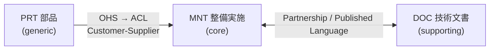

# コンテキストマップ

整備実施（MNT）がコアドメインです。技術文書（DOC）は MNT とパートナーシップを結び、判断ロジックは MNT が持ち、
DOC の手順はそれを**参照する**（文書の構造と業務ルールを分離しつつ接続する）。部品（PRT）は Open Host Service として在庫照会を公開し、MNT 側は腐敗防止層で受ける。

```yaml specloop:context-map
contexts:
  - { code: MNT, name: 整備実施, type: core, path: maintenance, owner: "@maintenance-owner" }
  - { code: DOC, name: 技術文書, type: supporting, path: techpub, owner: "@techpub-owner" }
  - { code: PRT, name: 部品, type: generic, path: parts, owner: "@parts-owner" }
relations:
  - id: REL-PRJ-MNT-DOC
    upstream: MNT
    downstream: DOC
    patterns: [partnership, published-language]
    via: [DEC-MNT-PROP-DISPOSITION, TERM-MNT-PROPELLER, TERM-MNT-CHIP-DEPTH, TERM-MNT-CRACK, PRC-DOC-PROPELLER-REPLACE]
    description: パートナーシップのため双方向参照を許す。経路は via に列挙した要素に限る。
  - id: REL-PRJ-PRT-MNT
    upstream: PRT
    downstream: MNT
    patterns: [customer-supplier, open-host-service, anticorruption-layer]
    via: [IFC-PRT-PARTS-AVAILABILITY, TERM-PRT-PART-NUMBER]
    translation: MNT の Propeller（位置・処置）を PRT の PartNumber 照会に変換する ACL を MNT 側に置く。
```

<!-- specloop:generated begin source=SMC-UAVM-PRJ-CONTEXTMAP-020A view=context-map -->

<!-- specloop:generated end -->
