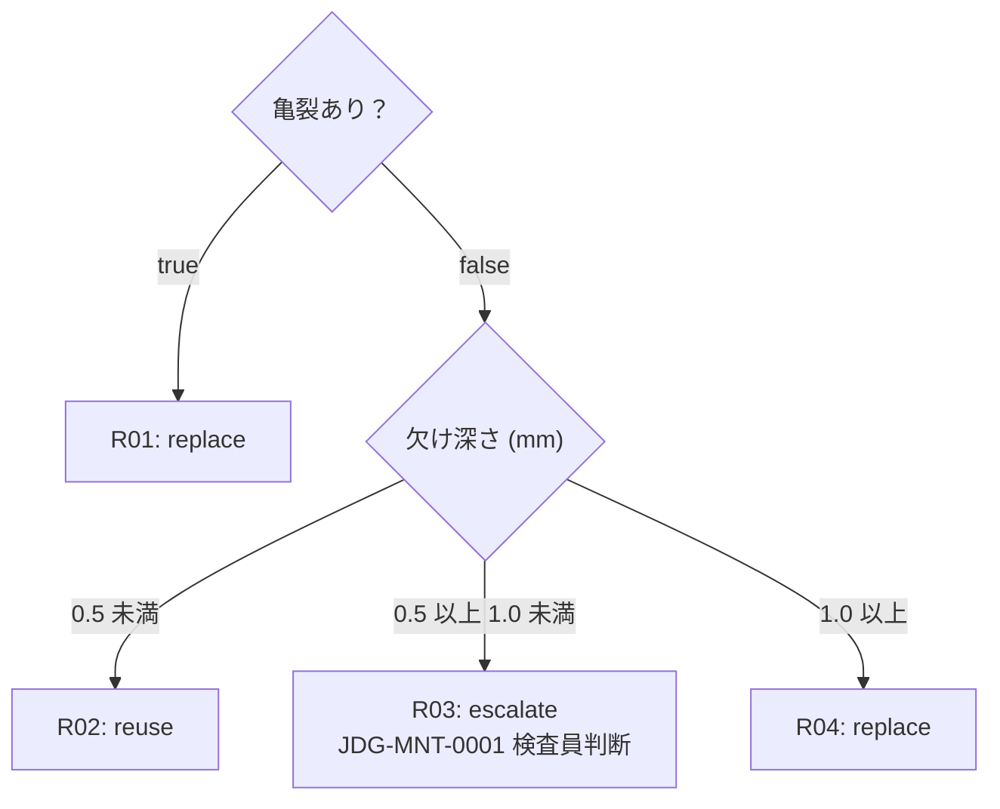

# プロペラ処置 判断表

> [!NOTE]
> 閾値はサンプル用の架空値です。

この判断表は MNT が所有し、DOC の手順 `PRC-DOC-PROPELLER-REPLACE#S020` から参照されます（コンテキストマップ REL-PRJ-MNT-DOC）。
手順書は「何をするか」を、判断表は「どう判断するか」を持ちます。BREX が持てない判断ロジックをここで明示します。

```yaml mutualspec:decision
decisions:
  - id: DEC-MNT-PROP-DISPOSITION
    question: 点検したプロペラを再使用するか、交換するか。
    hitPolicy: unique
    inputs:
      - { name: crackFound, type: boolean, term: TERM-MNT-CRACK }
      - { name: chipDepthMm, type: number, unit: mm, term: TERM-MNT-CHIP-DEPTH }
    outputs:
      - { name: disposition, type: enum, values: [reuse, replace, escalate], term: TERM-MNT-PROPELLER-DISPOSITION }
    rules:
      - { id: R01, when: { crackFound: true, chipDepthMm: "-" }, then: { disposition: replace }, rationale: 亀裂は深さに関係なく交換する。 }
      - { id: R02, when: { crackFound: false, chipDepthMm: "< 0.5" }, then: { disposition: reuse } }
      - id: R03
        when: { crackFound: false, chipDepthMm: "[0.5..1.0)" }
        then: { disposition: escalate }
        rationale: この範囲は欠けの位置・形状により判断が分かれるため、検査員が判断する。
        judgement:
          id: JDG-MNT-0001
          by: Inspector
          criteria: 欠けの位置（前縁の外側 1/3 か否か）と形状を確認し、reuse か replace を決めて理由を記録する。
          escalateTo: MaintenanceManager
          record: true
      - { id: R04, when: { crackFound: false, chipDepthMm: ">= 1.0" }, then: { disposition: replace } }
    trace:
      derivesFrom: [REQ-MNT-0003]
      verifiedBy: [SCN-MNT-0002]
```

<!-- mutualspec:generated begin source=SMC-UAVM-MNT-PROPDISP-310A view=decision-flow -->

<!-- mutualspec:generated end -->
