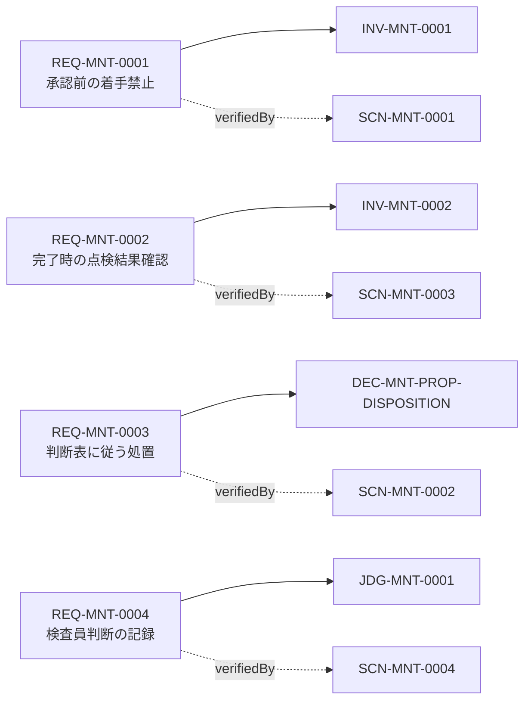

# 作業指示 要求仕様

## 背景

プロペラ点検の結果記録が紙の作業カードに分散しており、交換判断の根拠を後から確認できない。
作業指示に点検結果と処置を集約し、処置は判断表に従って決める。

## 要求

規範的な内容は下の YAML ブロックが正本です。この節の文章は背景説明（informative）です。

```yaml specloop:requirements
requirements:
  - id: REQ-MNT-0001
    level: system
    type: safety
    statement: 作業指示は、整備管理者が承認するまで作業中に移行してはならない。
    pattern: state-driven
    rationale: 承認前の着手は、部品・工具・人員の準備不足のまま作業が始まる原因になる。
    priority: must
    risk: high
    difficulty: easy
    stakeholders: [MaintenanceManager, Technician]
    source: [整備管理者ヒアリング 2026-10]
    verification:
      method: test
      criteria:
        - 起票状態の作業指示に対する着手コマンドが拒否されること（SCN-MNT-0001）
    status: approved
    trace:
      satisfiedBy: [INV-MNT-0001, CMD-MNT-START]
      verifiedBy: [SCN-MNT-0001]
  - id: REQ-MNT-0002
    level: system
    type: functional
    statement: 作業指示を完了するとき、システムは取付位置ごとのプロペラ点検結果がすべて記録されていることを確認しなければならない。
    pattern: event-driven
    rationale: 点検漏れのまま完了すると、交換判断の根拠を後から確認できない。
    priority: must
    risk: medium
    difficulty: nominal
    stakeholders: [Inspector, MaintenanceManager]
    source: [検査員ヒアリング 2026-10]
    verification:
      method: test
      criteria:
        - 点検結果が 1 位置でも欠けている作業指示の完了コマンドが拒否されること（SCN-MNT-0003）
    status: approved
    trace:
      satisfiedBy: [INV-MNT-0002, CMD-MNT-COMPLETE]
      verifiedBy: [SCN-MNT-0003]
  - id: REQ-MNT-0003
    level: system
    type: functional
    statement: システムは、プロペラ処置を判断表 DEC-MNT-PROP-DISPOSITION に従って決定しなければならない。
    pattern: ubiquitous
    rationale: 処置の基準を人によって変えないため。判断表は DOC の手順からも参照される。
    priority: must
    risk: high
    difficulty: nominal
    stakeholders: [Inspector, Technician]
    source: [整備規程（サンプル）]
    verification:
      method: test
      criteria:
        - 判断表の全 4 行について、入力に対する処置が表と一致すること（SCN-MNT-0002）
    status: approved
    trace:
      satisfiedBy: [DEC-MNT-PROP-DISPOSITION, CMD-MNT-RECORD-INSPECTION]
      verifiedBy: [SCN-MNT-0002]
  - id: REQ-MNT-0004
    level: system
    type: process
    statement: プロペラ処置が escalate のとき、システムは検査員の判断結果とその理由の記録を要求しなければならない。
    pattern: state-driven
    rationale: 判断表で決めきれない領域（暗黙知）の判断を回収し、次のループで判断表に昇格できるようにする。
    priority: should
    risk: medium
    difficulty: nominal
    stakeholders: [Inspector]
    source: [SpecLoop 判断点の運用方針]
    verification:
      method: demonstration
      criteria:
        - 欠け深さ 0.7 mm の点検結果を記録したとき、判断結果と理由の入力を求められること（SCN-MNT-0004）
    status: approved
    trace:
      satisfiedBy: [JDG-MNT-0001]
      verifiedBy: [SCN-MNT-0004]
```

## 要求間の関係

<!-- specloop:generated begin source=SMC-UAVM-MNT-WORKORDER-100A view=trace -->

<!-- specloop:generated end -->
