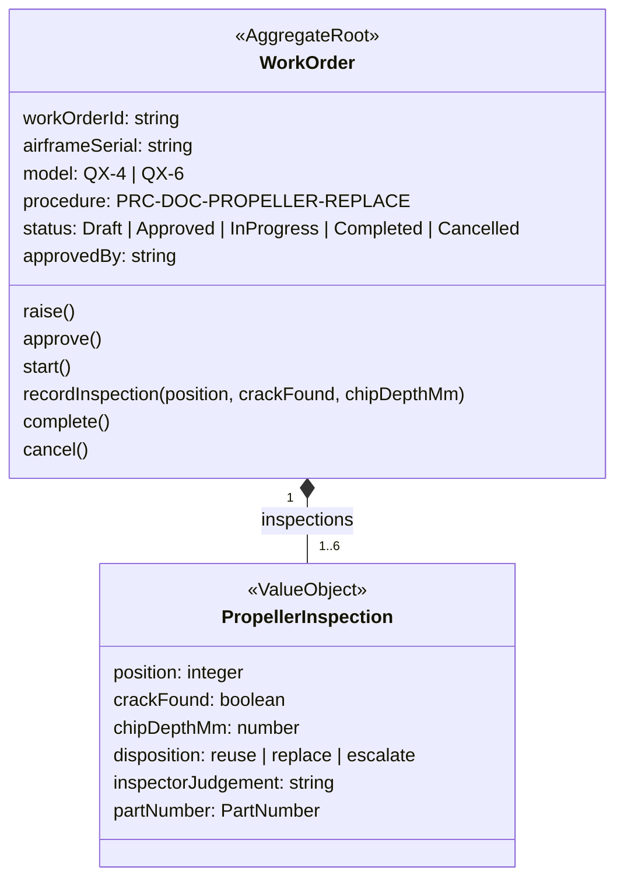

# 作業指示 ドメインモデル

作業指示（WorkOrder）を集約ルートとし、プロペラ点検結果（PropellerInspection）は値オブジェクトとして集約内に持つ。
点検結果の変更は必ず集約ルートのコマンドを通す。

```yaml specloop:model
aggregates:
  - id: AGG-MNT-WORK-ORDER
    name: WorkOrder
    term: TERM-MNT-WORK-ORDER
    root:
      id: ENT-MNT-WORK-ORDER
      identity: workOrderId
      attributes:
        - { name: workOrderId, type: string }
        - { name: airframeSerial, type: string, term: TERM-MNT-AIRFRAME }
        - { name: model, type: "enum(QX-4,QX-6)" }
        - { name: procedure, type: PRC-DOC-PROPELLER-REPLACE, description: 実施する手順（DOC の published 要素） }
        - { name: status, type: "enum(Draft,Approved,InProgress,Completed,Cancelled)" }
        - { name: approvedBy, type: string, required: false }
        - { name: inspections, type: "list<VO-MNT-PROPELLER-INSPECTION>" }
    valueObjects:
      - id: VO-MNT-PROPELLER-INSPECTION
        name: PropellerInspection
        term: TERM-MNT-PROPELLER-INSPECTION
        attributes:
          - { name: position, type: integer, description: 取付位置 }
          - { name: crackFound, type: boolean, term: TERM-MNT-CRACK }
          - { name: chipDepthMm, type: number, unit: mm, term: TERM-MNT-CHIP-DEPTH }
          - { name: disposition, type: "enum(reuse,replace,escalate)", term: TERM-MNT-PROPELLER-DISPOSITION }
          - { name: inspectorJudgement, type: string, required: false, description: escalate 時の検査員判断と理由 }
          - { name: partNumber, type: TERM-PRT-PART-NUMBER, required: false }
        constraints:
          - "position は model が QX-4 なら 1..4、QX-6 なら 1..6"
          - "chipDepthMm >= 0"
    invariants:
      - id: INV-MNT-0001
        statement: 作業中に移行できるのは承認済みの作業指示だけである。
        rationale: 承認前着手の防止（REQ-MNT-0001）。
        expression: "start: status == Approved"
        enforcedBy: [CMD-MNT-START]
        trace: { derivesFrom: [REQ-MNT-0001] }
      - id: INV-MNT-0002
        statement: 完了した作業指示は、すべての取付位置について点検結果を 1 件ずつ持つ。
        rationale: 点検漏れの防止（REQ-MNT-0002）。
        expression: "complete: set(inspections.position) == positions(model)"
        enforcedBy: [CMD-MNT-COMPLETE]
        trace: { derivesFrom: [REQ-MNT-0002] }
      - id: INV-MNT-0003
        statement: 点検結果の処置は判断表の結果と一致し、escalate の場合は検査員判断を持つ。
        rationale: 処置基準の一貫性（REQ-MNT-0003, REQ-MNT-0004）。
        enforcedBy: [DEC-MNT-PROP-DISPOSITION, CMD-MNT-RECORD-INSPECTION]
        trace: { derivesFrom: [REQ-MNT-0003, REQ-MNT-0004] }
    commands:
      - { id: CMD-MNT-RAISE, name: raise, term: TERM-MNT-CMD-RAISE, actor: Technician }
      - { id: CMD-MNT-APPROVE, name: approve, term: TERM-MNT-CMD-APPROVE, actor: MaintenanceManager, emits: [EVT-MNT-WORK-ORDER-APPROVED] }
      - { id: CMD-MNT-START, name: start, term: TERM-MNT-CMD-START, actor: Technician, preconditions: [INV-MNT-0001], emits: [EVT-MNT-WORK-ORDER-STARTED] }
      - id: CMD-MNT-RECORD-INSPECTION
        name: recordInspection
        term: TERM-MNT-CMD-RECORD-INSPECTION
        actor: Technician
        parameters:
          - { name: position, type: integer }
          - { name: crackFound, type: boolean, term: TERM-MNT-CRACK }
          - { name: chipDepthMm, type: number, unit: mm, term: TERM-MNT-CHIP-DEPTH }
        preconditions: [INV-MNT-0003]
        emits: [EVT-MNT-PROPELLER-REPLACEMENT-REQUIRED]
      - { id: CMD-MNT-COMPLETE, name: complete, term: TERM-MNT-CMD-COMPLETE, actor: Technician, preconditions: [INV-MNT-0002], emits: [EVT-MNT-WORK-ORDER-COMPLETED] }
      - { id: CMD-MNT-CANCEL, name: cancel, term: TERM-MNT-CMD-CANCEL, actor: MaintenanceManager, emits: [EVT-MNT-WORK-ORDER-CANCELLED] }
    events:
      - { id: EVT-MNT-WORK-ORDER-APPROVED, name: WorkOrderApproved, term: TERM-MNT-EVT-APPROVED }
      - { id: EVT-MNT-WORK-ORDER-STARTED, name: WorkOrderStarted, term: TERM-MNT-EVT-STARTED }
      - { id: EVT-MNT-WORK-ORDER-COMPLETED, name: WorkOrderCompleted, term: TERM-MNT-EVT-COMPLETED }
      - { id: EVT-MNT-WORK-ORDER-CANCELLED, name: WorkOrderCancelled, term: TERM-MNT-EVT-CANCELLED }
      - id: EVT-MNT-PROPELLER-REPLACEMENT-REQUIRED
        name: PropellerReplacementRequired
        term: TERM-MNT-EVT-REPLACEMENT-REQUIRED
        published: true
        payload:
          - { name: workOrderId, type: string }
          - { name: position, type: integer }
          - { name: model, type: "enum(QX-4,QX-6)" }
    behavior: BHV-MNT-WORK-ORDER-LIFECYCLE
policies:
  - id: POL-MNT-0001
    when: EVT-MNT-PROPELLER-REPLACEMENT-REQUIRED
    then: IFC-PRT-PARTS-AVAILABILITY
    description: 交換が必要になったら、ACL を通して PRT に交換用プロペラの在庫を照会する。
```

<!-- specloop:generated begin source=SMC-UAVM-MNT-WORKORDER-200A view=class -->

<!-- specloop:generated end -->
