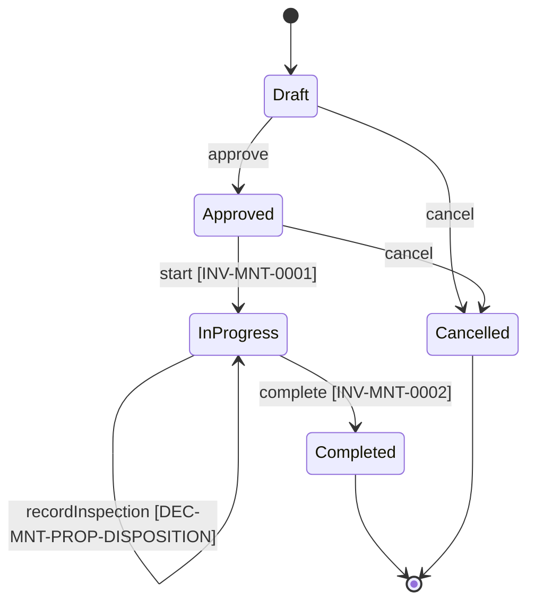

# 作業指示 状態遷移

状態遷移は BREX では表現できない「業務の順序」を持つ意味モデル層の要素です。
YAML が正本で、下の Mermaid 図は `mutualspec render` が生成します（手で編集しない）。

```yaml mutualspec:behavior
stateMachines:
  - id: BHV-MNT-WORK-ORDER-LIFECYCLE
    subject: AGG-MNT-WORK-ORDER
    initial: Draft
    states:
      - { name: Draft, term: TERM-MNT-STATE-DRAFT }
      - { name: Approved, term: TERM-MNT-STATE-APPROVED }
      - { name: InProgress, term: TERM-MNT-STATE-IN-PROGRESS }
      - { name: Completed, term: TERM-MNT-STATE-COMPLETED, final: true }
      - { name: Cancelled, term: TERM-MNT-STATE-CANCELLED, final: true }
    transitions:
      - { from: Draft, to: Approved, on: CMD-MNT-APPROVE, emits: [EVT-MNT-WORK-ORDER-APPROVED] }
      - { from: Draft, to: Cancelled, on: CMD-MNT-CANCEL, emits: [EVT-MNT-WORK-ORDER-CANCELLED] }
      - { from: Approved, to: InProgress, on: CMD-MNT-START, guard: [INV-MNT-0001], emits: [EVT-MNT-WORK-ORDER-STARTED], requirement: [REQ-MNT-0001] }
      - { from: Approved, to: Cancelled, on: CMD-MNT-CANCEL, emits: [EVT-MNT-WORK-ORDER-CANCELLED] }
      - { from: InProgress, to: InProgress, on: CMD-MNT-RECORD-INSPECTION, guard: [DEC-MNT-PROP-DISPOSITION], requirement: [REQ-MNT-0003, REQ-MNT-0004] }
      - { from: InProgress, to: Completed, on: CMD-MNT-COMPLETE, guard: [INV-MNT-0002], emits: [EVT-MNT-WORK-ORDER-COMPLETED], requirement: [REQ-MNT-0002] }
```

<!-- mutualspec:generated begin source=SMC-UAVM-MNT-WORKORDER-300A view=state -->

<!-- mutualspec:generated end -->
