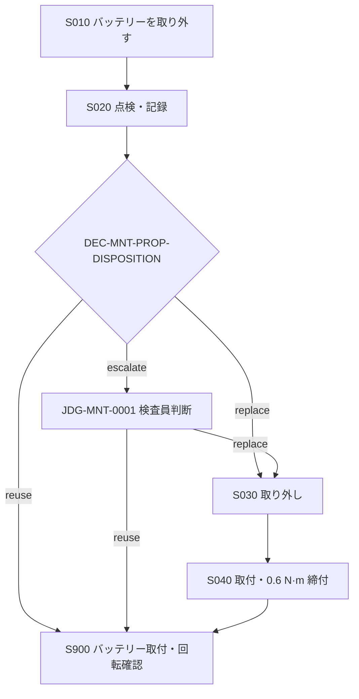

# プロペラの点検と交換

> [!NOTE]
> トルク値はサンプル用の架空値です。

```yaml mutualspec:procedure
procedure:
  id: PRC-DOC-PROPELLER-REPLACE
  title: プロペラの点検と交換
  applicability: { prop: model, in: [QX-4, QX-6] }
  preliminary:
    personnel: [Technician, Inspector]
    tools:
      - { name: トルクレンチ（0.2〜2.0 N·m）, term: TERM-DOC-TORQUE-WRENCH }
      - { name: デプスゲージ（0.05 mm 目盛） }
    parts:
      - { term: TERM-MNT-PROPELLER, qty: 1 }
    safety:
      - { type: warning, text: バッテリーを取り外すまでプロペラに触れてはならない。モーターが不意に回転し、負傷するおそれがある。 }
      - { type: caution, text: 回転方向（CW / CCW）の異なるプロペラを取り違えて取り付けてはならない。 }
    conditions: [作業指示が作業中であること]
  steps:
    - id: S010
      text: 機体からバッテリーを取り外す。
      expected: 機体の電源 LED が消灯している。
    - id: S020
      text: 取付位置ごとにプロペラを点検し、亀裂の有無と欠け深さを記録する。
      record: [crackFound, chipDepthMm]
      decision: DEC-MNT-PROP-DISPOSITION
      satisfies: [REQ-MNT-0003]
    - id: S030
      text: プロペラ処置が replace の取付位置について、プロペラを取り外す。
    - id: S040
      text: 新しいプロペラを取り付け、トルクレンチで 0.6 N·m に締め付ける。
      safety:
        - { type: caution, text: 回転方向の刻印がモーターの刻印と一致していることを確認する。 }
      expected: トルクレンチが設定値で作動した。
  closeout:
    - id: S900
      text: バッテリーを取り付け、プロペラを手で回して引っ掛かりがないことを確認する。
      expected: 全取付位置のプロペラが引っ掛かりなく回転する。
  s1000d:
    infoCode: "920"
    itemLocationCode: A
    systemCode: "61"
```

<!-- mutualspec:generated begin source=SMC-UAVM-DOC-PROPREPL-500A view=procedure-flow -->

<!-- mutualspec:generated end -->
